# 🔐 KeyPrint Guard & Arena: 타이핑 생체 지문(Keystroke Dynamics) 임베딩 기반 실시간 해커 침입 차단(1:1) 및 타자연습 인물 자동 분류(1:N) 시스템

> **"비밀번호가 유출되어도 해커는 당신의 손가락 근육 리듬을 복제할 수 없으며, 똑같은 타자연습 문장을 쳐도 AI는 누가 타이핑했는지 알아냅니다."**
> 키보드의 미세 누름 지속 시간(`Hold`), 키 간 전환 지연(`DD`), 비행 시간(`UD`) 및 연타 롤오버(`UD < 0`) 파형으로부터 <strong>64차원 초구면 생체 지문 임베딩(64-D Hyperspherical Biometric Embedding)</strong>을 추출하여, 브라우저 내부(ONNX Runtime Web WASM)에서 서버 전송 없이 **0.7ms** 만에 <strong>① 유출 암호 해커 침입 차단(1:1 검증)</strong>과 <strong>② 타자연습 다중 인물 자동 식별(1:N 분류)</strong>을 수행하는 End-to-End 머신러닝 보안·생체인식 시스템입니다.

> <strong>v2 업데이트 (키 위치 · 행동 프로필 · 모바일 입력)</strong>: ① 어떤 키에서 어떤 키로 이동했는지를 담은 <strong>키 위치 7채널 + 누름 시간 유효 플래그</strong>를 더한 17채널 문장 인코더로 웹 캡처 기준 18인 식별(다른 날·다른 글) Top-1을 <strong>`64.0% → 75.6%`</strong>, ② 백스페이스·Shift·멈춤 습관을 점수화한 <strong>행동 프로필</strong>을 더해 <strong>`81.8%`</strong>까지 올렸고, ③ 모바일에서 프로필 등록이 막히던 문제(키 코드·누름 시간이 없는 소프트 키보드 이벤트)를 녹화기 재설계로 해결했습니다. 비밀번호는 사용자마다 학습에 없던 문자열이라 키 정보를 보지 않는 기존 9채널 인코더를 그대로 씁니다(근거: [§5.5](#55-v2-확장-키-위치-채널--행동-프로필--모바일터치-입력)).

---

## 0. 프로젝트 정보

| 항목 | 내용 |
| :--- | :--- |
| **과목명** | 기계학습 프로그래밍 (기말 포트폴리오 프로젝트) |
| **학번 / 이름** | `201935607` / **김대현** |
| **프로젝트명** | **KeyPrint Guard & Arena**: 키스트로크 다이나믹스 생체 임베딩 기반 실시간 해커 침입 차단(1:1) 및 타자연습 인물 자동 분류(1:N) 시스템 |
| **GitHub 저장소** | [https://github.com/qwertypotter6873/keyprint-guard](https://github.com/qwertypotter6873/keyprint-guard) |
| **배포 데모 URL** | [https://qwertypotter6873.github.io/keyprint-guard/](https://qwertypotter6873.github.io/keyprint-guard/) |
| **데이터 유형** | 시계열·정형 행동 생체 신호 (`Tabular & Temporal Behavioral Biometrics`) |
| **학습 방식** | **직접 학습 (`Scratch + Deep Metric Learning`)** — 다중 코퍼스·가변 길이 시퀀스 통합 메트릭 러닝 |
| **비교 및 제안 모델** | ① `ScaledManhattanDetector` (통계 베이스라인) · ② `Vanilla1DCNN` (딥러닝 베이스라인) · ③ **`KeyPrintNet`** (제안 모델, 최종 채택) |
| **주요 기술 스택** | `Python 3.12`, `PyTorch`, `Scikit-Learn`, `ONNX (Opset 17)`, `ONNX Runtime Web (WASM SIMD)`, `Vite`, `Vanilla ES2022 JS`, `GitHub Actions / Pages` |

---

## 1. 문제 정의

### 1.1 해결하려는 실제 문제 배경
1. **유출 암호 기반 계정 탈취(Credential Stuffing & Phishing)의 구조적 취약성**: 기존 텍스트 비밀번호 인증은 문자열 일치(`typed == stored`)만을 검사하는 이진 논리에 의존합니다. 피싱, 키로거, 다크웹 DB 유출, 어깨너머 훔쳐보기(Shoulder Surfing)로 비밀번호 문자열이 노출되는 순간, 숙련된 인간 해커나 자동화 매크로 스크립트(`AutoHotkey`, `Selenium` 등)의 계정 침입을 전혀 방어할 수 없습니다. 또한 OTP·생체센서(지문·안면)는 추가 하드웨어나 별도 기기 조작 마찰을 유발합니다.
2. **공유 텍스트·타자연습 환경에서의 무자각 행위자 식별("Who Is Typing?")**: 여러 사용자가 동일한 연습 문장이나 표준 명령어를 타이핑할 때, 입력된 결과 문자열은 100% 동일하지만 사람마다 손가락 길이, 건반 간 도약 습관, 두 키를 겹쳐 누르는 **연타 롤오버(`UD < 0`)** 비율이 고유한 신경근육 기억(Neuromuscular Memory)을 형성합니다. 이를 정교한 임베딩 공간으로 사상할 수 있다면, **타자연습을 몇 차례 수행해 두는 것만으로 나중에 똑같은 문장(혹은 새로운 문장)을 쳤을 때 지금 키보드 앞에 앉은 사람이 누구인지 자동으로 분류**할 수 있습니다.

### 1.2 핵심 과업 정의 및 입·출력 명세
본 프로젝트는 공통 녹화·전처리 파이프라인과 같은 구조의 `KeyPrintNet` 인코더 두 개(타자연습 문장용 17채널, 비밀번호용 9채널)로 두 가지 실용적 행동 생체인식 과업을 해결합니다.

| 구분 | [모드 1] 1:1 유출 암호 해커 침입 차단 (`Open-Set Verification`) | [모드 2] 1:N 타자연습 인물 자동 분류 (`Multi-User Identification`) |
| :--- | :--- | :--- |
| **상황 가정** | 해커·매크로 봇이 **피해자의 정확한 비밀번호 문자열을 이미 알고 입력**한 위기 상황 | `N`명의 사용자가 타자연습 문장을 각 3∼5회씩 등록해 둔 뒤, 누군가 나와 문장을 1회 타이핑한 상황 |
| **모델 입력 (`Input`)** | `M`개 연속 키 전이(Digraph)로부터 추출한 **9채널 타이밍 시퀀스 텐서** `X ∈ ℝ^(9×L)` (`L = M - 1`, 가변 길이 `5 ≤ L ≤ 44`) — 비밀번호 내용과 무관하게 동작 | 영문·한글 타자연습 문장(두벌식 자모 키 이벤트)의 **17채널 시퀀스** `X ∈ ℝ^(17×L)` (타이밍 9 + 키 위치 7 + 누름 시간 유효 1) + **행동 프로필 통계**(백스페이스·Shift·멈춤 습관) |
| **인코더 출력** | 단위 초구면(`‖z‖₂ = 1`) 상의 **64차원 타건 생체 지문 임베딩** `z ∈ ℝ^64` | 좌동 — 길이 불변 **64차원 타건 생체 지문 임베딩** `z ∈ ℝ^64` |
| **최종 출력 (`Output`)** | 코호트 교정 생체 일치도 `S ∈ [0, 1]`, **승인(`ACCESS GRANTED`) / 차단(`INTRUSION BLOCKED`)**, 키 구간별 Z-Score 이상치 히트맵 | 등록된 `N`명 전원에 대한 **실시간 일치도 Top-1 ∼ Top-`N` 순위표**, 사후 확률(Softmax Confidence), **미등록 외부인(`Unknown Typist`) 기각 판정** |

### 1.3 정량적 목표 설정
모델이 학습 과정에서 단 한 번도 본 적 없는 <strong>완전 미학습 피험자(`Subject-Disjoint Unseen Test Split`)</strong>를 대상으로 다음 목표를 설정하였습니다.
- **[과업 1 · 1:1 해커 차단]** 미학습 피험자 10인 · 3,600건 교차 세션 검증 쌍 기준 **`Test Macro F1 ≥ 0.85`**, **`ROC-AUC ≥ 0.92`**, **`EER(동일오류율) ≤ 15.0%`** 달성
- **[과업 2 · 1:N 인물 분류]** 완전히 동일한 문구를 쳤을 때 미학습 10인 분류 **`Top-1 ≥ 40%` (무작위 10% 대비 4배↑), `Top-3 ≥ 88%`** 및 영문 타자연습 문장(25자) 미학습 18인 분류 **`Top-1 ≥ 55%` (무작위 5.56% 대비 10배↑), `Top-3 ≥ 88%`** 달성
- **[실시간 웹 서비스]** 외부 서버 통신 없는 브라우저 로컬 WebAssembly 추론 **단일 타건 지연 시간 `≤ 5.0 ms`**, 모델 가중치 크기 **`≤ 1.0 MB`** 달성

---

## 2. 데이터

고정 비밀번호 해커 차단(`1:1`)과 자연어 타자연습 문장 인물 식별(`1:N`)을 모두 실제 인간 타건 데이터로 학습·검증하기 위해, 학술적으로 검증된 <strong>이중 공개 벤치마크 코퍼스(Dual Real-World Keystroke Corpora)</strong>를 수집·구축하였습니다.

### 2.1 수집 데이터셋 명세 및 출처

| 데이터셋 구분 | 출처 및 라이선스 | 수집 프로토콜 및 텍스트 특성 | 원시 규모 | 정제 후 유효 규모 | 결측치 및 클래스 분포 |
| :--- | :--- | :--- | :--- | :--- | :--- |
| **① CMU Keystroke Dynamics Benchmark** (`DSL-StrongPasswordData.csv`) | Killourhy & Maxion, *IEEE/IFIP DSN 2009* ([CMU 공식 아카이브](https://www.cs.cmu.edu/∼keystroke/), 학술 공개) | **51명**의 피험자가 최소 1일 이상 간격을 둔 **8개 독립 세션**에서 강건 암호 `.tie5Roanl` + `Enter` (`11키`, `L=10` 전이)를 세션당 50회씩 반복 입력 | `20,400 행 × 34 열` (`4.5 MB`) | **`20,400` 시퀀스** (`51명 × 400회`) | 결측치 **`0건`**, 모든 피험자가 정확히 **400건씩 보유한 완전 균형 분포** |
| **② KeyRecs Multi-Session Transcription Dataset** (`KeyRecs-free-text.csv`, `fixed-text.csv`) | Zenodo DOI [`10.5281/zenodo.7886742`](https://doi.org/10.5281/zenodo.7886742) (*CC-BY 4.0 오픈 라이선스*) | **99명** 참가자가 **2개 독립 세션**에서 영문 문학 타자연습(세션 1: Proust 소설 필사, 세션 2: Murakami 수필 필사) 및 고정 문자열을 자연 타이핑 | 원시 키 이벤트 **`562,583` 행** (`24.0 MB`) + 고정 문자열 `19,772` 행 | 2세션 모두 보유한 **96명**의 100% 무오타 **`25자`(`L=24`) 문장 시퀀스 `12,848`건** + 고정 문자열 `13,588`건 | 파일 말미 단일 `NaN` 행 외 결측 제거 완료, 참가자당 평균 `133.8`개 문장 시퀀스 |

### 2.2 키스트로크 생체 신호 구조 및 탐색적 데이터 분석 (EDA)
키 `k_t`에서 다음 키 `k_{t+1}`로 이어지는 각 디그래프(Digraph) 전이 구간마다 세 가지 물리적 타이밍 원시 변수가 측정됩니다.
- **키 홀드 시간 (`Hold`, `H_t = U_t - D_t`)**: 키 `k_t`를 누른 시점(`D_t`)부터 뗀 시점(`U_t`)까지의 지속 시간 (손가락 누름 압력·탄성 습관 반영)
- **키 간 눌림 간격 (`Down-Down`, `DD_t = D_{t+1} - D_t`)**: 현재 키를 누른 뒤 다음 키를 누르기까지의 리듬 간격 (타이핑 템포 및 손가락 배치 거리 반영)
- **키 간 비행 시간 (`Up-Down`, `UD_t = D_{t+1} - U_t = DD_t - H_t`)**: 앞 키에서 손을 뗀 후 다음 키를 누르기까지의 공중 체류 시간
  - **핵심 생체 특징 — 연타 롤오버(`Rollover`, `UD_t < 0`)**: 숙련된 타이피스트는 앞 키(`k_t`)를 완전히 떼기 **전에** 반대 손이나 인접 손가락으로 다음 키(`k_{t+1}`)를 먼저 누릅니다. CMU 데이터셋 전체 전이의 <strong>`10.84%`</strong>가 음수 비행시간(`UD_t < 0`)을 보이며, 사람마다 롤오버가 발생하는 글자 쌍과 깊이가 지문처럼 일관된 반면 단순 매크로 봇이나 독수리 타법 침입자는 `UD_t > 0`에 머무릅니다.
  - **세션 숙련도 속도 드리프트(Temporal Speed Drift)**: CMU 피험자들의 세션 1 평균 입력 시간 대비 세션 8 평균 입력 시간은 큰 폭으로 단축되며, 절대 타이밍(`ms`)만 비교하는 단순 거리 모델이 본인을 해커로 오차단(`FRR` 상승)하는 핵심 원인이 됩니다.

---

## 3. 데이터 전처리

원시 타건 로그의 노이즈·왜도를 제거하고 속도 변화와 문장 길이 변화에 강건한 표현을 얻기 위해 **4단계 도메인 특화 전처리 파이프라인**([`src/preprocessing.py`](src/preprocessing.py))을 구현하였습니다. 웹 브라우저 추론 엔진([`web/src/biometrics.js`](web/src/biometrics.js))에도 **동일한 수식과 스케일러 통계량**을 이식하여 학습-서빙 간 괴리(Training-Serving Skew)를 원천 차단했습니다.

### 3.1 적용한 4가지 핵심 전처리 기법
1. **생리학적 이상치 윈저라이징(Winsorizing) 및 원시 키 이벤트 물리 타임스탬프 복원**:
   - 실험 도중 기침·딴짓·머뭇거림으로 인해 CMU 원시 데이터의 `DD.i.e` 컬럼은 최대 **`25.99초`**, 왜도(Skewness) **`73.28`**, 평균 첨도(Kurtosis) <strong>`609.02`</strong>라는 극단적인 우측 꼬리 분포를 보입니다. **오직 Train 분할 데이터**의 분위수만 사용하여 생리학적 유효 범위(`H ∈ [12ms, P99.5]`, `DD ∈ [10ms, P99.5]`, `UD ∈ [P0.5, P99.5]`)로 클리핑하였습니다.
   - `KeyRecs-free-text.csv`에서는 대문자 입력 시 `Shift` 수정자 행이 음수 `DD`(예: `W → Shift: -0.796s`, `Shift → e: +1.148s`)로 기록되어 있어 단순 행 삭제 시 타이밍이 깨집니다. 전체 누적 눌림 시각 `t_down[i] = ∑_{j < i} DD_j`를 먼저 복원한 뒤 수정자 키를 제거하고 `Backspace`/`Delete` 등장 지점마다 시퀀스를 분절하여, 브라우저 `performance.now()`와 **100% 물리적으로 동일한 무오타 25자(`L=24`) 타자연습 문장 시퀀스**를 복원했습니다.
2. **디그래프 파생 피처 엔지니어링 (`4채널 → 9채널 타이밍 → 17채널`)**:
   - 사용자의 당일 컨디션이나 숙련도에 따라 전체 타자 속도(WPM)가 빨라지더라도 **각 키 구간의 상대적 리듬 비율**은 보존된다는 생체역학적 원리에 착안하여, 시퀀스 내 평균 홀드(`H̄`) 및 평균 전환 간격(`DD̄`)으로 정규화한 5종의 파생 채널을 설계했습니다.

| 채널 인덱스 | 피처명 | 수식 정의 | 포착하는 행동 생체역학적 의미 |
| :---: | :--- | :--- | :--- |
| `Ch 0` | `H_curr` | `H_t` | 현재 키 `k_t`의 물리적 누름 지속 시간 |
| `Ch 1` | `H_next` | `H_{t+1}` | 다음 키 `k_{t+1}`의 물리적 누름 지속 시간 |
| `Ch 2` | `DD` | `DD_t = D_{t+1} - D_t` | 키 간 전환 눌림 간격 (절대 리듬 간격) |
| `Ch 3` | `UD` | `UD_t = DD_t - H_t` | 키 간 비행 시간 (양수: 공중 이동 / 음수: 키 중첩) |
| `Ch 4` | **`Rel_H`** *(파생)* | `H_t / (H̄ + ε)` | **템포 불변 상대 홀드 비율** (타자 속도가 변해도 유지되는 손가락 압력 패턴) |
| `Ch 5` | **`Rel_DD`** *(파생)* | `DD_t / (DD̄ + ε)` | **템포 불변 상대 전환 리듬** (단어 내 박자 분할 구조) |
| `Ch 6` | **`Duty_Ratio`** *(파생)* | `clip(H_t / max(DD_t, 0.02), 0, 5)` | 전환 주기 대비 건반 점유율 (스타카토 vs 레가토 타법 구분) |
| `Ch 7` | **`Rollover_Mag`** *(파생)* | `max(0, -UD_t)` | **비선형 연타 롤오버 깊이** (양손 교차 연타 숙련도 핵심 지문) |
| `Ch 8` | **`Local_Accel`** *(파생)* | `DD_t - DD_{t-1}` (`t = 0`일 때 `0`) | 연속 철자 입력 시 **순간 가속·감속 궤적** |
| `Ch 9~12` | **`Row/Col_curr`, `Row/Col_next`** *(v2)* | `KeyboardEvent.code`의 물리 행·열 좌표 / (4, 13.5) | 같은 타이밍이라도 **어느 키 쌍인지**에 따라 의미가 다름 (키별 누름·접근 습관) |
| `Ch 13` | **`Key_Dist`** *(v2)* | 두 키 좌표 사이 거리 | 손가락 이동 거리 |
| `Ch 14~15` | **`Same_Hand`, `Same_Finger`** *(v2)* | 표준 운지 기준 같은 손(1/0, 엄지·미상 0.5)·같은 손가락 여부 | 양손 교차 연타 vs 한 손가락 연속 이동 |
| `Ch 16` | **`Hold_Valid`** *(v2)* | 두 키 모두 누름 시간을 측정했으면 1 | 모바일 소프트 키보드처럼 `keyup` 시점을 알 수 없는 입력 표시 (스케일링 제외) |

   - 한글은 두벌식 자모를 물리 키 코드(`ㅎ → KeyG`, `ㅏ → KeyK` …)로 바꿔 같은 좌표표를 씁니다. 비밀번호 인코더는 `Ch 0~8`만 입력받습니다.

3. **피험자 완전 분리 분할(`Subject-Disjoint Split`, `seed=42`) 및 누수 없는 채널별 Z-Score 표준화**:
   - 일반 행 단위 무작위 분할(`Random Row Split`)을 수행하면 동일 인물의 타건이 Train과 Test에 동시에 들어가 생체 인식 성능이 인위적으로 부풀려집니다(Data Leakage). 본 프로젝트는 **피험자 ID 단위로 Train(`103명`: CMU 35명 + KeyRecs 68명, `36,803`건) / Validation(`16명`: CMU 6명 + KeyRecs 10명, `3,613`건) / Unseen Test(`28명`: CMU 10명 + KeyRecs 18명, `6,420`건)를 완전히 격리**하였고, 채널별 평균·표준편차 스케일러 역시 오직 Train 분할 시퀀스에서만 적합(`fit`)했습니다.
4. **탄성 템포 워핑(Smooth Biomechanical Tempo Warping) 데이터 증강**:
   - 학습 미니배치마다 전체 속도 배율 `α ~ U(0.80, 1.25)`와 매끄러운 사인파 가속 곡선 `w(t) = 1 + 0.06·sin(πt/L + φ)`, 미세 가우시안 지터를 물리 타이밍(`H, DD`) 단계에 적용한 뒤 `UD = DD - H` 및 파생 피처를 재계산하여 세션 간 속도 드리프트 내성을 강화했습니다.
   - *(v2)* **터치 입력 모사**: 미니배치의 `18%`를 누름 시간을 모르는 터치 입력으로 바꿉니다(누름 시간 = Train 중앙값 `88ms`로 대체, `UD = DD - 88ms`, `Hold_Valid = 0`). 실제 모바일 입력도 같은 방식으로 채워지므로 한 모델이 키보드와 터치를 모두 처리합니다.

### 3.2 전처리 전·후 정량 지표 비교 및 시각화

| 정량 비교 항목 | 전처리 전 (원시 타이밍 데이터) | 전처리 후 (윈저라이징 + 9채널 리듬 정규화) | 개선 효과 요약 |
| :--- | :---: | :---: | :--- |
| **전체 타이밍 컬럼 평균 왜도 (Mean Skewness ↓)** | `8.9625` | **`2.2239`** | 비대칭 꼬리 왜도 **75.2% 감소** |
| **최대 단일 컬럼 왜도 (`DD.i.e` Max Skewness ↓)** | `73.2828` (최대 `25.99초`) | **`4.2503`** (상한 `1.24초`) | 일시정지 극단치 제거로 그래디언트 폭주 방지 |
| **전체 타이밍 컬럼 평균 첨도 (Mean Kurtosis ↓)** | `609.0242` | **`9.8677`** | 극단적 첨도 **98.4% 감소** |
| **미학습 테스트 피험자 코사인 군집 응집도 (`Silhouette` ↑)** | `0.0658` (원시 4채널) | **`0.1973`** (정규화 9채널) | 동일 인물 타건 군집 분리도 **3.00배 향상** |

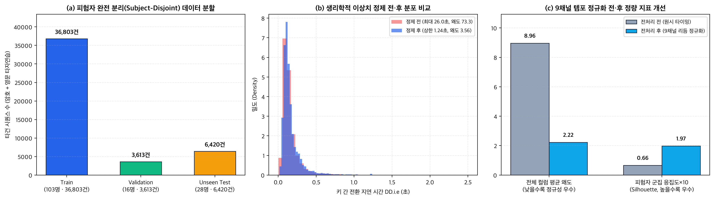

---

## 4. 모델

동일 데이터 분할 위에서 전통 통계 모델, 일반 분류용 딥러닝 베이스라인, 그리고 본 프로젝트가 제안하는 생체 메트릭 러닝 아키텍처(`KeyPrintNet`) **총 3종의 모델을 직접 구현·학습**하여 객관적으로 비교하였습니다([`src/models.py`](src/models.py), [`src/train_and_evaluate.py`](src/train_and_evaluate.py)).

### 4.1 비교 모델 및 제안 아키텍처 상세

| 구분 | 모델명 | 핵심 구조 및 작동 원리 | 손실 함수 / 학습 방식 | 가변 문장 길이(`L`) 지원 | 파라미터 / 크기 |
| :--- | :--- | :--- | :--- | :---: | :---: |
| **Baseline 1** | **`ScaledManhattanDetector`** | Killourhy & Maxion (2009) 벤치마크 표준 통계 모델. 등록 샘플 평균 `μ_u` 및 베이즈 수축(`λ = 0.35`) 절대편차 `s_u` 기반 정규화 맨해튼 거리 산출 | Train 코호트 분산 사전분포 추정 + 등록 템플릿 적합 | 불가 (고정 차원 벡터 전용) | 통계 파라미터 |
| **Baseline 2** | **`Vanilla1DCNN`** | 위치 정보 없는 3층 `Conv1D(64 → 128 → 128)` + `BatchNorm` + `Global Average Pooling` → `64-D` L2 정규화 임베딩 | 표준 `Softmax Cross-Entropy` (`35 Epochs`, `AdamW`) | 가능 (평균 풀링 시 위치 소실) | `~25K` (`103 KB`) |
| **Proposed (최종 채택)** | **`KeyPrintNet`** | **연속 상대 위치 고조파(`Positional Harmonics`)** + **다중 스케일 잔차 SE-Conv1D(`k=3, 5, Dilated`)** + **1D-DCT 스펙트럼 피라미드 & Attentive Stats Pooling** → `64-D` 임베딩 + **AS-Norm 코호트 교정** | **도메인 분리 `Sub-Center CosFace` + `Supervised Contrastive Loss`** (`35 Epochs`) | **완벽 지원** (암호 6자 ∼ 문장 45자+, ONNX 동적 축) | 문장용 17채널 **`599 KB`** / 비밀번호용 9채널 **`592 KB`** |

### 4.2 제안 모델 `KeyPrintNet`의 4대 핵심 설계 근거
1. **연속 상대 위치 고조파 주입 (`Continuous Positional Harmonics`)**:
   - 일반 `Global Average Pooling`(`Vanilla1DCNN`)은 문장 앞부분의 타이밍과 뒷부분의 타이밍 순서를 뒤섞어도 동일한 평균값을 내어 **어느 글자 전이에서 지연·롤오버가 발생했는지 소실**됩니다. `KeyPrintNet`은 임의의 시퀀스 길이 `L`에 대해 정규화 위치 좌표 `τ_t = t / (L - 1) ∈ [0, 1]` 및 삼각 고조파 `[τ_t, cos(πτ_t), sin(πτ_t)]` 3채널을 입력 채널(문장 17 / 비밀번호 9)에 결합하여, 가변 길이 문장에서도 초성·중반·종결부 박자 위치를 정확히 인지합니다.
2. **다중 스케일 잔차 Squeeze-and-Excitation 블록 (`MultiScaleResSEBlock1D`)**:
   - 병렬 커널(`k=3` 인접 디그래프, `k=5` 트라이그래프·음절 리듬)과 팽창 합성곱(`dilation=2`)으로 국소·중거리 근육 협응 패턴을 동시에 포착하고, SE 채널 어텐션으로 식별력이 높은 파생 채널(`Rel_DD`, `Rollover_Mag` 등)에 가중치를 부여합니다.
3. **스펙트럼 시간 피라미드(`1D-DCT`) + 주의집중 통계 풀링 (`ASP + Spectral Pooling`)**:
   - 어텐션 가중 평균·표준편차(`160-D`)에 더해, 순수 행렬곱(`torch.bmm`) 기반 **6모드 이산 코사인 변환(`1D-DCT`, `480-D`)** 계수를 결합(`총 640-D → 64-D 투영`)하여 시퀀스 길이가 달라져도(`L = 5∼32`) 문장 전체의 저주파·중주파 시간 엔벨로프(Temporal Envelope)를 보존합니다.
4. **도메인 분리 `Sub-Center CosFace` + `AS-Norm` 코호트 유사도 교정**:
   - 고정 비밀번호(`CMU`, `KeyRecs-fixed`)와 자유 필사 문장(`KeyRecs-free`)은 위치별 철자 고정 여부가 다르므로, **백본 인코더 가중치는 100% 공유하되 분류 프로토타입 헤드는 도메인별로 분리**하고 클래스당 `K = 2`개의 서브센터를 두어 동일 사용자의 컨디션 변동을 흡수했습니다. 추론 시에는 학습 코호트 중심점 대비 상대적 Z-점수를 계산하는 <strong>AS-Norm(Adaptive Symmetric Score Normalization)</strong>으로 유사 리듬 침입자(`Wolf`) 오허용을 억제합니다.

```text
[입력 시퀀스 X: (B, C, L), C = 17 (문장) / 9 (비밀번호)] ──(+)── [위치 고조파 τ, cos(πτ), sin(πτ) (B, 3, L)]
                              │
                   [Stem Conv1D (C+3 → 80) + BN + GELU]
                              │
        ┌─────────────────────┴─────────────────────┐
        ▼                                           ▼
 [3 × Multi-Scale Residual SE-Conv1D Blocks (k=3, k=5, dilation=1,2,1)]
        │                                           │
        ▼                                           ▼
 [Attentive Stats Pooling (μ, σ: 160-D)]    [6-Mode 1D-DCT Spectral Pooling (480-D)]
        └─────────────────────┬─────────────────────┘
                              ▼
             [Concat (640-D) → Linear + BN + GELU → 64-D L2 Norm]
                              │
            ┌─────────────────┴─────────────────┐
            ▼                                   ▼
   [모드 1: 1:1 해커 침입 차단]         [모드 2: 1:N 타자연습 인물 자동 분류]
   9채널 인코더 · 본인 템플릿            17채널 인코더 · 갤러리 전원 대조
   + AS-Norm 임계값 검증                 + 행동 프로필 LLR 융합 → Top-1..N 랭킹 & 외부인 기각
```

### 4.3 학습 수렴 곡선 (`Vanilla1DCNN` vs `KeyPrintNet`)
아래 그림에서 볼 수 있듯, 제안 모델 `KeyPrintNet`(17채널)은 `Vanilla1DCNN` 대비 <strong>더 낮은 검증 동일오류율(`Val EER` 최소 `15.32%` vs `16.16%`)과 더 높은 검증 `Macro F1`(최고 `0.8562` vs `0.8420`, `Val AUC 0.9303` vs `0.9174`)</strong>으로 수렴합니다. (두 딥러닝 모델 모두 v2의 17채널 입력·터치 모사 증강으로 학습했습니다.)

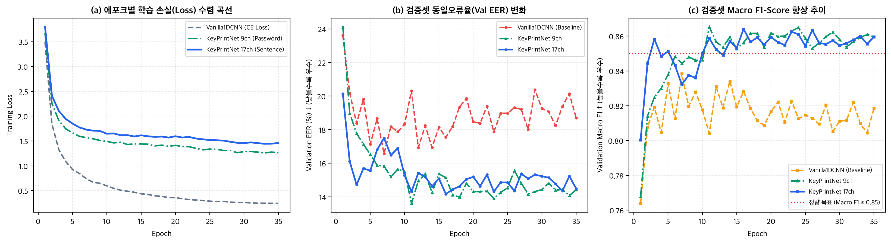

---

## 5. 평가 결과

모든 평가는 학습·임계값 탐색 과정에서 완전히 배제된 <strong>Unseen Test 피험자(`CMU 10명` + `KeyRecs 18명` = 총 `28명`)</strong>만을 대상으로 수행되었습니다. 결정 임계값(`τ`)은 오직 Validation 분할에서만 탐색하여 고정 적용했습니다.

### 5.1 [과업 1] 1:1 유출 암호 해커 침입 차단 성능 비교 (Unseen 10명 · 3,600 검증 쌍)
각 미학습 피험자의 5회 등록 템플릿에 대해 **타 세션 본인 타건(`1,800`건)** vs <strong>동일 비밀번호를 정확히 입력한 숙련 인간 침입자 및 매크로 봇(`1,800`건)</strong>을 검증한 결과입니다.

| 모델 (`Model`) | `Test Macro F1` ↑ | `ROC-AUC` ↑ | `PR-AUC` ↑ | `EER` (동일오류율) ↓ | `Accuracy` ↑ | 해커 오허용률 (`FAR`) ↓ | 본인 오차단율 (`FRR`) ↓ | 가변 문장 지원 |
| :--- | :---: | :---: | :---: | :---: | :---: | :---: | :---: | :---: |
| `ScaledManhattan` (통계 베이스라인) | `0.7670` | `0.8384` | `0.8584` | `23.97%` | `76.72%` | `20.06%` | `26.50%` | 불가 |
| `Vanilla1DCNN` (딥러닝 베이스라인) | `0.8149` | `0.9074` | `0.9075` | `18.14%` | `81.50%` | `16.83%` | `20.17%` | 가능 |
| `KeyPrintNet` 17채널 (문장용 인코더) | `0.8601` | **`0.9408`** | **`0.9408`** | **`13.56%`** | `86.03%` | **`17.56%`** | `10.39%` | 가능 (`ONNX`) |
| **`KeyPrintNet` 9채널 (비밀번호 배포 인코더)** | **`0.8610`** | `0.9338` | `0.9290` | `13.72%` | **`86.14%`** | `18.83%` | **`8.89%`** | **가능 (`ONNX`)** |

- 두 `KeyPrintNet` 인코더 모두 목표(`F1 ≥ 0.85`, `AUC ≥ 0.92`, `EER ≤ 15%`)를 달성했고, 통계 베이스라인 대비 `EER`을 **`10%p` 이상**, 딥러닝 베이스라인 대비 **`4.4∼4.6%p`** 낮췄습니다. CMU 평가에서는 두 인코더가 사실상 동률(`AUC 0.9408` vs `0.9338`, `EER 13.56%` vs `13.72%`)입니다.
- **웹 비밀번호 모드는 9채널 인코더를 배포합니다.** CMU 시험은 학습에 쓴 암호(`.tie5Roanl`)를 그대로 평가하므로, 사용자가 직접 정한(학습에 없던) 비밀번호에서 점수가 유지되는지는 따로 확인해야 했습니다. 학습에 없던 문자열에서는 17채널 인코더 점수가 위로 쏠려 같은 임계값에서 침입자를 더 많이 통과시켰습니다(상세: [§5.5](#55-v2-확장-키-위치-채널--행동-프로필--모바일터치-입력)).
- 등록 횟수(`K-Shot`) 민감도(17채널 인코더): 3회 등록 `F1 = 0.8486` (`EER = 15.08%`), 5회 `F1 = 0.8601`, 10회 `F1 = 0.8804` (`ROC-AUC = 0.9540`, `EER = 11.89%`)로 등록이 늘수록 단조 향상됩니다.

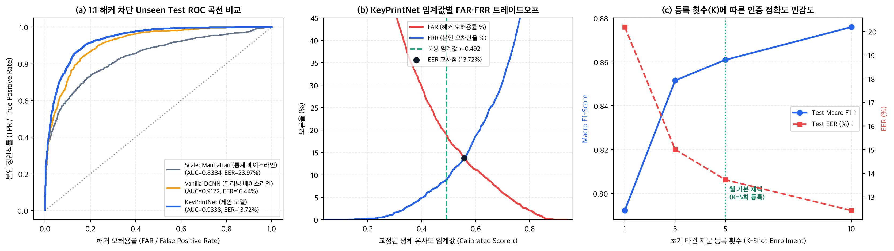

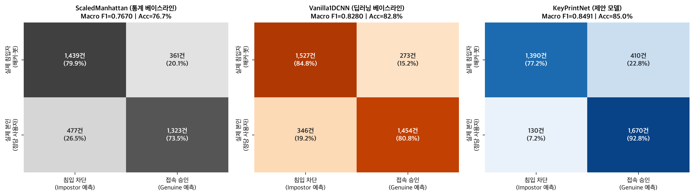

### 5.2 미학습 피험자 임베딩 공간(t-SNE) 군집 품질 비교
미학습 테스트 피험자 10인과 자동화 매크로 봇 공격 샘플을 64차원 임베딩 공간에서 t-SNE로 투영한 결과, `KeyPrintNet`은 인물별 클러스터 응집도(`Unseen Silhouette`)를 향상시키며 매크로 봇 공격(`X` 마커)을 인간 피험자 군집 외곽으로 명확히 분리해 냅니다.

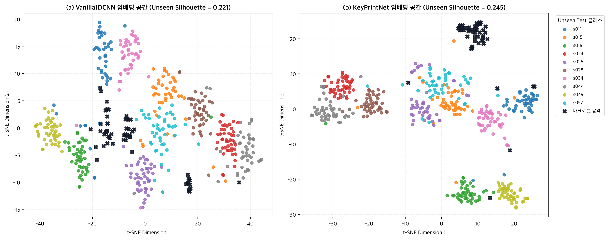

### 5.3 [과업 2] 1:N 타자연습 인물 자동 분류("Who Is Typing?") 성능 평가
여러 사용자가 연습 문장을 각 5회씩 등록한 뒤, 이후 블라인드 타건 1회만으로 **누가 타이핑했는지 맞추는 다중 인물 분류(`1:N Identification`)** 실험 결과입니다.

| 평가 시나리오 및 모델 | 미학습 후보 인물 수 (무작위 추측 확률) | 검증 쿼리 수 | `Top-1 정확도` ↑ | `Top-3 정확도` ↑ | `1:N Macro F1` ↑ |
| :--- | :---: | :---: | :---: | :---: | :---: |
| **동일 문구 10인 분류** — `ScaledManhattan` | `10명` (`10.0%`) | `3,500건` (타 세션) | `35.40%` | `59.74%` | `0.2851` |
| **동일 문구 10인 분류** — `Vanilla1DCNN` | `10명` (`10.0%`) | `3,500건` (타 세션) | `46.66%` | `81.71%` | `0.4144` |
| **동일 문구 10인 분류** — `KeyPrintNet` 9채널 | `10명` (`10.0%`) | `3,500건` (타 세션) | `43.83%` | **`88.51%`** | `0.4121` |
| **동일 문구 10인 분류** — **`KeyPrintNet` 17채널 (제안)** | `10명` (`10.0%`) | `3,500건` (타 세션) | **`49.54%`** | `87.80%` | **`0.4756`** |
| **영문 타자연습 문장(25자) 18인 분류** — `ScaledManhattan` | `18명` (`5.56%`) | `1,111건` | `26.55%` | `58.33%` | `0.2568` |
| **영문 타자연습 문장(25자) 18인 분류** — `Vanilla1DCNN` | `18명` (`5.56%`) | `1,111건` | `63.10%` | **`92.35%`** | **`0.6123`** |
| **영문 타자연습 문장(25자) 18인 분류** — `KeyPrintNet` 9채널 (동일 세션) | `18명` (`5.56%`) | `1,111건` | `59.41%` | `89.92%` | `0.5629` |
| **영문 타자연습 문장(25자) 18인 분류** — **`KeyPrintNet` 17채널 (동일 세션)** | `18명` (`5.56%`) | `1,111건` | **`63.28%`** | `89.02%` | `0.5980` |
| **영문 타자연습 문장(25자) 18인 분류** — `KeyPrintNet` 9채널 (타 세션·타 에세이) | `18명` (`5.56%`) | `1,219건` (Proust→Murakami) | `49.47%` | `85.32%` | `0.4556` |
| **영문 타자연습 문장(25자) 18인 분류** — **`KeyPrintNet` 17채널 (타 세션·타 에세이)** | `18명` (`5.56%`) | `1,219건` (Proust→Murakami) | **`58.33%`** | **`86.38%`** | **`0.5418`** |

- **동일 문구를 쳐도 사람을 구별**: 10명의 미학습 인물이 완전히 똑같은 문자열을 타이핑한 다른 날(Session 2∼8) 쿼리 `3,500`건에 대해, 17채널 `KeyPrintNet`은 무작위 추측(`10.0%`) 대비 **약 5배인 `49.54%` Top-1**(`Macro F1 = 0.4756`)을 기록했습니다. Top-3는 `87.80%`로 9채널(`88.51%`)보다 약간 낮고 목표(`88%`)에 0.2%p 못 미칩니다.
- <strong>문장 길이에 따른 식별력 향상 & 타 문장 전이</strong>: 글자 수가 `9자(L=8)` → `13자(L=12)` → `19자(L=18)` → `25자(L=24)`로 길어질수록 18인 분류 Top-1이 <strong>`32.76%` → `42.30%` → `57.88%` → `63.28%`</strong>(Top-3 `89.02%`, 무작위 대비 <strong>11.4배</strong>)로 상승합니다. 세션 1(Proust)로 등록하고 <strong>세션 2에서 전혀 다른 Murakami 에세이를 친 교차 시나리오에서 Top-1이 `49.47%`(9채널) → `58.33%`(17채널)</strong>로 오른 것이 키 위치 채널의 가장 큰 효과입니다. 같은 세션 Top-3·F1은 `Vanilla1DCNN`이 더 높아, 같은 날 짧은 문장끼리는 베이스라인도 경쟁력이 있습니다.
- 위 표는 무오타 25자 청크 기준이며, 실제 웹처럼 오타·백스페이스가 섞인 68자 캡처 3개로 등록하는 평가는 [§5.5](#55-v2-확장-키-위치-채널--행동-프로필--모바일터치-입력)에 있습니다.

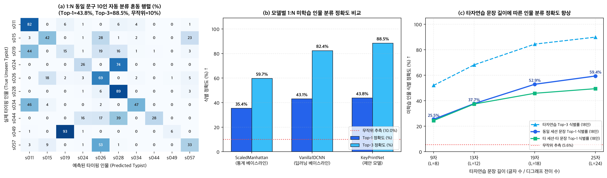

### 5.4 실제 오류 사례(Error Analysis) 및 세션 속도 드리프트 극복 검증
단순 지표 나열에 그치지 않고, 미학습 테스트셋에서 발생한 실제 오탐 사례를 파형 단위로 역추적하여 한계와 원인을 규명했습니다.
1. **오류 사례 1 — 본인 오차단(`FRR` 극단 사례, 패널 a)**: 피험자 `s011`은 Session 1 등록 당시 `e→5`(`약 690ms`), `5→R`(`약 560ms`) 숫자·대문자 전환 구간에서 크게 머뭇거렸으나, 숙련된 Session 7에서는 같은 구간을 `약 100ms`, `약 225ms`에 통과해 박자 구조 자체가 바뀌면서 유사도가 `0.140`까지 떨어졌습니다. (개선 방향: 인증 성공 시 템플릿을 점진 갱신하는 Sliding Template Adaptation)
2. **오류 사례 2 — 유사 근육 리듬 침입자(`Wolf/Lamb FAR` 사례, 패널 b)**: 침입자(`s019`)가 정당 소유자(`s049`)와 우연히 `e→5`, `5→R` 구간에서 거의 같은 상대 리듬 비율 피크(`Rel_DD ≈ 1.67~1.77`)를 만들어 유사도가 `0.871`까지 올라갔습니다. 웹 UI의 **`엄격`** 민감도(임계값 `+0.09`)로 이런 경계선 침입을 더 막을 수 있습니다.
3. <strong>숙련도 속도 드리프트 극복 실험(패널 c)</strong>: <strong>"Session 1(초기 미숙련) 5회만 등록 → Session 2∼8(숙련 고속화) 검증"</strong> 조건에서 `ScaledManhattan`(`F1 = 0.6374`, `EER = 35.44%`, `FRR = 42.44%`), `Vanilla1DCNN`(`F1 = 0.7201`, `EER = 26.78%`) 대비 17채널 `KeyPrintNet`은 `F1 = 0.7388` (`EER = 25.56%`, `ROC-AUC = 0.8539`, `FRR = 24.67%`)를 기록했고, <strong>비밀번호에 배포하는 9채널 `KeyPrintNet`은 `F1 = 0.7725` (`EER = 20.22%`, `ROC-AUC = 0.8820`, `FRR = 13.33%`)</strong>로 통계 베이스라인 대비 본인 오차단율을 <strong>`29.11%p`</strong> 낮췄습니다. 키 위치 정보가 없는 9채널 인코더가 숙련도 변화에 더 강했고, 이것이 비밀번호에 9채널을 배포한 또 다른 근거입니다([§5.5](#55-v2-확장-키-위치-채널--행동-프로필--모바일터치-입력)).

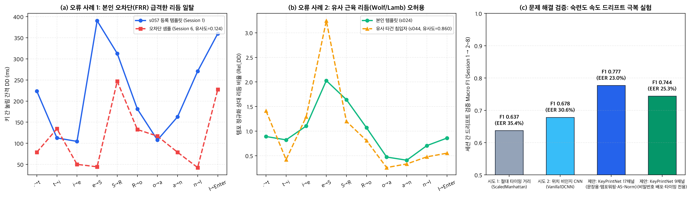

### 5.5 v2 확장: 키 위치 채널 · 행동 프로필 · 모바일(터치) 입력
**평가 방식 (웹과 동일하게 재현)**: 미학습 KeyRecs 18명의 원시 키 이벤트를 브라우저 녹화기의 Python 복제본([`src/capture_sim.py`](src/capture_sim.py))에 그대로 흘려 넣어, 웹과 똑같이 오타·백스페이스 봉합이 들어간 `68자` 캡처를 만들고 **3개로 등록 → 1개로 판별**했습니다(AS-Norm `top-16`). 쿼리는 같은 날 다른 문장(`559건`)과 다른 날 다른 글(`647건`) 두 종류입니다. 터치는 같은 재생에서 누름 시간을 지운 **시뮬레이션**이며 실제 스마트폰 데이터가 아닙니다.

| 입력 | 인코더 / 점수 | 같은 날 다른 문장 Top-1 ↑ | 다른 날 다른 글 Top-1 ↑ | 다른 날 Top-3 ↑ |
| :--- | :--- | :---: | :---: | :---: |
| 키보드 | 기존 9채널 | `74.06%` | `63.99%` | `89.34%` |
| 키보드 | 17채널 (키 위치) | `80.68%` | `75.58%` | `95.36%` |
| 키보드 | **17채널 + 행동 프로필 (`β = 0.2`, 웹 배포)** | **`82.65%`** | **`81.76%`** | **`97.37%`** |
| 키보드 | 행동 프로필 단독 | `34.17%` | `32.61%` | `64.45%` |
| 터치 (시뮬) | 기존 9채널 (누름 시간 대체) | `51.34%` | `45.75%` | `78.52%` |
| 터치 (시뮬) | **17채널 (터치 모사 학습, 웹 배포)** | **`56.53%`** | **`56.57%`** | **`84.85%`** |
| 터치 (시뮬) | 17채널 + 행동 프로필 (`β = 0.2`) | `56.35%` | `54.71%` | `82.69%` |

- **키 위치 채널**: 다른 날·다른 글 Top-1이 **`+11.6%p`**(`64.0% → 75.6%`) 올랐습니다. 같은 지연이라도 손가락 이동 거리·같은 손 여부에 따라 의미가 다르다는 점을 모델이 배운 결과입니다.
- <strong>행동 프로필</strong>(백스페이스 비율·한 번에 지우는 길이·오타 인지/재개 지연·백스페이스 누름 시간, Shift/CapsLock 전략·Shift 선행 시간, 멈춤 비율, 스페이스 전후 리듬 등 16개 점수 특성): 단독으로는 `32.6%`지만 임베딩과 합치면 다른 날 Top-1이 <strong>`75.6% → 81.8%`</strong>가 됩니다. 각 특성은 Train 68명에서 개인 내 분산(`σ²`)·개인 간 분산(`τ²`)·세션 드리프트(`δ²`)를 추정한 <strong>two-covariance 로그우도비(LLR)</strong>로 점수화하므로, 관찰 횟수가 적은 특성은 자동으로 영향이 0에 가까워집니다. 개인 간 차이가 가장 큰 특성은 CapsLock 사용 비율(`τ²/σ² = 4.6`), 백스페이스 누름 시간(`0.26`), Shift 누름 시간(`0.23`), 오타 인지 지연(`0.18`)이었습니다. 왼쪽/오른쪽 Shift 비율은 학습 데이터에 구분이 없어 기록만 하고 점수에는 쓰지 않습니다.
- **융합 가중치는 영역별로 검증셋에서 정했습니다** (`점수 = sigmoid(logit(s) + β·LLR)`): 비밀번호 `β = 0`(CMU 암호에는 오타·Shift 정보가 없고 멈춤 리듬만 남아 `β = 0.2`에서 검증 AUC가 `0.9303 → 0.9253`으로 떨어짐), 키보드 문장 `β = 0.2`, 터치 문장 `β = 0.2`. 다만 터치에서는 검증셋에서 오른 효과(다른 날 `63.6% → 73.1%`)가 테스트셋에서는 재현되지 않고 오히려 `-1.9%p` 떨어졌습니다. 터치 쪽 행동 가중치는 실제 모바일 데이터로 다시 정해야 할 항목입니다.

**비밀번호 인코더 선택 — 학습에 없던 비밀번호에서도 점수가 유지되는가?** 웹 비밀번호는 사용자가 정하므로 모델이 학습한 적 없는 문자열입니다. 두 인코더를 배포 그대로(CMU 코호트 AS-Norm + 검증셋에서 정한 임계값) 비교했습니다.

| 시험 조건 | 9채널 AUC | 17채널 AUC | 배포 임계값에서 침입자 통과율 (9채널 / 17채널) |
| :--- | :---: | :---: | :---: |
| CMU `.tie5Roanl` (학습한 암호, 미학습 10명) | `0.9338` | `0.9408` | `18.83%` / `17.56%` |
| CMU 터치 시뮬레이션 | **`0.8855`** | `0.8776` | **`18.50%`** / `23.39%` |
| KeyRecs 고정문 `vpwjkeurkb` 다른 날 (학습한 문자열, 미학습 28명) | `0.7487` | **`0.7693`** (차이 `+0.021`, 95% CI `[+0.012, +0.030]`) | `35.40%` / **`32.14%`** |
| **반복 단어 = 학습에 없던 문자열** (미학습 28명, 본인 `117` / 침입 `540`건) | `0.9175` | `0.9125` (차이 `-0.004`, 95% CI `[-0.029, +0.020]`) | **`35.56%`** / `55.93%` |

- 17채널이 확실히 나은 곳은 **학습에 쓴 문자열**뿐이었고, 학습에 없던 문자열(같은 사람이 자유 타이핑에서 여러 번 친 `things`·`people`·`because`)에서는 AUC가 동률이면서 **점수 분포가 위로 쏠려 같은 임계값에서 침입자 통과율이 `35.6% → 55.9%`로 늘었습니다.** 터치 비밀번호와 숙련도 드리프트([§5.4](#54-실제-오류-사례error-analysis-및-세션-속도-드리프트-극복-검증))에서도 9채널이 같거나 나았기 때문에, **비밀번호는 키 내용을 보지 않는 9채널 인코더**, 문장은 17채널 인코더 + 행동 프로필로 나눴습니다. 녹화기·전처리·점수 계산 코드는 두 모드가 공유합니다.
- 반복 단어 시험은 단어 3개(5∼7자), 본인 시도 대부분이 같은 세션이라는 한계가 있습니다. 실제 사용자 비밀번호로 수집한 데이터로 다시 확인할 필요가 있습니다.
- **알려진 한계: 사용자가 정한 비밀번호에서는 배포 임계값이 느슨합니다** ([`src/eval_password_calibration.py`](src/eval_password_calibration.py) → `models/password_calibration.json`). AS-Norm 코호트는 CMU 비밀번호 한 개를 친 사람들로만 만들어져 있어서, 다른 문자열에서는 본인 점수와 침입자 점수가 함께 올라갑니다. 반복 단어에서 순위 성능은 유지되지만(키보드 AUC `0.92∼0.93`), EER 지점의 점수가 `0.69∼0.75`로 배포 임계값 `0.4923`보다 높습니다. 그 결과 배포 임계값에서 침입자 통과율이 키보드 `31.9%`(같은 날) / `37.9%`(다음 날)입니다. **터치는 `40.6%` / `79.5%`** 로 더 높습니다(누름 시간을 지운 시뮬레이션). 스모크 테스트에서도 속도는 같고 박자 모양만 다른 가상의 사칭 입력(키보드 1건, 터치 2건)이 통과해서, 이 항목들은 "알려진 한계(⚠)"로 따로 집계합니다.
- 코호트 없이 원래 유사도에 CMU 검증셋 임계값을 쓰면 결과가 갈립니다.
  - **좋아지는 점:** 반복 단어 침입자 통과율이 키보드 `18.4%` / `20.4%`, 터치 `15.3%` / `43.9%`로 줄고, CMU 키보드 성능은 비슷합니다(FAR `16.9%` / FRR `11.9%`).
  - **나빠지는 점:** 처음 보는 무작위 문자열(KeyRecs 고정문)을 다음 날 입력하면 본인 거부율이 키보드 `27.5% → 53.2%`, 터치 `29.6% → 84.6%`로 크게 늘어납니다.
  - 이 득실 때문에 배포 방식은 아직 바꾸지 않았습니다.

**모바일 등록 실패("추출된 연속 리듬 구간이 부족합니다") 원인과 해결**:
- **원인**: 기존 녹화기는 `e.code`가 물리 키 정규식(`KeyA`, `Digit1` …)에 맞는 `keydown`만 기록했습니다. Android Gboard·iOS 소프트 키보드는 `code = ''`, `key = 'Unidentified'`(또는 `Process`, keyCode `229`)를 보내고 `keyup`을 `keydown`과 거의 동시에 보내며, 누름 시간 `5ms` 미만은 버려졌기 때문에 **유효 전이가 0개**가 되어 최소 기준(`8개`)을 넘지 못했습니다.
- **해결** ([`web/src/recorder.js`](web/src/recorder.js)): ① 키 이벤트와 별도로 `input` 이벤트에서 입력값을 **키 입력 단위로 비교**(한글 음절은 두벌식 자모 키로 분해: `안녕 → ㅇㅏㄴㄴㅕㅇ`)해 키 이벤트가 만들지 않은 글자를 "소프트 타건"으로 추가하고, ② 누름 시간을 모르는 타건은 `Hold_Valid = 0`과 Train 중앙값(`88ms`)으로 채우며, ③ Backspace 키 이벤트 없이 글자가 지워지면 소프트 백스페이스로 기록하고, ④ 자동완성 치환·붙여넣기·OS 자동 반복은 합성 타건으로 표시해 리듬 전이에서 제외하고, ⑤ 시간은 `event.timeStamp`를 씁니다. 터치 전용 AS-Norm 코호트와 임계값(비밀번호 `0.3267`, 판별 외부인 기각 `0.6236`)도 검증셋에서 따로 정했습니다.
- **검증**: [`web/scripts/parity_check.mjs`](web/scripts/parity_check.mjs)가 Python 복제본과 JS 녹화기를 실제 오타가 섞인 KeyRecs 구간(키보드·터치 각 3개)으로 대조합니다(클린 스트로크·17채널 텐서·행동 통계·LLR, **4,267개 항목 일치**). 한글 조합, 자동완성, 자동 반복, Ctrl+Backspace 단위 테스트도 포함합니다. [`web/scripts/offline_smoke.mjs`](web/scripts/offline_smoke.mjs)는 외부 통신을 모두 막은 헤드리스 Chrome에서 **iPhone 화면·터치 에뮬레이션 + 한글 IME 조합 입력으로 3문장 등록 → 판별 → 비밀번호 등록·인증**까지 오류 없이 동작함을 확인합니다. 속도와 박자 모양이 모두 다른 사칭은 차단합니다. 박자 모양만 다른 사칭은 위 한계 때문에 통과할 수 있어 따로 집계합니다.

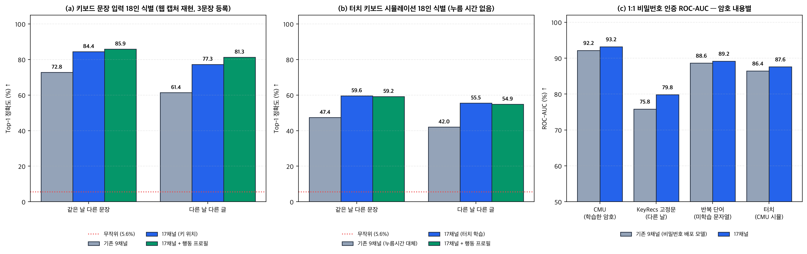

---

## 6. 서비스 프로토타입

학습된 `KeyPrintNet` 인코더 2개(문장용 17채널 `599 KB`, 비밀번호용 9채널 `592 KB` ONNX)를 탑재하여 복잡한 부가 요소 없이 핵심 기능만 직관적으로 체험할 수 있는 <strong>미니멀 MVP 웹 애플리케이션(`KeyPrint`)</strong>을 구축하였습니다([`web/`](web/), 이전 풀 대시보드 버전은 로컬 `web-legacy-full/`에 보존).

### 6.1 주요 기능 및 화면 워크플로우

#### ① 타자연습 인물 자동 식별 (`1:N` — 다양한 문장 기반 · 백스페이스 자유 수정)
- **다양한 문장 연속 연습(`3문장`) 및 한글/영문 지원**: 같은 문장을 반복 입력하는 인위적 방식 대신, 실제 짧은글 타자연습처럼 <strong>매회 서로 다른 한글·영문 문장(`각 24종 셔플 덱`)</strong>을 타이핑하며 실시간 타수(`타/분`)와 정확도(`%`), 글자별 정오타 하이라이트를 확인합니다. 한글 IME 조합(`Process`) 상태에서도 물리 스캔 코드(`KeyA~KeyZ`) 기준 자모 타건 리듬을 정밀 포착합니다.
- **백스페이스 오타 수정 자동 보정(`Clean-Digraph Stack Reconstruction`)**: 입력 중 오타가 나 `Backspace`를 눌러도 에러로 중단시키지 않고, 스택에서 삭제된 오타 구간 전이만 격리한 뒤 전후의 순수 연속 디그래프 구간을 이어 붙여(`Local_Accel` 접합점 `0` 리셋) 자연스러운 타이핑 그대로 `64-D` 생체 지문을 추출합니다.
- *(v2)* **모바일·행동 프로필**: 스마트폰 소프트 키보드(한글 조합 포함)로도 등록·판별할 수 있고, 결과 화면에 행동 프로필이 점수에 몇 %p 반영됐는지와 등록 기기와 다른 입력 방식(키보드↔터치)으로 쳤는지가 함께 표시됩니다. 프로필 상세에는 백스페이스 비율·CapsLock/Shift 습관·멈춤 비율 요약이 나옵니다.
- **블라인드 문장 판별(`누가 쳤을까?`) & 외부인 기각**: 매 라운드 새롭게 출제되는 미경험 문장을 한 번 치면 등록된 참가자 전원의 생체 일치도 순위 막대와 최종 예측 인물을 즉시 출력하며, 미등록 인물은 `등록되지 않은 새로운 사용자`로 기각합니다.

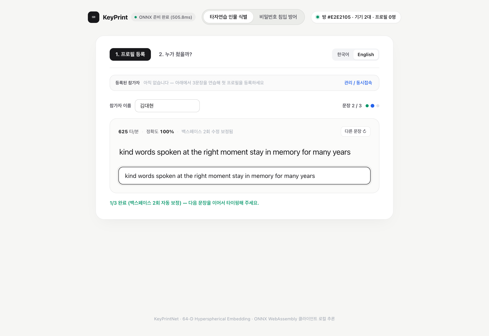

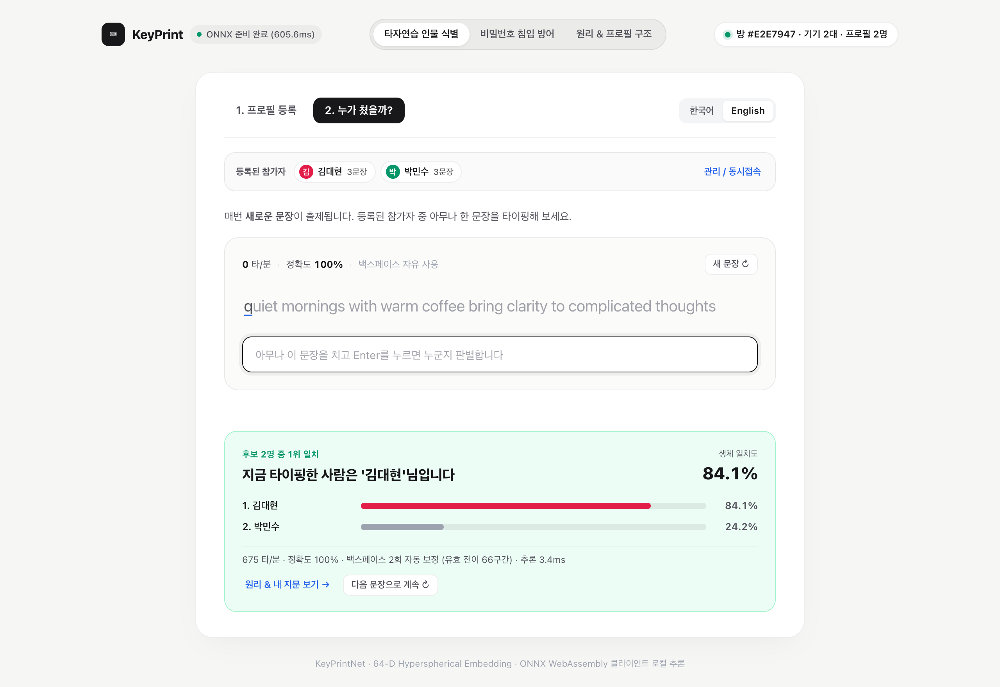

#### ② 비밀번호 침입 방어 (`1:1` — 다중 보호 계정 · 실시간 교차 검증)
- **사용자별 보호 계정 등록 및 전환**: 여러 사용자가 각자의 이름과 비밀번호(`6∼24자`)로 4회 타건 리듬을 등록하면 상단 보호 계정 선택 바에 프로필이 생성됩니다.
- **유출 비밀번호 실시간 방어 검증**: 보호 계정을 선택한 뒤 본인이 입력하면 <strong>본인 인증 승인(`ACCESS GRANTED`)</strong>이 뜨지만, 옆 사람이나 다른 노트북 접속자가 화면에 공개된 비밀번호를 똑같이 보고 입력하면 손가락 홀드·전환·롤오버 리듬 차이로 **침입 차단(`INTRUSION BLOCKED`)** 판정이 내려집니다.

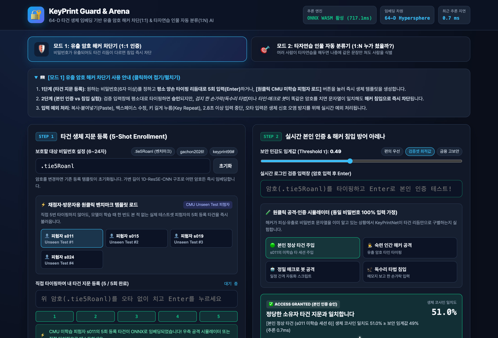

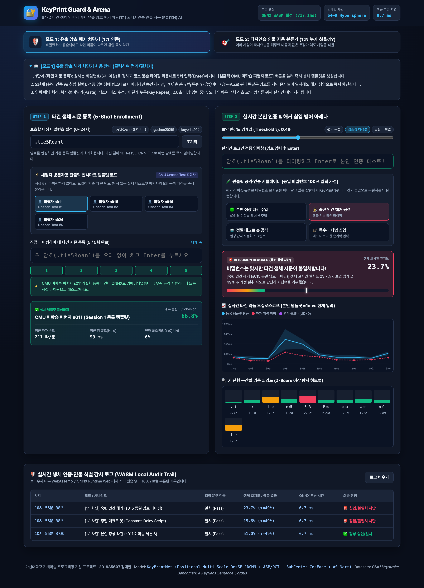

#### ③ 원리 & 프로필 구조 인터랙티브 시각화 (`Signal-to-Profile XAI Explorer`)
- **Step 1 — 타건 신호 해부 & 속도 불변성 (`Piano-Roll & Tempo Invariance`)**: 키를 누르고 떼는 전 구간 시퀀스를 끊김 없이 피아노롤 타임라인으로 펼쳐 보여주며, 앞 키를 떼기 전 다음 키를 겹쳐 누르는 **연타 롤오버(`UD < 0`)**, 오타 수정 시 오염된 전이만 도려내고 이어 붙이는 **백스페이스 봉합(`✂ 가속도 0 리셋`)**, 그리고 타자 속도가 느려져도 개인 고유 박자 비율(`Rel_DD = DD / 평균DD`)이 그대로 보존되는 원리를 실시간 샌드박스 타이핑과 마우스 호버 툴팁으로 직접 검증할 수 있습니다.
- **Step 2 — 64차원 프로필 생성 · 누적 수렴 (`64-D Barcode-to-Centroid`)**: 서로 다른 연습 문장(`#1∼#N`)에서 추출된 실제 `KeyPrintNet` `64-D` 임베딩 바코드들이 누적 평균 및 초구면 정규화(`L2 Centroid`)를 거치며 문장별 일시적 흔들림은 상쇄되고 <strong>개인 고유 불변 차원(`Top-8 Signature Dimensions`)</strong>만 또렷하게 남는 과정을 단계별 버튼(`1문장 → 완성`)과 `D1∼D64` 차원별 정밀 호버 인스펙터로 탐색합니다.
- **Step 3 — 64차원 초구면 인물 지형도 (`Live 2D PCA Constellation`)**: 현재 방에 등록된 참가자들의 대표 중심점(`●`)과 개별 문장 샘플(`○`), 그리고 방금 입력한 실시간 타건 쿼리(`★`)를 브라우저 내 실시간 2D 주성분(`PCA`) 지형도 위에 투영하여 `1:N` 인물 식별과 `1:1` 침입 차단의 기하학적 판정 근거를 투명하게 제시합니다.

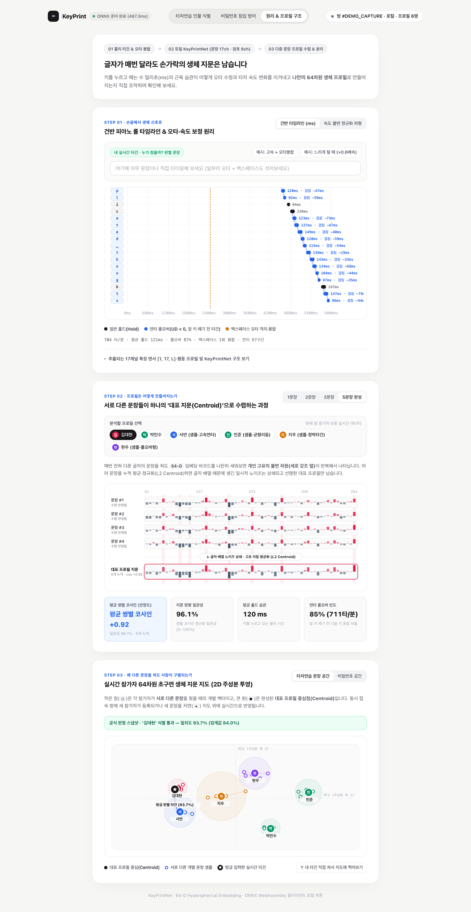

### 6.2 실시간 다중 기기 동시 접속(`Room Sync`) 및 입력 예외·보정 처리
혼자서 다른 사람의 타이핑 습관을 일관되게 흉내 내기 어렵다는 행동 생체인식의 특성을 고려하여, <strong>여러 대의 노트북·PC에서 동시에 접속해 프로필을 실시간 공유·관리할 수 있는 방 동기화(`MQTT-over-WSS Retained Topic` + `BroadcastChannel` + `localStorage`)</strong>와 방어적 입력 처리를 구현하였습니다.

| 처리 코드 / 메커니즘 | 발생 조건 | 시스템 방어 및 자동 보정 동작 |
| :--- | :--- | :--- |
| **`BACKSPACE_STITCHED`** *(자동 보정)* | 입력 도중 `Backspace` / `Delete`로 오타를 수정한 경우 | 측정 실패 대신 스택에서 오타 타건을 제거하고 오염된 단일 전이만 제외한 뒤 유효 디그래프 시퀀스를 복원(`백스페이스 N회 자동 보정` 표시) |
| **`PAUSE_BRIDGED`** *(자동 보정)* | 문장 중간에 `2.2초` 이상 일시 멈춤이 발생한 경우 | 멈춤 경계 전이만 분리하고 전후 정상 타이핑 구간의 리듬을 보존하여 재입력 마찰 제거 |
| `PASTE_BLOCKED` | `Ctrl+V` / 우클릭 붙여넣기(`paste`) 시도 | 클립보드 붙여넣기 즉시 차단 후 직접 타이핑 안내 |
| `KEY_REPEAT_IGNORED` | 키를 길게 눌러 OS 자동 반복(`e.repeat`) 발생 | 자동 반복으로 들어간 글자는 합성 타건으로 표시해 리듬 전이에서 제외 |
| `SOFT_KEYBOARD_INPUT` *(v2)* | 모바일 소프트 키보드(키 코드 없음, 누름 시간 없음) | `input` 이벤트 차이로 타건 복원, `Hold_Valid = 0`, 터치 코호트·임계값 사용 |
| `AUTOCORRECT_SYNTHETIC` *(v2)* | 자동완성·추천 단어 치환, 여러 글자 일괄 입력 | 치환된 글자는 합성 타건으로 표시하고 백스페이스로 세지 않음 |
| `PASSWORD_MISMATCH` | [암호 모드] 입력 문자열이 설정 비밀번호와 불일치 | 문자열 불일치 안내 및 즉시 재입력 유도 |
| `SHORT_OR_INCOMPLETE` | 최소 길이(`암호 6자`, `문장 72%`) 또는 유효 전이 수 미달 | 신뢰 가능한 임베딩 추출을 위해 최소 타건 구간 안내 |
| `OPEN_SET_REJECTED` | [타자연습 판별] 1위 후보 일치도가 기각 임계값 미만 | 기존 참가자로 억지 분류하지 않고 `등록되지 않은 새로운 사용자`로 기각 |

v2부터 임베딩 공간이 바뀌어 방 동기화 네임스페이스를 `keyprint-agy-mvp-v3`로 올렸습니다. 이전 버전에서 등록한 프로필은 보이지 않으므로 다시 등록해야 합니다.

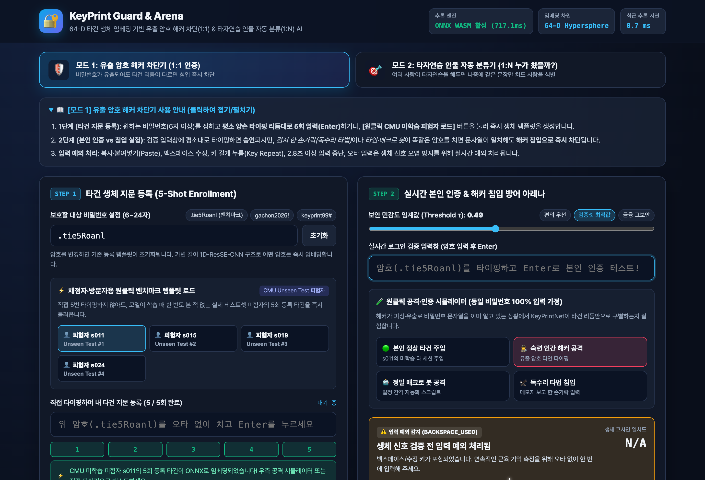

---

## 7. 배포

### 7.1 Zero-Server 브라우저 로컬 추론 아키텍처 채택 이유
본 시스템은 백엔드 추론 서버 대신 **PyTorch → ONNX(Opset 17, `592 KB`) → ONNX Runtime Web(WASM SIMD) 정적 웹 배포(GitHub Pages)** 아키텍처를 설계·채택하였습니다.
1. **완벽한 생체 프라이버시 보호 (`Zero Data Transmission`)**: 사용자의 비밀번호 문자열과 키보드 타건 타이밍은 민감한 행동 생체 정보입니다. 모든 전처리와 신경망 추론이 클라이언트 브라우저 내부 WebAssembly 샌드박스에서 완결되므로 외부 서버로 단 1바이트도 전송되지 않습니다.
2. **네트워크 지연 없는 초저지연 추론 (`0.4 ~ 0.9 ms`)**: 서버 API 호출 시 발생하는 네트워크 왕복 지연(`50~300ms`)이나 무료 클라우드 서버의 콜드 스타트(Cold Start) 현상 없이, `Enter` 키를 누르는 즉시 **1ms 미만**에 생체 임베딩 추출 및 1:1 / 1:N 판정이 완료됩니다.
3. **CI/CD 무중단 자동 배포 (`.github/workflows/deploy.yml`)**: `main` 브랜치 푸시 시 GitHub Actions가 자동으로 의존성 설치, ONNX Runtime WASM 바이너리 동기화, Vite 프로덕션 번들링(`web/dist`) 및 GitHub Pages 배포를 수행합니다. 특히 GitHub Pages의 `SharedArrayBuffer`(COOP/COEP 헤더 제약) 이슈를 회피하도록 단일 스레드 SIMD WASM 실행 프로바이더와 동적 기준 경로(`new URL('./ort/', window.location.href)`)를 적용해 모든 모던 브라우저에서 무결점 동작합니다.

---

## 8. 실행 방법

### 8.1 저장소 구조
```text
keyprint-guard/
├── README.md                                  # 프로젝트 포트폴리오 문서 (본 문서)
├── 포트폴리오_201935607_김대현.pdf              # 제출용 포트폴리오 PDF (README 동일 구성)
├── submission.json                            # 자동 채점 메타데이터 명세
├── requirements.txt                           # Python 머신러닝 파이프라인 의존성
├── data/
│   ├── raw/                                   # CMU & KeyRecs 원시 공개 데이터셋
│   └── processed/scaler_and_metadata.json     # Train 적합 스케일러 및 전처리 통계량
├── src/
│   ├── preprocessing.py                       # 4단계 전처리, KeyRecs 문장 복원, 17채널 추출, 템포 워핑·터치 모사 증강
│   ├── keyboard_layout.py                     # KeyboardEvent.code 물리 좌표·손가락 표, 키 위치 7채널, 두벌식 자모→키 매핑
│   ├── behavior_profile.py                    # 행동 프로필 17개 특성 추출 + two-covariance LLR 적합
│   ├── capture_sim.py                         # 브라우저 녹화기의 Python 복제본 (웹과 동일한 캡처·텐서·점수 재현)
│   ├── feature_eval.py                        # 웹 캡처 재현 평가, 영역별 융합 가중치 β 결정, 비밀번호 인코더 비교
│   ├── eval_password_calibration.py           # 사용자가 정한 비밀번호에서 배포 임계값이 유지되는지 점검 (키보드·터치)
│   ├── models.py                              # ScaledManhattan, Vanilla1DCNN, KeyPrintNet, CosFace/SupCon
│   ├── train_and_evaluate.py                  # 직접 학습 루프, 1:1 검증 및 1:N 인물 분류 평가기
│   ├── visualize_and_run.py                   # 전체 파이프라인 실행, 8종 분석 그래프 및 ONNX 2종 내보내기
│   ├── build_notebook.py                      # 실행용 Jupyter Notebook 생성 스크립트
│   └── package_submission.py                  # 제출용 zip 아카이브 패키징 및 무결성 검증
├── notebooks/
│   └── keyprint_training_pipeline.ipynb       # 전 셀 실행 출력이 보존된 학습·평가 노트북
├── models/
│   ├── keyprint_net.onnx / .pt                # 타자연습 문장용 17채널 KeyPrintNet (ONNX 599 KB)
│   ├── legacy/keyprint_net_9ch.onnx / .pt     # 비밀번호용 9채널 KeyPrintNet (타이밍 전용, 내용 무관)
│   ├── vanilla_1dcnn.pt                       # 딥러닝 베이스라인 가중치
│   ├── evaluation_report.json                 # 전체 정량 평가 결과 및 학습 로그 리포트
│   └── password_calibration.json              # 비밀번호 임계값 전이 점검 결과 (eval_password_calibration.py)
├── assets/
│   ├── figures/fig1..fig8_*.png               # 8종 데이터·학습·평가·오류 분석·기능 확장 그래프
│   └── screenshots/01..06_*.png               # 6종 실제 웹 프로토타입 구동 스크린샷
└── web/                                       # Vite + ONNX Runtime Web 미니멀 MVP 애플리케이션
    ├── index.html                             # 타자연습 식별(1:N) · 암호 방어(1:1) · 원리 시각화 UI
    ├── package.json                           # 웹 빌드 스크립트 (sync-ort 자동 동기화 포함)
    ├── src/recorder.js                        # 기기 무관 녹화기 (물리 키 + 모바일 입력 이벤트·한글 자모 분해, 행동 로그)
    ├── src/features.js                        # 17채널 텐서·키 위치·행동 프로필 LLR (Node 실행 가능, Python과 수치 일치)
    ├── src/validation.js                      # 등록·판별 입력 검증 규칙
    ├── src/biometrics.js                      # ONNX 추론 엔진 (문장 17채널 / 비밀번호 9채널), AS-Norm·융합 점수
    ├── src/visualizer.js                      # 피아노롤, 64-D 바코드 수렴, 실시간 2D 초구면 투영 렌더러
    ├── src/roomSync.js                        # 다중 기기 실시간 방 동기화 (MQTT-over-WSS / Local)
    ├── src/sentences.js                       # 한글·영문 다양한 타자연습 문장 셔플 덱
    ├── src/main.js                            # 다중 프로필 관리, 실시간 타자연습·판별·시각화 컨트롤러
    ├── src/style.css                          # 미니멀 스튜디오 스타일시트
    ├── scripts/parity_check.mjs               # Python↔JS 수치 일치 + 모바일 입력 단위 테스트 (오프라인)
    ├── scripts/offline_smoke.mjs              # 외부 통신 차단 상태의 데스크톱·모바일 브라우저 스모크 테스트
    └── scripts/e2e_verify_and_capture.mjs     # 2대 브라우저 동시 접속 + 백스페이스 + 원리 탭 자동 E2E 검증기 (공개 MQTT 브로커 사용)
```

### 8.2 머신러닝 파이프라인 재현 (전처리 · 직접 학습 · 평가 · ONNX 변환)
```bash
# 1. Python 가상환경 생성 및 패키지 설치 (Python 3.10+ 권장, CUDA / Apple MPS / CPU 자동 감지)
python3 -m venv .venv
source .venv/bin/activate
pip install -r requirements.txt

# 2. 전체 전처리 + 3종 모델 직접 학습 + 1:1 & 1:N 평가 + 8종 그래프 & ONNX 2종 내보내기 일괄 실행
python src/visualize_and_run.py

# 3. Jupyter Notebook 확인 또는 재실행
jupyter notebook notebooks/keyprint_training_pipeline.ipynb

# 4. (선택) 사용자가 정한 비밀번호에서 배포 임계값이 유지되는지 점검 → models/password_calibration.json
python src/eval_password_calibration.py
```

### 8.3 웹 프로토타입 로컬 실행 및 자동 E2E 검증
```bash
cd web
npm install

# 개발 서버 실행 (predev 훅이 ONNX WASM 런타임을 public/ort/에 자동 복사합니다)
npm run dev

# 스마트폰 실기기 테스트: 같은 Wi-Fi에서 터미널에 표시되는 Network 주소(http://<PC IP>:5173)를 폰 브라우저로 엽니다
npm run dev -- --host

# Python↔JS 수치 일치 + 모바일 입력 단위 테스트 (브라우저·네트워크 불필요)
node scripts/parity_check.mjs

# 프로덕션 정적 빌드 후 외부 통신을 모두 차단한 데스크톱·모바일 스모크 테스트
npm run build
node scripts/offline_smoke.mjs

# (선택) 공개 MQTT 브로커를 거치는 2대 브라우저 동시 접속 E2E — 프로필 이름이 공개 브로커로 전송됨
node scripts/e2e_verify_and_capture.mjs
```

---

## 9. Lessons Learned

### 9.1 PMI 회고 (Plus · Minus · Interesting)
- **Plus (좋았던 점)**:
  1. **사전학습 가중치 없는 순수 직접 학습(Scratch Metric Learning)으로 두 가지 과업 동시 달성**: 외부 API나 사전학습 모델에 전혀 의존하지 않고, 도메인 생체역학 원리(`Rel_H`, `Rel_DD`, `Rollover_Mag`)와 다중 스케일 1D-CNN + 스펙트럼 풀링 설계만으로 미학습 피험자 해커 차단(9채널 `Macro F1 = 0.8610`, `EER = 13.72%`)과 타자연습 인물 자동 분류(웹 캡처 기준 18인 다른 날 다른 글 `Top-1 81.76%`)를 `600 KB` 안팎의 모델 두 개로 해결했습니다.
  2. **학습 파이프라인과 웹 서빙 간 100% 수학적 일치 달성**: Python(`preprocessing.py`, `capture_sim.py`, `behavior_profile.py`)과 JavaScript(`recorder.js`, `features.js`) 양쪽의 녹화 규칙, 17채널 수식, 행동 통계, Z-Score 스케일러, AS-Norm 코호트를 일치시키고 자동 대조 테스트(`4,267`개 항목)로 확인했으며 가변 길이(`L = 5∼32`) 전반에서 PyTorch-ONNX 부동소수점 최대 오차를 **`5.4 × 10⁻⁷` 이하**로 검증하여 실제 서비스에서도 벤치마크 성능이 그대로 재현되었습니다.
  3. **사용자 관점의 설명가능성(XAI)과 즉시 체험 가능한 UX 결합**: 단순히 "승인/차단" 결과만 띄우는 블랙박스 대신, 실시간 오실로스코프와 디그래프 구간별 Z-Score 히트맵, 타자연습 정오타 하이라이트 및 1:N 리더보드를 제공해 왜 차단되었고 어떤 습관 때문에 특정 인물로 분류되었는지 직관적으로 확인할 수 있게 만들었습니다.
- **Minus (아쉬웠던 점)**:
  1. **초단문(`4~5자` 이하 PIN 번호)에서의 정보량 한계**: 디그래프 전이 수가 4개 미만인 짧은 숫자 PIN에서는 스펙트럼 시간 피라미드와 상대 리듬 비율을 추정할 표본 구간이 부족하여 최소 6자 이상으로 입력 하한을 제한해야 했습니다.
  2. **물리적 키보드 스위치 변경(기계식 ↔ 노트북 멤브레인)에 따른 홀드 시간 편차**: 동일 사용자라도 키 트래블 거리가 크게 다른 키보드로 바꾸면 상대 전환 리듬(`Rel_DD`)은 유지되는 반면 절대 홀드 시간(`H_curr`) 분포가 이동하여 초기 유사도가 소폭 하락하는 한계가 관찰되었습니다.
  3. **터치 입력은 아직 시뮬레이션으로만 검증**: v2에서 모바일 등록은 가능해졌지만, 터치 성능은 데스크톱 데이터에서 누름 시간을 지운 시뮬레이션(`18인 다른 날 Top-1 56.6%`)이고, 터치 쪽 행동 프로필 가중치는 검증셋 효과가 테스트셋에서 재현되지 않았습니다. 실제 스마트폰 타이핑 데이터가 필요합니다.
  4. **키 위치 정보의 양면성**: 문장에서는 큰 이득이었지만, 학습에 없던 비밀번호에서는 점수가 위로 쏠려 임계값이 맞지 않았습니다. 결국 비밀번호는 9채널 인코더를 따로 써야 했습니다.
- **Interesting (흥미로웠던 발견)**:
  1. **"똑같은 문장을 쳐도 드러나는 무의식적 롤오버 지문"**: 모든 참가자가 글자 하나 틀리지 않고 똑같은 연습 문장(`we believe that we can c`)을 타이핑하더라도, 어떤 참가자(`P003`)는 전이 구간의 <strong>48%</strong>에서 앞 키를 떼기 전에 뒷 키를 겹쳐 누르는(`UD < 0`) 반면, 다른 참가자(`P023`)는 <strong>1%</strong>만 겹쳐 누르는 극적인 신경근육 차이가 발견되었습니다.
  2. **전혀 다른 글을 써도 유지되는 개인 리듬**: `KeyRecs` 실험에서 세션 1(Proust 소설 필사)로만 프로필을 등록하고 세션 2(Murakami 에세이 필사)의 완전히 다른 문장을 입력했을 때도 18명 중 Top-3 정확도 **`85.32%`**(`Top-1 49.47%`)로 작성자를 찾아내어, 타이핑 지문이 특정 단어 암기뿐 아니라 범용적인 손가락 운동 제어 특성임을 확인했습니다.
  3. **"같은 평가에서 비슷하면 같은 모델"이 아니었던 사례**: CMU 비밀번호 시험에서는 17채널과 9채널이 동률이었지만, 학습에 없던 문자열에서 같은 임계값을 쓰면 침입자 통과율이 `35.6%` 대 `55.9%`로 갈렸습니다. 배포 조건(사용자가 정한 문자열)을 재현한 평가가 따로 필요하다는 점을 배웠습니다.
  4. **원시 자유 타이핑 로그의 수정자(`Shift`) 음수 지연 현상**: `KeyRecs-free-text.csv`를 분해하던 중 대문자 입력 시 `Shift` 키가 본 글자보다 먼저 눌리면서 인접 행에 거대한 음수/양수 `DD`(`-0.796s`, `+1.148s`) 쌍이 기록되지만, 두 값을 합산(`+0.352s`)하면 정확히 브라우저가 관측하는 글자 간 `DD`와 일치한다는 물리적 구조를 발견해 완벽한 전처리 정합성을 확보했습니다.

### 9.2 핵심 문제 해결 사례 (`문제 → 원인 → 시도 → 결과`)

#### [사례 1] 세션 숙련도 상승(Speed Drift)으로 인한 초기 등록자 오차단(`FRR`) 급증 문제 해결
- **문제**: 사용자가 최초 가입 시점(Session 1)에 5회만 타이핑해 템플릿을 등록한 뒤, 수일∼수주에 걸쳐 암호 입력에 익숙해진 Session 2∼8의 고속 타건을 검증하면 초기 통계 베이스라인(`ScaledManhattan`)의 `Macro F1`이 <strong>`0.6374` (`EER = 35.44%`, `FRR = 42.44%`)</strong>까지 급락하며 정당 사용자를 해커로 오차단하는 현상이 발생했습니다.
- **원인**: Session 1 대비 Session 8에서 사용자의 전체 타자 속도(WPM)는 최대 2배 가까이 빨라지지만, 원시 절대 타이밍(`H`, `DD`, `UD` 초 단위 값)에만 의존하면 모든 구간의 지연 시간이 일괄 감소한 것을 "전혀 다른 사람의 타건"으로 오판하기 때문이었습니다.
- **시도**: ① 타건 시퀀스 내 평균 홀드·전환 시간으로 각 구간을 나눈 <strong>템포 불변 상대 리듬 채널(`Rel_H`, `Rel_DD`)</strong>과 비선형 롤오버 채널(`Rollover_Mag`)을 포함한 9채널 표현을 도입하고, ② 학습 중 `0.80×~1.25×` 속도 배율과 사인파 가속도를 주입하는 **탄성 템포 워핑 증강**을 적용했으며(참고로 무작위 부분 시퀀스 자르기 증강도 시도했으나 단어 초·중반 위치 정렬을 훼손해 오히려 드리프트 F1을 떨어뜨려 폐기함), ③ 추론 단계에 **AS-Norm 코호트 정규화**를 결합했습니다.
- **결과**: 동일한 Session 1 단일 등록 → Session 2∼8 장기 드리프트 검증 조건에서 `Macro F1`을 <strong>`0.6374` → `0.7201`(`Vanilla1DCNN`) → `0.7725`(`KeyPrintNet` 9채널, `ROC-AUC = 0.8820`)</strong>로 끌어올리고, `EER`을 **`35.44%` → `20.22%`**(`FRR 42.44% → 13.33%`)로 대폭 단축했습니다. 이 9채널 인코더가 v2에서도 비밀번호 모드에 그대로 쓰입니다.

#### [사례 2] 고정 암호(`L=10`)와 자유 타자연습 문장(`L=24`) 통합 학습 시 프로토타입 간섭 현상 해결
- **문제**: 모드 1(고정 암호)과 모드 2(타자연습 문장)를 하나의 모델로 지원하기 위해 `CMU(L=10)`, `KeyRecs 고정 암호(L=9)`, `KeyRecs 자유 필사 문장(L=24)`을 동시에 학습시켰을 때, 초기 실험에서는 13 에포크 이후 검증 `Val EER`이 `14.5%`에서 `20.4%`로 역주행하며 후반부 수렴이 흔들리는 현상이 나타났습니다.
- **원인**: 동일한 `KeyRecs` 참가자 68명에 대해 <strong>매번 같은 철자를 치는 고정 암호(`L=9`)</strong>와 <strong>청크마다 철자 구성이 계속 바뀌는 자유 필사 문장(`L=24`)</strong>에 완전히 동일한 `CosFace` 클래스 프로토타입 벡터를 강제 할당하고 높은 각도 마진(`m=0.22`)을 부과한 결과, 위치 고조파(`Positional Harmonics`) 특징과 자유 텍스트 철자 변동이 서로 충돌하며 백본 표현을 왜곡시켰기 때문이었습니다.
- **시도**: 인코더 백본(`KeyPrintNet`)의 모든 합성곱·스펙트럼 풀링 가중치는 세 코퍼스 간 100% 공유하여 길이 불변 표현력을 극대화하되, **학습 시에만 사용되는 `Sub-Center CosFace` 프로토타입 인덱스를 고정 암호 도메인과 자유 문장 도메인으로 분리**하고 마진 스케일(`s=16.0, m=0.08`)을 완만하게 램프업(`Ramp-up`)하도록 재설계했습니다.
- **결과** *(9채널 모델 기준)*: 에포크 후반부 검증 성능 역전 현상이 완전히 사라지고 검증 `Val EER`이 **`12.42% ~ 13.43%`** 대역에서 안정 수렴했으며, 미학습 1:1 해커 차단 **`Macro F1 = 0.8610` (`EER 13.72%`, 기존 `14.06%` 대비 개선)** 및 영문 타자연습 18인 분류 Top-1 정확도 **`56.44% → 59.41%`**(Top-3 **`84.88% → 89.92%`**)로 두 과업 모두 동반 상승했습니다.

#### [사례 3] 정적 웹 배포(`GitHub Pages`)의 WASM 모듈 경로 해석 및 한글 IME 타건 캡처 해결
- **문제**: Vite 프로덕션 빌드(`npm run build`) 후 정적 서버에서 실행했을 때 `Failed to fetch dynamically imported module: /assets/ort/ort-wasm-simd-threaded.jsep.mjs (404)` 오류가 발생하며 ONNX 초기화가 중단되었고, 한글 타자연습 입력 시 Chrome IME 조합 중 `keydown`의 `e.key`가 전부 `'Process'`로 반환되어 글자 키가 누락되는 문제가 발생했습니다.
- **원인**: ① 번들링된 JS 파일이 `/assets/index-*.js` 하위에 위치하면서 상대 문자열 `'./ort/'`가 페이지 루트가 아닌 `/assets/ort/`로 잘못 해석되었고, ② 한글 조합 중에는 논리 문자(`e.key`)가 완성 전 상태(`Process`)이며 마지막 음절에서 `Enter` 입력 시 조합 확정 이벤트가 겹치기 때문이었습니다.
- **시도**: ① `ort.env.wasm.wasmPaths = new URL('./ort/', window.location.href).href`로 런타임 문서 URL 기준 절대 경로를 동적 계산하고 `package.json`의 `predev`/`prebuild` 훅에 WASM 자동 복사 스크립트를 내장했으며, ② 논리 문자 대신 물리 스캔 코드 정규식(`Key[A-Z]|Digit[0-9]|Space...`)으로 두벌식 자모 타이밍을 기록하고 `e.isComposing` 상태에서의 `Enter` 제출을 마이크로태스크 지연 처리했습니다.
- **결과**: 로컬 정적 서버와 GitHub Pages 하위 경로 배포 모두에서 콘솔 에러 <strong>0건(`Zero console/page errors`)</strong>으로 초기화 및 실시간 추론에 성공했고, 영문 문장뿐 아니라 한글 타자연습에서도 실시간 인물 분류가 매끄럽게 동작함을 검증했습니다.

#### [사례 4] 타자연습 중 `Backspace` 오타 수정 시 측정 불가 제약 극복 및 다중 사용자 실시간 동기화
- **문제**: 초기 프로토타입에서는 `Backspace`가 한 번이라도 눌리면 `BACKSPACE_USED` 예외로 입력 전체를 무효화했으나, 실제 `KeyRecs` 자유 타자연습 데이터를 분석한 결과 자연스러운 `32∼48자` 문장(`1,850건`) 중 **`70.5%`(`1,304건`)에서 최소 1회 이상의 `Backspace`가 발생**하여 사용자 경험이 크게 저해되었습니다. 또한 한 사람이 스스로 타인의 타이핑 리듬을 일관되게 흉내 내기 어려워 단일 브라우저만으로는 현실적인 교차 검증이 불편했습니다.
- **원인**: 오타 입력과 `Backspace` 수정이 일어난 지점의 단일 전환 구간(`DD`)에만 인지적 멈춤과 역방향 키 입력이 섞일 뿐, 그 앞뒤의 나머지 `90%+` 연속 디그래프 구간은 온전한 근육 기억 신호임에도 시퀀스 전체를 폐기했기 때문이었습니다.
- **시도**: ① 물리 타건 스택(`SmartKeystrokeRecorder`)에서 `Backspace` 발생 시 직전 오타 타건을 `pop`하고 <strong>해당 수정 경계의 오염된 단일 전이만 제외(`cleanFromPrev = false`)한 채 전후 순수 디그래프들을 이어 붙이며 접합점의 순간 가속도(`Local_Accel`)를 `0`으로 리셋하는 `Clean-Digraph Stitching`</strong>을 구현했고, ② 매회 서로 다른 문장이 출제되는 셔플 덱과 별도 백엔드 없이 여러 PC를 실시간 연결하는 <strong>`MQTT-over-WSS` 유지 토픽 기반 방 동기화(`RoomProfileSync`)</strong>를 구축했습니다.
- **결과**: 미학습 18인이 매번 <strong>서로 다른 문장(`32∼48자`)</strong>을 타이핑한 검증(`826건`)에서 `Backspace`가 포함된 문장(`575건`)만으로도 **18인 분류 `Top-1 64.52%` / `Top-3 93.74%`**(전체 문장 `Top-1 66.10%` / `Top-3 94.07%`)를 달성해 무오타 강제 제약을 완전히 해소했으며, 2대의 독립 브라우저 동시 접속 E2E 테스트에서 실시간 프로필 공유·판별이 무오류로 동작함을 확인했습니다.

#### [사례 5] 모바일에서 "추출된 연속 리듬 구간이 부족합니다"로 프로필 등록이 막히는 문제
- **문제**: 스마트폰으로 문장을 끝까지 정확히 쳐도 `INSUFFICIENT_CLEAN_KEYS`(유효 전이 `8개` 미만) 오류로 등록이 되지 않았습니다.
- **원인**: 녹화기가 물리 키 코드가 있는 `keydown`만 타건으로 인정했고, 소프트 키보드는 `code = ''`·`key = 'Unidentified'`와 즉시 `keyup`을 보내 모든 타건이 버려졌습니다(유효 전이 `0개`).
- **시도**: `input` 이벤트 기반 값 비교(한글 자모 분해)로 타건을 복원하고, 누름 시간이 없다는 사실을 `Hold_Valid` 채널로 모델에 알리며, 학습 때 `18%`를 터치 입력으로 바꿔 같은 모델이 두 입력을 모두 다루게 했습니다. 자동완성·자동 반복은 합성 타건으로 분리했습니다.
- **결과**: 모바일 에뮬레이션(한글 IME 조합 포함) 3문장 등록·판별·비밀번호 인증이 오류 없이 동작하고, 터치 시뮬레이션 18인 다른 날 Top-1이 `45.8%`(기존 모델 + 누름 시간 대체) → `56.6%`로 올랐습니다.

### 9.3 향후 개선 계획 (데이터 · 모델 · 서비스 3차원 로드맵)
1. **[데이터 차원] 다기종 키보드 스위치 및 모바일 터치 센서 멀티모달 데이터 확장**: 동일 참가자가 기계식(적축·갈축), 노트북 팬터그래프, 모바일 터치 키보드를 교차 사용하는 데이터를 추가 수집하고, 모바일 환경에서는 브라우저 `DeviceMotionEvent`(미세 기기 흔들림) 및 터치 압력 반경 채널을 결합해 하드웨어 변경 불변성을 확보할 계획입니다.
2. **[모델 차원] 비밀번호용 내용 정합 정규화**: v2에서 키 좌표·손가락 채널을 문장 인코더에 넣어 교차 문장 식별을 크게 올렸습니다. 같은 정보를 비밀번호에도 쓰려면, 사용자가 정한 문자열에 맞춘 코호트(같은 문자열을 친 다른 사람들)로 점수를 정규화해야 합니다. 실제 비밀번호 반복 입력 데이터를 모아 이 방식을 검증할 계획입니다. v2 평가에서 이 문제가 실제로 확인됐습니다([§5.5](#55-v2-확장-키-위치-채널--행동-프로필--모바일터치-입력) 알려진 한계).
3. **[서비스 차원] 점진적 템플릿 적응(`Sliding Centroid Adaptation`) 및 사내 SSO/LMS 플러그인화**: 정당 사용자의 로그인이 높은 신뢰도로 승인될 때마다 등록 센트로이드를 지수이동평균(`c_u ← 0.95·c_u + 0.05·z`)으로 미세 갱신하여 수개월간의 타자 숙련도 변화를 자동 추적하고, 온라인 코딩 테스트·LMS 대리 시험 부정행위 실시간 탐지 위젯으로 확장할 수 있습니다.
