# 🔐 KeyPrint Guard & Arena: 타이핑 생체 지문(Keystroke Dynamics) 기반 해커 침입 차단(1:1) 및 타자연습 인물 자동 분류(1:N) 시스템

> **비밀번호 문자열이 유출되어 타인이 똑같이 입력하더라도, 키를 누르고 떼는 미세한 손가락 리듬만으로 구별할 수 있을까?**
> 직접 설계·학습한 `64차원` 단위 초구면 인코더 두 개(`KeyPrintNet` 17채널·9채널)를 브라우저 내부(`ONNX Runtime Web WASM`)에서 실시간 구동해 **① 유출 암호 침입 차단**(1:1 검증)과 **② 자유 문장 작성자 식별**(1:N 분류)을 서버 전송 없이 수행하는 행동 생체인식 프로젝트입니다.

[정식 데모 · GitHub Pages](https://qwertypotter6873.github.io/keyprint-guard/) · [PR #5 미리보기](https://keyprint-guard-pr5.bookend-dev.chatgpt.site/) · [검증 완료 학습·평가 노트북](notebooks/keyprint_training_pipeline.ipynb) · [공식 평가 리포트](models/evaluation_report.json) · [한국어 타건 연구 기록](research/korean-typing/README.md) · [다기기 실측 · 문자열 보정 연구](research/cross-device-and-calibration/README.md)

---

## 0. 프로젝트 정보

| 항목 | 내용 |
| :--- | :--- |
| **과목명** | 기계학습 프로그래밍 (기말 포트폴리오 프로젝트) |
| **학번 / 이름** | `201935607` / **김대현** |
| **프로젝트명** | **KeyPrint Guard & Arena**: 키스트로크 다이나믹스 생체 임베딩 기반 실시간 해커 침입 차단(1:1) 및 타자연습 인물 자동 분류(1:N) 시스템 |
| **GitHub 저장소** | [공개 소스코드](https://github.com/qwertypotter6873/keyprint-guard) · [PR #5 검증 기록](https://github.com/qwertypotter6873/keyprint-guard/pull/5) |
| **배포 데모 URL** | [정식 데모 · GitHub Pages](https://qwertypotter6873.github.io/keyprint-guard/) · [리뷰용 미리보기 데모](https://keyprint-guard-pr5.bookend-dev.chatgpt.site/) |
| **데이터 유형** | 시계열·정형 행동 생체 신호 (`Tabular & Temporal Behavioral Biometrics`) |
| **학습 방식** | **직접 학습 (`Scratch + Deep Metric Learning`)** — 다중 코퍼스·가변 길이 시퀀스 통합 각도 메트릭 러닝 |
| **비교 및 제안 모델** | ① `ScaledManhattanDetector` (통계 베이스라인) · ② `Vanilla1DCNN` 기본형 및 통제 변형(`+증강`, `+AS-Norm`) · ③ **`KeyPrintNet` 9채널 / 17채널** (제안 모델, 최종 채택) |
| **대표 평가지표** | 1:1 고정 암호 `Macro F1` (`0.8427`), `ROC-AUC` (`0.9201`), `EER` (`15.97%`) / 1:N 영문 문장 `Top-1` (`65.44%`, 교차 세션 `58.63%`) |
| **주요 기술 스택** | `Python 3.12`, `PyTorch`, `Scikit-Learn`, `SciPy`, `ONNX (Opset 17)`, `ONNX Runtime Web (WASM SIMD)`, `Vite`, `Vanilla ES2022 JS`, `GitHub Actions / Pages` |

---

## 1. 문제 정의

### 1.1 해결하려는 문제 배경
1. **문자열 일치에만 의존하는 비밀번호 인증의 한계**: 기존 로그인은 입력 문자열이 저장된 암호와 같은지(`typed == stored`)만 확인합니다. 피싱, DB 유출, 어깨너머 훔쳐보기로 비밀번호가 한 번 노출되면 사칭자나 매크로 봇(`AutoHotkey`, `Selenium` 등)의 침입을 막을 수 없으며, OTP·생체센서 추가 인증은 별도 기기 조작 불편을 유발합니다.
2. **공유 텍스트·타자연습 환경에서의 무자각 작성자 확인**: 온라인 코딩 실습, 타자연습, 원격 시험에서는 여러 사람이 같은 문장이나 명령어를 입력하더라도 누가 직접 타이핑했는지 확인하기 어렵습니다. 사람마다 손가락 길이, 키 간 도약 속도, 앞 키를 떼기 전 다음 키를 먼저 누르는 **연타 롤오버(`UD < 0`)** 습관이 다르다는 점을 이용하면 타이핑 행위 자체만으로 작성자를 판별할 수 있습니다.

### 1.2 4W 정의 및 기존 서비스 대비 차별점

| 구분 (`4W`) | 핵심 정의 |
| :--- | :--- |
| **Who (대상 사용자)** | ① 유출·공유 위험으로부터 계정을 보호하려는 웹 서비스 사용자 및 관리자<br>② 별도 장비 없이 타이핑 작성자 본인을 확인하려는 온라인 교육·실습 플랫폼 |
| **What (해결 과업)** | 키 누름·해제 시각으로부터 `64차원` 단위 초구면 임베딩을 추출해 **1:1 유출 암호 침입 차단**과 **1:N 자유 문장 작성자 식별**을 동시 수행 |
| **When (작동 시점)** | 로그인 비밀번호 입력 직후(`Enter`) 및 한글·영문 짧은글 타자연습 입력 완료 시점(`Backspace` 오타 수정 자유 허용) |
| **Why (필요성)** | 지문 리더기·카메라·2차 인증 앱 없이 **평소 타이핑 동작만으로 작동하는 제로 마찰(Zero-Friction) 보조 보안선** 제공 |

- **기존 방식 대비 차별점**
  1. **고정 암호에서 자유 문장·사용자 지정 암호로의 일반화**: 단일 고정 암호 벤치마크 평가에 그치지 않고, 매번 글자가 바뀌는 자유 문장(`1:N`)과 사용자가 직접 정한 임의 암호(`1:1`)로의 전이 성능을 실제 분리된 원시 이벤트로 검증했습니다.
  2. **백스페이스 오타 복원 및 모바일 터치 통합 지원**: 오타 수정 시 문장 전체를 버리던 기존 한계를 넘어 삭제 구간만 도려내고 전후 리듬을 이어 붙이는 봉합 알고리즘(`Clean-Digraph Stitching`)과 터치 결측 홀드 마스킹(`Hold_Valid = 0`)을 구현했습니다.
  3. **서버 전송 없는 로컬 추론 및 설명가능성(XAI)**: 두 개의 경량 ONNX 모델(`592`\~`599 KiB`)이 브라우저 내부에서 `1.5`\~`5 ms` 내에 추론을 마치며, 피아노롤 파형·`64차원` 바코드·`2D` 주성분 지도로 판정 근거를 즉시 시각화합니다.

### 1.3 핵심 과업 및 입·출력 명세

| 구분 | [모드 1] 1:1 유출 암호 침입 차단 (`Guard`) | [모드 2] 1:N 타자연습 인물 자동 분류 (`Arena`) |
| :--- | :--- | :--- |
| **문제 상황** | 타인 또는 매크로 봇이 **정확한 비밀번호 문자열을 알고 입력**한 상황 | 각자 5문장씩 등록해 둔 참가자들 중 누군가 **새로운 문장 2개**를 입력한 상황 |
| **모델 입력** | `M`개 연속 키의 `L = M − 1`개 전이 텐서(`9채널` 타이밍 + `17채널` 기하) 및 대문자 입력 방식(`Shift` vs `CapsLock`) | 한글(두벌식 자모)·영문 타건의 `17채널` 시퀀스(타이밍 `9` + 키 위치 `7` + 홀드 유효 `1`) 및 행동 통계 `16종` |
| **인코더 출력** | 단위 초구면(`‖z‖₂ = 1`) 위의 **`64차원` 생체 지문 벡터** (`z₉, z₁₇ ∈ ℝ^64`) | 길이 불변 **`64차원` 단위 초구면 생체 지문 벡터** (`z₁₇ ∈ ℝ^64`) |
| **최종 판정 출력** | 길이 보정 듀얼 일치도(`0`\~`100%`, 기준 `50%`)에 따른 **시연 기준 통과 / 확인 보류** 및 리듬 요약 | 비교 대상 2명 이상일 때 **예상 작성자 1위와 상위 5명 순위**, 그리고 미등록 외부인을 고려한 **수락 / 보류** 별도 표시 |

### 1.4 정량적 목표 설정 및 달성 현황

<!-- goals:start -->

프로젝트 초기에 과업별 정량 목표를 설정하고, 학습·임계값 보정에 사용되지 않은 **독립 Test 분할**(`seed=42`)에서 달성 여부를 검증했습니다.

| 과업·조건 | 평가지표 | 목표치 | Test 결과 | 달성 여부 |
| --- | --- | --- | --- | --- |
| CMU 고정 암호 (1:1) | Macro F1 | ≥ 0.8500 | 0.8427 | 미달 |
| CMU 고정 암호 (1:1) | ROC-AUC | ≥ 0.9200 | 0.9201 | 달성 |
| CMU 고정 암호 (1:1) | EER | ≤ 15.00% | 15.97% | 미달 |
| 고정 문구 교차 세션 10인 (1:N) | Top-1 | ≥ 40.00% | 44.17% | 달성 |
| 고정 문구 교차 세션 10인 (1:N) | Top-3 | ≥ 88.00% | 87.60% | 미달 |
| 영문 25자 동일 세션 18인 (1:N) | Top-1 | ≥ 55.00% | 65.44% | 달성 |
| 영문 25자 동일 세션 18인 (1:N) | Top-3 | ≥ 88.00% | 91.98% | 달성 |

- **표본 시드 민감도 확인**: 동일한 CMU Test 10명에서 검증 질의 쌍만 20개의 서로 다른 난수 시드로 다시 추출했을 때, `Macro F1 ≥ 0.85`를 넘긴 시드는 **0/20개**였습니다(중앙값 `0.84120`, 범위 `0.8306`\~`0.8478`, 이전 공개 버전은 `2/20`개). 즉 공식 시드(`0.8427`)는 특정 표본에만 불리하거나 유리하게 치우친 값이 아닌 중앙값 부근의 대표 성적입니다. [시드별 측정값](models/trial_sensitivity.json)
- **웹 경량화·속도 목표 달성**: 클라이언트 배포 목표는 **인코더당 `1 MiB` 이하, 1회 추론 지연 `5 ms` 이하**이며, 최종 ONNX 모델 크기는 `592`\~`599 KiB`(§8 참조), 브라우저 실시간 추론 지연은 데모 판정 화면에 함께 표시됩니다.

<!-- goals:end -->

---

## 2. 데이터

고정 암호 검증(`1:1`)과 자유 문장 작성자 식별(`1:N`)을 모두 실제 사람 타건으로 학습·검증하기 위해 학술 공개 벤치마크 두 종(**CMU + KeyRecs**)을 통합 구축했으며, 한국어 일반화 확인에는 학습에 쓰지 않은 외부 실측 자료 두 종(**FACT + AI Hub 71518**)을 별도로 사용했습니다.

### 2.1 수집 데이터셋 출처 · 라이선스 · 규모 · 클래스 분포

| 데이터셋 | 출처 및 라이선스 | 수집 프로토콜 | 규모 (원시 → 정제 후) | 결측치 및 클래스 분포 |
| :--- | :--- | :--- | :--- | :--- |
| **① CMU Keystroke Benchmark**<br>(`DSL-StrongPasswordData.csv`) | Killourhy & Maxion, *DSN 2009*<br>([공식 아카이브](https://www.cs.cmu.edu/\~keystroke/), 학술 공개 · Freely Available) | **51명**이 1일 이상 간격의 **8개 세션**에서 고정 암호 `.tie5Roanl` + `Enter`(`11키`, `L=10` 전이)를 세션당 50회 입력 | 원시 `20,400행 × 34열` (`4.5 MB`)<br>→ 정제 후 **`20,400` 시퀀스** (`51명 × 400회`) | 결측치 **`0건`**, 전 피험자 400건씩 보유한 **완전 균형 분포** |
| **② KeyRecs Multi-Session**<br>(`KeyRecs-free/fixed-text.csv`) | Dias et al., *Data in Brief 2023*<br>[Zenodo `10.5281/zenodo.7886742`](https://doi.org/10.5281/zenodo.7886742) (**CC-BY 4.0**) | **99명 전원 2세션**(`198`세션) 참가, 세션마다 서로 다른 영문 문학 지문 5개 필사 + 고정 문자열(`vpwjkeurkb`) 타이핑 | 원시 자유 필사 **`562,596`행** + 고정문 `19,772`행<br>→ 무오타 `25자`(`stride=25`) **`96명 · 11,105건`** + Train 고정문 `13,588건` | 손상 `0행` 무손실 복원, 유효 `96명`당 **`43`\~`177`개**(평균 `115.7`개) 문장 보유 |

- **원시 로그 정합성 노트**: `KeyRecs` 자유 필사 원시 `562,596`행은 유효 키 전이 `562,398`행과 각 세션 마지막 키 홀드 `198`행으로 구성되며, 비이스케이프 큰따옴표(`"`) 타건 `26`행까지 줄 단위 파서로 손실 없이 복원했습니다([데이터 논문](https://doi.org/10.1016/j.dib.2023.109509)). 두 세션 사이 날짜 간격은 원 자료에 공개되지 않아 세션 단위로만 해석합니다.
- **한국어 외부 평가용 자료 (모델 학습·임계값 선정 미사용)**: ① [FACT 스마트폰 한·영 타건 공개 부록](https://doi.org/10.1016/j.patcog.2020.107556)(Galaxy S8, `50명`)과 ② [AI Hub 71518](https://www.aihub.or.kr/aihubdata/data/view.do?dataSetSn=71518)(승인 후 로컬 분석한 중학생 국어 답안 키보드 로그, 중복 제거 후 `849명 · 9,358건`)으로 §5.8\~5.9의 한국어 전이 성능을 별도 검증했습니다(저장소에는 재현 코드와 집계치만 수록, [상세 근거](research/korean-typing/README.md)).

### 2.2 이중 코퍼스 선정 이유 및 탐색적 데이터 분석 (EDA)
- **데이터 선정 이유 (`CMU + KeyRecs` 상호보완 결합)**
  - **`CMU`의 역할과 한계**: 8개 독립 세션에 걸친 **장기 숙련도 속도 변화**(Speed Drift)와 고정 암호 `1:1` 검증의 표준 기준선을 제공하지만, 모든 샘플이 단일 문자열(`.tie5Roanl`)에 고정되어 있어 임의 문장이나 새로운 암호의 키 위치 특성을 학습할 수 없습니다.
  - **`KeyRecs`의 역할**: 99명의 자유 문장 필사 과정에서 발생하는 실제 `Backspace` 수정, `Shift`/`CapsLock` 대문자 습관, 다양한 알파벳 조합 전이를 모두 포함하므로 `1:N` 작성자 식별과 사용자 지정 암호 일반화 학습에 필수적입니다. 두 데이터를 결합해 **미세 박자 변별력**과 **키 배열 일반화**를 동시에 확보했습니다.
- **주요 타건 물리 변수 및 핵심 생체 특성**
  - **홀드 시간 (`Hold`, `H_t = U_t − D_t`)**: 키 `k_t`를 누른 뒤 떼기까지 머무는 시간(손가락 누름 탄성 반영).
  - **눌림 간격 (`Down-Down`, `DD_t = D_{t+1} − D_t`)**: 현재 키를 누른 시점부터 다음 키를 누르기까지의 리듬 간격.
  - **비행 시간 (`Up-Down`, `UD_t = D_{t+1} − U_t = DD_t − H_t`)**: 앞 키에서 손을 뗀 뒤 다음 키를 누르기까지의 공중 이동 시간.
  - **연타 롤오버 (`Rollover`, `UD_t < 0`)**: 숙련자는 앞 키를 떼기 전에 반대 손이나 인접 손가락으로 다음 키를 먼저 누릅니다. CMU Train 전체 전이 중 **`10.99%`** (`UD_t < 0`)에서 음수 비행시간이 나타나며, 사람마다 롤오버가 일어나는 키 쌍과 깊이가 뚜렷하게 구분됩니다.
  - **세션 숙련도 드리프트**: CMU 피험자는 세션 1보다 세션 8에서 입력 속도가 크게 빨라지므로, 절대 시간(`ms`)만 비교하는 모델은 본인 숙련도 향상을 타인으로 오차단(`FRR` 상승)하기 쉽습니다.

---

## 3. 데이터 전처리

원시 로그의 극단치·파싱 왜곡을 제거하고 Python 학습 파이프라인([`src/preprocessing.py`](src/preprocessing.py), [`src/capture_sim.py`](src/capture_sim.py))과 웹 브라우저 서빙 엔진([`web/src/recorder.js`](web/src/recorder.js), [`web/src/features.js`](web/src/features.js)) 사이의 수치 괴리(Training-Serving Skew)를 차단하기 위해 **4단계 전처리 파이프라인**을 동일한 수식으로 구현했습니다.

### 3.1 적용한 4가지 핵심 전처리 기법

#### ① 원시 `H·DD` 보존 기반 생리학적 윈저라이징(Winsorizing) 및 로그 정합성 복원
- **극단치 클리핑 (Train 전용 경계 적합)**: CMU 원시 데이터에는 타이핑 중단으로 인한 최대 `25.99초`(Train 최대 `2.65초`)의 정지 구간이 존재합니다. 데이터 누수를 막기 위해 **오직 `Train` 피험자 분포에서만** 생리학적 상·하한 백분위수를 적합했습니다.
  - `H ∈ [max(P0.05, 0.012s), min(P99.8, 0.450s)]` → 최종 경계 **`[0.0120s, 0.2203s]`**
  - `DD ∈ [max(P0.05, 0.015s), min(P99.5, 1.500s)]` → 최종 경계 **`[0.0150s, 1.2384s]`**
  - `UD ∈ [max(P0.05, -0.250s), min(P99.5, 1.400s)]` → 최종 경계 **`[-0.1283s, 1.1584s]`**
- **롤오버 보존 순서 통일**: `H`와 `DD`를 먼저 잘라낸 뒤 빼면 실제 음수 롤오버가 왜곡될 수 있으므로, 반드시 **클리핑 전 원시 값으로 `raw_UD = raw_DD − raw_H`를 먼저 계산한 뒤 `H, DD, UD`를 독립 클리핑**합니다.
- **오타 봉합(`Clean-Digraph Stitching`) 및 시간 열 물리 검산**:
  - `Backspace`나 이상치 건너뜀으로 끊긴 구간을 이어 붙일 때 각 전이의 `(H_curr, H_next)`와 관측 플래그 `(hvCurr, hvNext)`를 개별 보존하고, 비연속 접합점(`stitchFlags[t] = true`)의 순간 가속도(`Local_Accel`)를 `0`으로 리셋해 가짜 급가속 노이즈를 제거했습니다.
  - `KeyRecs` 고정문 Train `13,588`행(`122,292`개 전이)을 물리 항등식(`UD = DD − H_curr`)으로 검산한 결과 공개 열 이름 기준 일치율은 `0.00082%`에 불과했고, `DD↔UU`·`DU↔UD` 열 교환 시 **`99.99918%`** 일치함을 발견해 물리식 기준으로 보정했습니다([열 검산 리포트](models/timestamp_sensitivity.json)).

#### ② 속도 불변 디그래프 파생 피처 설계 (`4채널 → 9채널 → 17채널`)
컨디션이나 숙련도에 따라 전체 타자 속도(WPM)가 달라져도 **문장 내 상대적 박자 비율과 키 간 운지 기하 특성**은 유지된다는 점에 착안해 총 `17채널` 시퀀스 특징을 구성했습니다(비밀번호 전용 `9채널` 인코더는 글자 내용과 무관한 `Ch 0`\~`8`만 사용하며, 한글 두벌식 자모는 `ㅎ → KeyG`, `ㅏ → KeyK` 등 물리 스캔 코드로 매핑해 동일 좌표계를 공유합니다).

| 채널 | 피처명 | 수식 및 정의 | 포착하는 행동 생체 특성 |
| :---: | :--- | :--- | :--- |
| `Ch 0`\~`1` | `H_curr`, `H_next` | `H_t`, `H_{t+1}` | 현재 키와 다음 키의 누름 지속 시간 (터치 결측 시 중앙값 `88ms` 대체) |
| `Ch 2` | `DD` | `D_{t+1} − D_t` | 키 간 전환 눌림 간격 (절대 템포) |
| `Ch 3` | `UD` | `clip(raw_DD_t − raw_H_t)` | 비행 시간 (양수: 공중 이동 / 음수: 연타 롤오버) |
| `Ch 4` | **`Rel_H`** *(파생)* | `H_t / (H̄ + ε)` | **속도 불변 상대 홀드 비율** (타속이 변해도 유지되는 손가락 탄성) |
| `Ch 5` | **`Rel_DD`** *(파생)* | `DD_t / (DD̄ + ε)` | **속도 불변 상대 전환 리듬** (단어·음절 내 박자 분할 비율) |
| `Ch 6` | **`Duty_Ratio`** *(파생)* | `clip(H_t / max(DD_t, 0.02), 0, 5)` | 전환 주기 대비 키 누름 점유율 (스타카토 vs 레가토 타법) |
| `Ch 7` | **`Rollover_Mag`** *(파생)* | `max(0, −UD_t)` | **연타 롤오버 깊이** (양손 교차 연타 숙련도 지문) |
| `Ch 8` | **`Local_Accel`** *(파생)* | `DD_t − DD_{t-1}` (첫 전이·봉합점 `0`) | 연속 입력 중 **순간 가속·감속 궤적** |
| `Ch 9`\~`12` | `Row/Col_curr, next` | 물리 키 행·열 좌표 / `(4, 13.5)` | 어느 위치의 키 쌍을 이동하는지에 따른 접근 각도·속도 |
| `Ch 13` | `Key_Dist` | 두 키 물리 좌표 유클리드 거리 | 손가락 도약 거리 대비 지연 특성 |
| `Ch 14`\~`15` | `Same_Hand`, `Same_Finger` | 같은 손(`1/0`, 미상 `0.5`) · 같은 손가락 여부 | 양손 교차 연타 vs 한 손가락 연속 도약 구분 |
| `Ch 16` | `Hold_Valid` | `hvCurr_t ∧ hvNext_t` (`1` 또는 `0`) | 실측 홀드 존재 여부 표시 (`Z-Score` 스케일링 제외, 터치 겸용) |

#### ③ 피험자 완전 분리 분할 (`Subject-Disjoint Split`, `seed=42`) 및 역할 격리
동일 인물의 타건이 학습과 평가에 섞이는 데이터 누수를 원천 차단하기 위해 **피험자 ID 단위로 완전 분리**(`seed=42`)했으며, 문장 청크는 인접 창끼리 끝·첫 키가 겹치지 않도록 **`25키` 비중첩 윈도우**(`stride=25`, `L=24`)로 추출했습니다.

| 코퍼스 구분 | `Train` (학습·통계 적합) | `Validation` (모델·임계값 선택) | `Test` (최종 성능 검증 전용) | 합계 |
| :--- | :---: | :---: | :---: | :---: |
| **CMU 고정 암호** | **35명** (`68.6%`, `14,000`건) | **6명** (`11.8%`, `2,400`건) | **10명** (`19.6%`, `4,000`건) | 51명 (`20,400`건) |
| **KeyRecs 자유 문장** | **68명** (`70.8%`, `7,971`건 `[71.8%]`) | **10명** (`10.4%`, `1,055`건 `[9.5%]`) | **18명** (`18.8%`, `2,079`건 `[18.7%]`) | 96명 (`11,105`건) |
| **KeyRecs 고정 문자열** | **68명** (`13,588`건, 보조 학습) | — | *(별도 전이 평가에만 사용)* | `13,588`건 (Train) |
| **통합 규모** | **103명 (`35,559`건)** | **16명 (`3,455`건)** | **28명 (`6,079`건)** | **147명 (`45,093`건)** |

- **분할별 역할 엄격 격리**
  - **`Train` 전용**: 클리핑 경계, 채널별 `Z-Score` 평균·표준편차(`Ch 0`\~`15`), 터치 홀드 대체 중앙값(`88.0 ms`), 행동 프로필 공분산 통계, `AS-Norm` 배경 코호트 산출.
  - **`Validation` 전용**: 에포크 체크포인트 및 배포 인코더 선택, 행동 프로필 융합 가중치(`β`), 모든 수락 임계값(`τ`) 및 암호 길이별·대문자 보정표 확정(검증용 합성 봇 시드 분리).
  - **`Test` 전용**: 동결된 파이프라인으로 단 한 번 최종 지표 측정(독립 테스트용 합성 봇 시드 사용).

#### ④ 탄성 템포 워핑(Smooth Tempo Warping) 및 모바일 터치 모사 증강
- 매 학습 미니배치마다 **클리핑 전 원시 타이밍**(`raw_H, raw_DD`)에 전체 속도 배율 `α`\~`U(0.80, 1.25)`, 완만한 사인파 가감속 곡선 `w(t) = 1 + 0.06·sin(πt/L + φ)`, 미세 가우시안 지터를 먼저 적용한 뒤 `UD` 재계산 → 클리핑 → 파생 채널 생성을 수행해 세션 간 속도 변화 내성을 학습시켰습니다.
- 또한 미니배치 중 **`18%` 표본**은 홀드 시간을 Train 중앙값(`88 ms`)으로 가리고 `Hold_Valid = 0`으로 마스킹해, 물리 키보드와 모바일 소프트 키보드 입력을 단일 인코더로 처리할 수 있게 했습니다.

### 3.2 전처리 전·후 정량 비교 및 단계별 실루엣 분해

동일 모집단(`CMU Train 35명, n=14,000`)에서 측정한 분포 정규화 효과와 미학습 피험자(`CMU Test 10명, n=4,000`)의 단계별 군집 응집도(`Cosine Silhouette`) 향상 폭은 다음과 같습니다.

| 비교 지표 (모집단 명시) | 전처리 전 (원시) | 전처리 후 (완료) | 개선 효과 및 단계별 분해 |
| :--- | :---: | :---: | :--- |
| **타이밍 평균 왜도 (`Skewness` ↓, `Train`)** | `3.8344` | **`2.0389`** | 비대칭 긴 꼬리 왜도 **46.8% 감소** |
| **타이밍 최대 왜도 (`Train` 31개 열 중)** | `13.7780` (`DD.period.t`) | **`4.1107`** (`DD.t.i`) | 동일 열(`DD.i.e`) 직접 비교 시 `4.40 → 3.56` 감소 |
| **타이밍 평균 첨도 (`Kurtosis` ↓, `Train`)** | `66.0474` | **`8.1443`** | 멈춤 이상치로 인한 극단적 첨도 **87.7% 감소** |
| **피험자 코사인 실루엣 (`Silhouette` ↑, `Test`)** | `0.0537` (원시 4ch) | **`0.1974`** (파생 9ch) | 원시(`0.0537`) → 클리핑(`0.0658`) → 표준화(`0.1627`) → **파생 9ch(`0.1974`, `3.68배` 향상)** *(상수 키 좌표를 포함한 고정 암호 17ch는 `0.1686`)* |

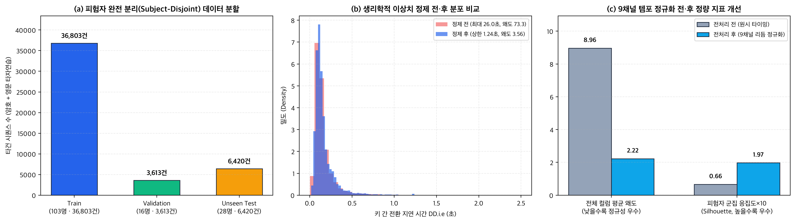

---

## 4. 모델

동일한 피험자 분할과 `35 Epochs` 학습 예산에서 고전 통계 모델, 일반 1D-CNN 베이스라인(기본형 및 동일 증강·`AS-Norm` 통제 변형), 제안 모델 `KeyPrintNet`(9채널·17채널)을 **모두 처음부터(`Scratch`) 직접 구현·학습**해 비교했습니다([`src/models.py`](src/models.py), [`src/train_and_evaluate.py`](src/train_and_evaluate.py)).

### 4.1 비교 모델 선정 이유 및 아키텍처 요약
- **베이스라인 선정 이유**
  1. **`ScaledManhattanDetector` (통계 기준선)**: CMU 벤치마크 원 논문(Killourhy & Maxion, 2009)에서 14종 이상치 탐지기 중 최상위권을 기록한 키스트로크 분야 대표 통계 모델입니다.
  2. **`Vanilla1DCNN` (딥러닝 기준선 및 통제 변형)**: 위치 인코딩·스펙트럼 풀링·각도 마진 손실 없이 순수 `Conv1D`와 전역 평균 풀링(`GAP`)만으로 학습했을 때의 기본 성적을 측정합니다. 여기에 **제안 모델과 똑같은 데이터 증강 및 `AS-Norm` 보정을 부여한 통제 변형**을 함께 평가해 아키텍처 자체의 순수 기여도를 분리했습니다.

| 구분 | 모델명 | 핵심 아키텍처 요약 | 학습 손실 · 보정 방식 | 가변 길이 지원 | 모델 크기 |
| :--- | :--- | :--- | :--- | :---: | :---: |
| **Baseline 1** | `ScaledManhattan` | 등록 평균 `μ_u` 및 경험적 베이즈 수축(`λ=0.35`) 절대편차 기반 맨해튼 거리 | Train 사전편차 적합 + 5-shot 등록 | 불가 (고정 길이) | 통계 파라미터 |
| **Baseline 2** | `Vanilla1DCNN`<br>*(기본 / 통제 변형)* | 3층 `Conv1D(32→64→64, k=3)` + `GAP` → `Linear(64)` + `L2` 정규화 | `Softmax Cross-Entropy` (`35 ep`, 통제형은 동일 증강·`AS-Norm` 적용) | 가능 (위치 소실) | `105 KiB`<br>(`24,704` 파라미터) |
| **Proposed**<br>*(최종 채택)* | **`KeyPrintNet`**<br>*(문장 17ch / 암호 9ch)* | 상대 위치 고조파 + 3층 다중 스케일 팽창 `SE-Conv1D(80ch)` + 이중 풀링(`ASP 160-D` + `6모드 DCT 144-D`) → `304→128→64-D L2` | 코퍼스 분리(`171` 클래스) `Sub-Center CosFace(K=2)` + `SupCon` + `AS-Norm` / 듀얼 결합 | **완전 지원**<br>(ONNX 동적 축) | 17ch **`599 KiB`**<br>9ch **`592 KiB`** |

### 4.2 제안 모델 `KeyPrintNet`의 4대 핵심 설계 근거
1. **연속 상대 위치 고조파 주입 (`Continuous Positional Harmonics`)**: 일반 `GAP`는 특징이 문장 앞·중간·끝 중 어디에서 발생했는지 잃어버립니다. 입력 길이에 무관하게 정규화된 상대 위치 `τ = (t + 0.5)/L`과 `cos(πτ), sin(πτ)`를 함께 주입해 초두·중반·종결부의 리듬 차이를 보존했습니다.
2. **병렬 다중 스케일 잔차 SE 블록 (`MultiScaleResSEBlock1D`)**: 인접 두 키의 물리 역학을 보는 국소 분기(`dilation=1`)와 3\~5타 호흡의 음절 리듬을 보는 광역 분기(`dilation=2`)를 병렬 결합하고, `Squeeze-and-Excitation` 채널 어텐션으로 식별력이 높은 파생·운지 채널을 강조합니다.
3. **주의집중 통계 풀링 + 스펙트럼 풀링 결합 (`ASP + 6-Mode 1D-DCT`)**: 채널별 가중 평균·표준편차(`160-D`)에 더해 `6모드` 이산 코사인 변환(`144-D`) 계수를 결합(`총 304-D`)하여, 입력 길이가 달라도(`L = 5`\~`44+`) 시작부터 끝까지의 완만한 속도 엔벨로프를 포착합니다.
4. **코퍼스 분리 `Sub-Center CosFace` + `AS-Norm` 코호트 보정**: 고정 암호와 자유 문장이 같은 분류 중심점을 공유하며 충돌하지 않도록 학습 헤드의 클래스 인덱스를 세 코퍼스별로 분리(`35 + 68 + 68 = 171` 클래스, `K=2` 서브센터)하고 마진을 `0 → 0.08`로 점진 확대했습니다. 추론 시에는 배경 코호트 대비 상대 점수를 구하는 `AS-Norm`과 듀얼 보정으로 유사 타속 사칭자 오수락을 억제합니다.

```text
[입력 시퀀스 X: (B, C, L), C = 17 또는 9] + [상대 위치 고조파: τ, cos(πτ), sin(πτ)]
                               │
                    [Stem Conv1D (C+3 → 80, k=3) + BN + GELU]
                               │
                    [3 × MultiScaleResSEBlock1D (80ch: dilation=1 ∥ dilation=2 + SE)]
                               │
         ┌─────────────────────┴─────────────────────┐
         ▼                                           ▼
  [Attentive Stats Pooling (μ, σ: 160-D)]    [SpecReduce (80→24) + 6-Mode 1D-DCT (144-D)]
         └─────────────────────┬─────────────────────┘
                               ▼
          [Concat (304-D) → Linear(128) + BN + GELU → Linear(64) + BN → 64-D L2 Norm]
                               │
             ┌─────────────────┴─────────────────┐
             ▼                                   ▼
    [1:1 암호 리듬 검증]                  [1:N 자유 문장 식별]
    9ch + 17ch 듀얼 표준화 점수           17ch AS-Norm + 행동 프로필 LLR
    + 암호 길이별 보정 · 대문자 습관      → 예상 1위 순위 및 오픈셋 수락·보류
```

### 4.3 왜 `64차원 단위 초구면(64-D Unit Hypersphere)` 임베딩을 선정했는가?

인코더 최종 출력을 유클리드 자유 공간이 아닌 **길이 `1`로 정규화된 64차원 단위 초구면**(`z ∈ ℝ^64, ‖z‖₂ = 1`)으로 설계한 이유는 다음과 같습니다.

1. **왜 '단위 초구면(`‖z‖₂ = 1`)'인가? — 크기 흔들림 제거 및 순수 리듬 방향 비교**
   - **오픈셋 각도 메트릭 러닝과의 정합성**: 학습 때 본 적 없는 신규 사용자를 즉시 등록·판별하려면 클래스 확률이 아닌 임베딩 간 기하학적 각도가 일관되어야 합니다. 모든 벡터를 구 표면에 올리면 문장 길이나 타건 강도에 따른 벡터 크기(Norm) 변동이 사라지고, `Sub-Center CosFace`와 `SupCon`이 학습한 **고유 리듬 방향**(코사인 각도)만으로 비교할 수 있습니다.
   - **대표 프로필(`L2 Centroid`) 수렴과 노이즈 상쇄**: `10자` 암호든 `68자` 문장이든 동일한 초구면 위의 점으로 사상되며, 등록 문장 5개를 평균 내어 다시 단위 길이로 정규화하면 특정 문장에서 잠깐 머뭇거린 일시적 노이즈가 상쇄됩니다.
   - **브라우저 초고속 내적 연산**: 두 단위 벡터의 코사인 유사도는 단순 내적(`u · v`)과 같아 제곱근·나눗셈 없이 `AS-Norm` 배경 비교와 `1:N` 순위 산출을 수 밀리초 안에 처리합니다.
2. **왜 하필 '`64차원(64-D)`'인가? — 과적합 억제 · 표현력 · 웹 경량화의 균형점**
   - **학습 규모(`Train 103명`) 대비 과적합 방지 병목**: 수십만 명을 학습하는 얼굴 인식(`512-D`)과 달리 키스트로크 학습 세트는 통합 `103명`(`35,559`건) 규모입니다. 내부 풀링 특징(`304-D`)을 고차원(`256`\~`512-D`)으로 그대로 내보내면 소수 학습자의 세션 노이즈나 특정 철자까지 암기하기 쉽고, 반대로 너무 작은 차원(`8`\~`16-D`)에서는 `342개`(`171 × 2`) 서브센터 간 각도 마진을 충분히 벌리기 어렵습니다. 이에 `304-D → 128-D → 64-D` 정보 병목(Bottleneck)을 두어 핵심 생체 리듬만 압축했습니다.
   - **클라이언트 로컬 추론 및 방 동기화 경량성**: 출력 헤드 크기를 줄여 ONNX 가중치를 **`592`\~`599 KiB`** (목표 `1 MiB` 이하)로 유지했고, 프로필 벡터 1개 크기도 `float32` 기준 **단 256 Bytes**에 불과해 `localStorage` 저장 및 다중 기기 방 동기화(MQTT) 패킷 부담이 거의 없습니다.
   - **공정한 베이스라인 통제 및 XAI 가독성**: `Vanilla1DCNN`과 `KeyPrintNet` 모두 `embed_dim=64`로 통일해 아키텍처 효과를 공정하게 비교했으며, 원리 탭에서 `64칸` 바코드로 한눈에 시각화하기에도 적합한 크기입니다 *(별도 차원 수 스윕으로 고른 값은 아니며 전 모델 공통 설계 상수로 고정함)*.

### 4.4 학습 설정 및 수렴 곡선 (`35 Epochs` 학습 로그)
- **공통 학습 예산**: 4개 신경망(`Vanilla` 기본·증강, `KeyPrintNet` 9ch·17ch) 모두 배치 크기 `256`, `AdamW` 옵티마이저로 동일하게 **`35 Epochs`** 학습했습니다(초기 학습률 `Vanilla 1.0e-3`, `KeyPrintNet 8.5e-4`).
- **수렴 결과**: `Validation` 최소 `EER` 기준 기본 `Vanilla1DCNN`은 `17.08%`에서 수렴한 반면, `KeyPrintNet 17채널`은 **`13.61%`** 수준까지 낮아졌습니다(전 에포크 손실·검증 로그는 `models/evaluation_report.json` 및 [검증 노트북](notebooks/keyprint_training_pipeline.ipynb)에 보존).

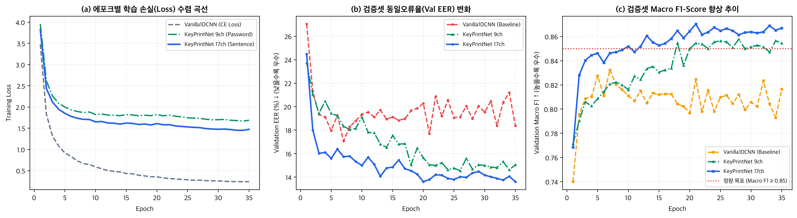

---

## 5. 평가 결과

<!-- evaluation:start -->

### 5.1 고정 암호 1:1 검증 (CMU Test 10명)

**평가 프로토콜**: 학습에 포함되지 않은 CMU Test 피험자 10명에서 1인당 5회 타건으로 등록 템플릿을 생성한 뒤, **타 세션 본인 입력 `1,800`건**, **동일 암호를 직접 타이핑한 실측 타인 입력 `1,600`건**, **합성 매크로 봇 입력 `200`건**을 비교했습니다. 모든 모델의 오수락률(`FAR`)과 본인 거부율(`FRR`)은 `Validation` 분할에서만 확정한 임계값을 그대로 적용해 측정했습니다.

| 모델 | Macro F1 ↑ | ROC-AUC ↑ | PR-AUC ↑ | EER ↓ | 인간 FAR ↓ | 합성 봇 FAR ↓ | 본인 FRR ↓ |
| --- | --- | --- | --- | --- | --- | --- | --- |
| Scaled Manhattan (통계 기준선) | 0.7703 | 0.8399 | 0.8595 | 23.75% | 20.31% | 12.00% | 26.50% |
| Vanilla 1D-CNN (기본) | 0.8174 | 0.9090 | 0.9061 | 18.06% | 15.25% | 3.00% | 22.56% |
| Vanilla + 증강 | 0.8308 | 0.9111 | 0.9129 | 16.94% | 19.94% | 0.50% | 16.06% |
| Vanilla + 증강 + AS-Norm | 0.8429 | 0.9256 | 0.9290 | 15.22% | 20.62% | 4.50% | 12.56% |
| KeyPrintNet 9채널 (타이밍) | 0.8578 | 0.9300 | 0.9264 | 14.33% | 14.81% | 1.00% | 15.17% |
| KeyPrintNet 17채널 | 0.8427 | 0.9201 | 0.9152 | 15.97% | 22.63% | 2.50% | 11.00% |

- **모델 간 비교 해석**: 고정 암호 단일 과업에서는 키 위치가 매번 동일하므로 순수 타이밍만 집중하는 **KeyPrintNet 9채널**이 가장 높은 성적(`Macro F1 0.8578`, `ROC-AUC 0.9300`, `EER 14.33%`)을 기록했습니다.
- **통제 베이스라인 대비 신뢰구간**: 자유 문장까지 함께 처리하는 `KeyPrintNet 17채널`(`Macro F1 0.8427`)과 동일 증강·`AS-Norm`을 적용한 통제 `Vanilla`(`0.8429`)의 차이를 피험자 10명 단위 부트스트랩으로 검정한 결과, 아래 표처럼 95% 신뢰구간이 모두 `0`을 포함해 고정 암호 단독 성능은 통계적으로 동등한 수준입니다.

| 지표 (17채널 − 통제 Vanilla) | 점추정 차이 | 95% 신뢰구간 |
| --- | --- | --- |
| ROC-AUC | -0.0055 | [-0.0287, +0.0235] |
| EER | +0.0075 | [-0.0275, +0.0347] |
| Macro F1 | -0.0002 | [-0.0257, +0.0322] |

> **참고 (전체 비교쌍 검산)**: 고정된 40개 등록 템플릿에 대해 가능한 모든 인간 비교 조합(본인 `14,000`건, 타인 `144,000`건 — 동일 피험자 반복 참여 포함)을 전수 계산한 결과도 별도 리포트에 수록했습니다. [전수 비교 및 20개 시드 민감도](models/trial_sensitivity.json)

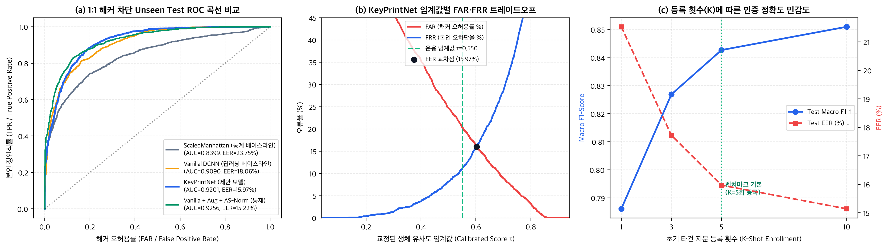

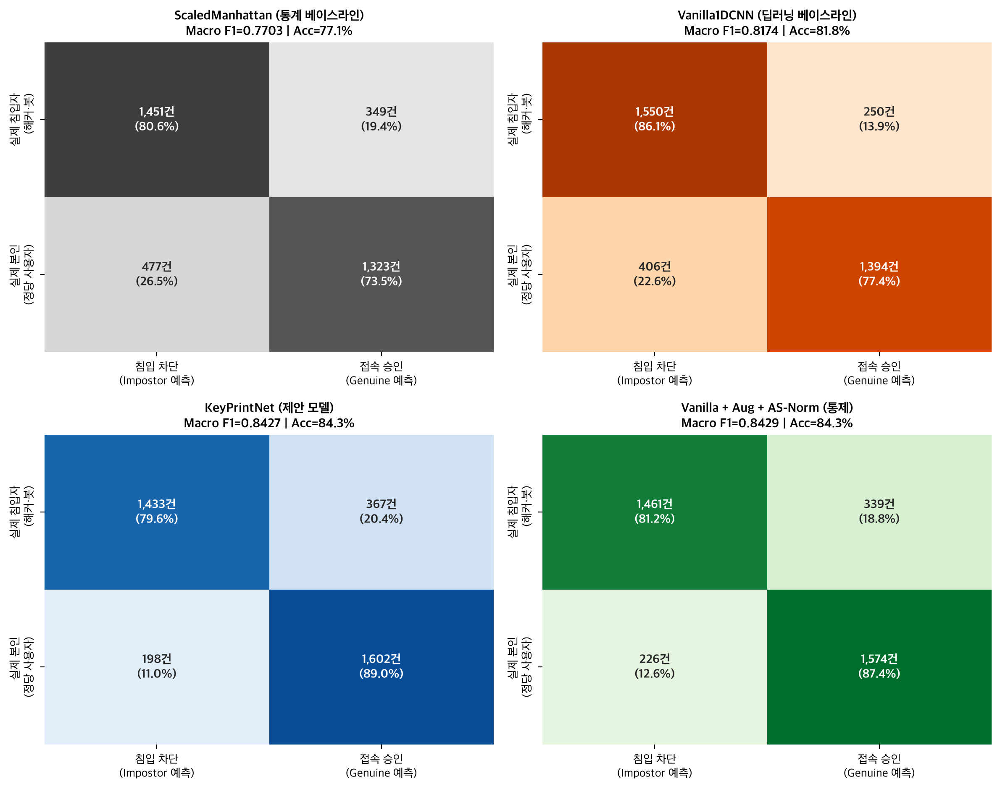

### 5.2 64차원 초구면 임베딩 군집 분포

CMU Test 피험자 10명의 타건(1인당 45개)과 합성 봇 입력 50개를 `64차원` 단위 초구면에 사상해 코사인 실루엣 계수와 2차원 `t-SNE` 분포를 비교했습니다. 제안 모델에서 동일 인물의 서로 다른 세션 타건이 한 군집으로 응집되고 합성 봇이 외곽으로 분리됨을 확인할 수 있습니다.

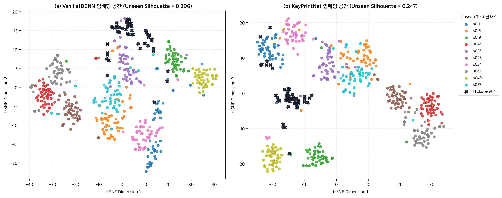

### 5.3 자유 문장 1:N 모델 선택 및 독립 Test 비교

**최종 문장 인코더 선정 근거 (`Validation` 기준)**: 자유 문장 식별 인코더는 Test 결과를 보지 않고 **Validation 10명의 영문 25자 교차 세션 Top-1 정확도**(후보당 질의 `551`건, 5문장 등록 + 각 모델의 Train 코호트 `AS-Norm` 동일 적용)로 선택했습니다. 그 결과 **KeyPrintNet 17채널**이 선정되었으며, 독립 Test 18명에서도 통제 베이스라인 대비 `Top-1`이 **+3.47%p**(`58.63%` vs `55.16%`) 앞섰습니다.

| 문장 인코더 후보 | Validation Top-1 | Test Top-1 ↑ | Test Top-3 ↑ | Test Macro F1 ↑ |
| --- | --- | --- | --- | --- |
| KeyPrintNet 17채널 | 68.97% | 58.63% | 88.18% | 0.5511 |
| Vanilla + 증강 + AS-Norm | 68.78% | 55.16% | 87.15% | 0.5189 |

**웹 배포 프로토콜(`68자`, 5문장 등록 · 2문장 질의) 오픈셋 검증**: 실제 웹 타자연습과 동일한 조건(등록자 5명 + 미등록 외부인 입력 포함)에서 두 후보의 행동 가중치와 수락 임계값을 공통 Validation 정답 수락률 목표(`49.87%`)에 맞춰 공정 비교했습니다. 채택된 **KeyPrintNet 17채널**은 등록자 오식별률 **`0.00%`**, 외부인 오수락률 **`0.10%`** 수준으로 훨씬 안전한 오픈셋 판별력을 보였습니다.

| 후보 모델 (68자 키보드 · 5인 등록) | Test 등록자 정답 수락률 ↑ | 등록자 오식별률 ↓ | 외부인 오수락률 ↓ |
| --- | --- | --- | --- |
| KeyPrintNet 17채널 | 35.68% | 0.00% | 0.10% |
| Vanilla + 증강 + AS-Norm | 30.53% | 0.14% | 0.57% |

최종 채택된 문장 모델의 입력 기기별 오픈셋 수락 규칙(1위 점수 하한 및 1·2위 점수 간격 동시 충족)과 Test 성적은 다음과 같습니다.

| 입력 환경 | 1위 점수 하한 | 1·2위 간격 하한 | 등록자 정답 수락률 | 외부인 오수락률 |
| --- | --- | --- | --- | --- |
| 물리 키보드 | 0.92 | 0.12 | 35.68% | 0.10% |
| 모바일 터치 모사 | 0.78 | 0.12 | 16.92% | 0.47% |

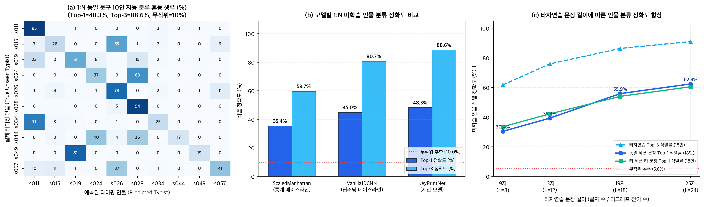

### 5.4 오류 사례 분석 및 세션 드리프트

CMU 인간 타건 검증에서 발생한 오류는 **본인 거부(`FRR`) 198건**, **타인 수락(`FAR`) 362건**이었습니다. 아래 표와 파형 그래프는 각 오류 유형 중 예측 점수가 가장 크게 빗나간 실제 Test 사례를 분석한 결과입니다(초기 세션 등록 후 숙련도 상승으로 타자 속도가 급변한 사례 및 평균 템포·롤오버 패턴이 우연히 겹친 사칭 사례).

| 오류 유형 | 대상 피험자 | 등록 세션 | 질의 샘플 행 | 예측 유사도 |
| --- | --- | --- | --- | --- |
| 최악 본인 거부 (False Reject) | s019 | 1 | 1107 | 0.1058 |
| 최악 타인 수락 (False Accept) | s024 | 5 | 2938 | 0.8585 |

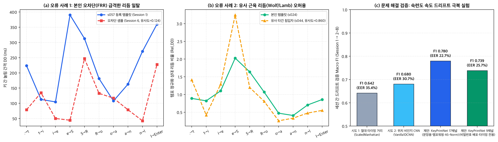

### 5.5 채널 확장(9ch → 17ch), 행동 프로필 및 터치 모사 절제 실험 (Ablation)

`KeyPrintNet` 9채널과 17채널에 동일한 데이터 분할, 학습 에포크(`35`), 템포 증강 및 **`18%` 터치 모사 증강**(누름 시간을 가리고 `Hold_Valid=0` 처리)을 적용해 각 요소의 기여도를 분리 측정했습니다(Test 18인 폐쇄형, 68자 문장 3개 등록 · 1개 질의 기준). 키 위치·운지 기하 정보를 추가한 `17채널`이 교차 세션 `Top-1`을 **`64.14% → 77.74%`** (`+13.60%p`) 끌어올렸으며, 모바일 터치 모사에서도 **`43.43% → 59.20%`** (`+15.77%p`)까지 큰 폭의 향상을 보였습니다.

| 입력 기기 | 비교 구성 | 동일 세션 Top-1 ↑ | 교차 세션 Top-1 ↑ | 교차 세션 Top-3 ↑ |
| --- | --- | --- | --- | --- |
| 물리 키보드 | 9채널 (순수 타이밍) | 73.35% | 64.14% | 88.87% |
| 물리 키보드 | 17채널 (+키 위치·유효성) | 82.29% | 77.74% | 96.29% |
| 물리 키보드 | 17채널 + 행동 프로필 | 84.79% | 79.44% | 96.91% |
| 물리 키보드 | 행동 프로필 단독 | 33.99% | 32.61% | 64.45% |
| 모바일 터치 모사 | 9채널 (순수 타이밍) | 48.12% | 43.43% | 74.50% |
| 모바일 터치 모사 | 17채널 (+키 위치·유효성) | 59.03% | 59.20% | 87.17% |
| 모바일 터치 모사 | 17채널 + 행동 프로필 | 59.93% | 58.89% | 85.01% |

**보조 검증 (KeyRecs 고정문 시간 열 해석 비교)**: §3.1에서 발견한 `KeyRecs` 고정문 CSV의 열 이름 뒤바뀜(`DD↔UU`, `DU↔UD`)이 학습에 미치는 영향을 확인하기 위해, 동일 조건(`17채널`, `35 Epochs`)에서 공개 열 이름 그대로 학습한 대조 모델을 별도로 훈련해 비교했습니다. 물리 관계식으로 보정한 학습이 검증 `EER`과 문장 `Top-3` 모두 소폭 우수함을 확인했습니다. [시간 열 검산 및 민감도 상세](models/timestamp_sensitivity.json)

| KeyRecs 고정문 학습 열 기준 | CMU Val Macro F1 | CMU Val EER ↓ | 25자 교차 세션 Val Top-1 | Val Top-3 |
| --- | --- | --- | --- | --- |
| 공개 열 이름 그대로 사용 | 0.8641 | 14.17% | 69.15% | 92.01% |
| Train 물리 관계식으로 보정 (채택) | 0.8670 | 13.61% | 68.97% | 93.47% |

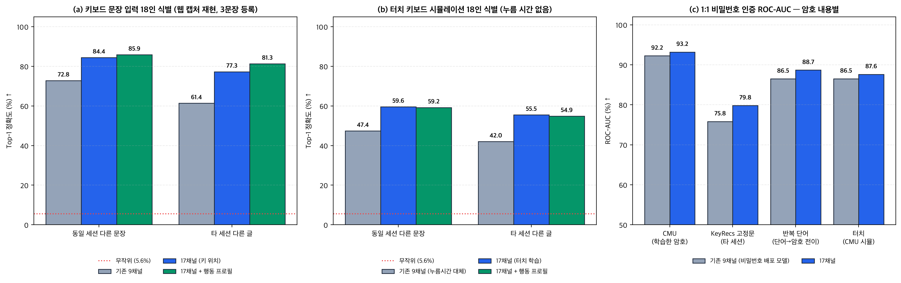

### 5.6 사용자 지정 암호 전이 평가 및 듀얼 인코더 보정

**왜 듀얼 인코더(`9채널 + 17채널`)를 결합했는가?**: 사용자가 직접 정한 임의의 암호 문자열에서는 단일 `9채널` 모델만 쓰면 키 위치 정보를 놓치고, `17채널` 모델만 쓰면 특정 암호 철자에 따른 배경 코호트 편향이 생길 수 있습니다. 이를 해결하기 위해 두 인코더의 점수를 타인 분포 기준으로 각각 표준화해 합산하는 **듀얼 보정**(`dualPasswordScore`)을 설계했습니다.

- **원시 이벤트 완전 분리 합성 검증**: 실제 자유 필사 로그의 디그래프를 조합해 Test용 단어형 암호 `30`종과 무작위 문자열 `30`종(총 `12,000`개 입력)을 구성했습니다. 동일 세션 본인 질의 `3,000`건 전수 검사 결과, 등록 템플릿과 원시 키 이벤트가 겹친 사례는 **`0`건**이었습니다(키보드 본인 비교 `6,000`건, 타인 비교 `31,676`건).

| 입력 환경 | 점수 산출 방식 | ROC-AUC ↑ | EER ↓ | 타인 수락률 (FAR) ↓ | 본인 거부율 (FRR) ↓ |
| --- | --- | --- | --- | --- | --- |
| 물리 키보드 | 9채널 단독 (AS-Norm) | 0.8361 | 23.73% | 36.06% | 15.02% |
| 물리 키보드 | 듀얼 인코더 결합 (9ch + 17ch) | 0.8782 | 20.06% | 37.63% | 8.55% |
| 모바일 터치 모사 | 9채널 단독 (AS-Norm) | 0.7383 | 32.42% | 64.20% | 11.37% |
| 모바일 터치 모사 | 듀얼 인코더 결합 (9ch + 17ch) | 0.7801 | 29.18% | 59.86% | 9.08% |

합성 암호가 아닌 **실제 연속 타이핑 데이터**(CMU, KeyRecs 고정문, 필사 중 자연 반복된 단어)에서도 동일한 듀얼 보정 규칙을 적용해 일반화 성능을 교차 확인했습니다(CMU 타인 비교에는 합성 봇 `200`건 포함). [비밀번호 보정 실험 전체](models/password_calibration.json)

| 실측 평가 시나리오 | 본인 / 타인 비교 건수 | 9채널 단독 AUC | 듀얼 결합 AUC ↑ | 듀얼 FAR / FRR |
| --- | --- | --- | --- | --- |
| CMU 고정 암호 | 1,800 / 1,800 | 0.9250 | 0.9193 | 30.28% / 4.94% |
| KeyRecs 고정 문자열 | 1,795 / 3,060 | 0.7275 | 0.7931 | 18.43% / 37.94% |
| 필사 내 반복 단어 (동일 세션) | 61 / 544 | 0.8729 | 0.9029 | 34.93% / 11.48% |
| 필사 내 반복 단어 (교차 세션) | 23 / 445 | 0.9247 | 0.9490 | 38.20% / 0.00% |

**템플릿 자동 적응(`Adaptation`)의 득실 비교**: 시간이 지나 타자 속도가 빨라질 때 발생하는 본인 거부(`FRR`)를 줄이기 위해, 검증 데이터 비용 합이 최소(`0.5511`)인 **`dual_adapt_margin_1`**(충분한 여유 점수로 통과한 본인 입력만 반영) 정책을 선택했습니다. 그 결과 2차 세션 말기 본인 거부율은 **`34.29% → 0.00%`** 수준으로 해소되었으나, 타인 수락률(`FAR`)이 `18.75% → 25.28%`로 함께 상승하는 트레이드오프가 확인되어 두 지표를 함께 보고합니다. [갱신 정책 전체 비교](models/evaluation_report.json)

| 키보드 템플릿 운영 정책 | Test 타인 수락률 (FAR) ↓ | 2차 세션 말기 본인 거부율 (FRR) ↓ |
| --- | --- | --- |
| 고정 템플릿 (갱신 없음) | 18.75% | 34.29% |
| 자동 적응 템플릿 (채택 정책) | 25.28% | 0.00% |

### 5.7 비밀번호 길이별 보정 및 대문자 입력 습관 결합

짧은 암호일수록 타이밍 전이 수가 적어 변별 정보량이 급감하므로, 웹 서비스의 **신규 암호 등록 최소 길이를 12자 이상**으로 제한했습니다(기본 탑재된 CMU 체험 샘플 4종만 원 데이터 규격인 `10자`·`9`전이 사용). 또한 Validation 10명에서 암호 길이(`8`·`10`·`12`·`14`·`16`·`20자`)별 점수 분포 기준표를 적합해 중간 길이를 선형 보간함으로써, 암호가 길어질 때 고정 임계값에서 오수락(`FAR`)이 치솟는 현상을 바로잡았습니다.

| 암호 길이 | 키보드 AUC ↑ | 고정 임계값 FAR / FRR | 길이별 보정 FAR / FRR (키보드) | 길이별 보정 FAR / FRR (터치) |
| --- | --- | --- | --- | --- |
| 8자 | 0.8808 | 34.46% / 10.62% | 35.50% / 10.08% | 57.42% / 10.55% |
| 12자 | 0.9259 | 40.72% / 3.62% | 22.50% / 8.30% | 50.63% / 7.54% |
| 16자 | 0.9504 | 48.55% / 1.08% | 15.35% / 10.03% | 33.28% / 9.52% |
| 20자 | 0.9657 | 51.62% / 0.16% | 15.26% / 4.26% | 35.29% / 5.35% |

- **대문자 입력 방식(`Shift` vs `CapsLock`) 결합 효과**: 물리 키보드에서 대문자를 `Shift`로 치는지 `CapsLock`으로 치는지의 개인 습관 우도비(`LLR`)를 `12자` 암호 검증에 결합하자, 본인 거부율 증가를 최소화(`8.72% → 9.14%`)하면서 **타인 수락률(`FAR`)을 `21.60% → 15.93%`로 크게 낮췄습니다**. [타건 스타일 분산 및 정보량 분석](models/typing_style_analysis.json)

<!-- evaluation:end -->

### 5.8 한국어 스마트폰 실측 타건 작성자 식별 (FACT 외부 검증)

영어 코퍼스로 학습한 인코더와 수락 기준이 한국어 타건에서도 작동하는지 확인하기 위해, 학습 및 임계값 선정에 전혀 사용하지 않은 [FACT 공개 부록](https://doi.org/10.1016/j.patcog.2020.107556)(Galaxy S8 스마트폰 한·영 타건, [수집·분할 원문 4장](https://dcollection.korea.ac.kr/srch/srchDetail/000000127101))을 동일 입력 파이프라인에 통과시켜 초기 배포본(`기존 공개본`, 단순 점수 하한)과 오픈셋 기준을 강화한 현재 버전(`PR #5`, 1·2위 점수 간격 추가)을 비교했습니다.

<!-- korean-results:start -->

참가자 50명을 5명씩 조로 나누고, 각 기록의 처음 76타(데모 한국어 문장의 두벌식 타수 중앙값)만 추출해 평가했습니다. 1인당 5개 기록으로 프로필을 등록한 뒤, 별도 시험 기록을 2개씩 묶은 250건에서 작성자를 판별했습니다. 또한 작성자가 속하지 않은 다른 5명 후보 조와 비교해 미등록 외부인 오수락률도 250건에서 함께 측정했습니다.

| 5인 후보 기준 지표 | 기존 공개본 (간격 0점) | 현재 배포본 (PR #5, 간격 12점) |
| --- | --- | --- |
| 작성자가 1위 (보류 전 순위) | 70.8% (177건) | 74.8% (187건) |
| 작성자로 최종 수락 | 70.4% (176건) | 7.6% (19건) |
| 다른 등록자로 오수락 | 29.2% (73건) | 0.0% (0건) |
| 미등록 가능성으로 판정 보류 | 0.4% (1건) | 92.4% (231건) |
| 미등록 외부인을 등록자로 오수락 | 87.6% (219건) | 13.2% (33건) |

- **순위 정확도 비교**: 수락·보류 기준을 적용하기 전 실제 작성자가 1위에 오른 비율은 `70.8% → 74.8%`(`+4.0%p`)였으며, 참가자 단위 부트스트랩 95% 신뢰구간은 `-2.8%p`\~`+10.8%p`로 순위 자체의 유의미한 변화로 단정하기는 어렵습니다.
- **오수락 차단과 보류 증가의 원리**: 기존 공개본은 1위 점수 `73점`만 넘으면 수락(1·2위 간격 조건 `0점`)해 미등록 외부인의 `87.6%`를 등록자로 잘못 수락했습니다. 반면 현재 배포본(`PR #5`)은 **1위 점수 `78점` 이상 + 2위와의 격차 `12점` 이상**을 동시에 요구하여 타인 오식별을 **`0.0%`**, 외부인 오수락을 **`13.2%`** 수준으로 대폭 줄였습니다(보류된 `231`건 중 `230`건은 1위 점수는 넘었으나 1·2위 격차 기준에서 보류됨).

- **후보 인원 및 입력 길이 변화**: 비교 후보를 50명 전원으로 늘리면 1위 정답률은 기존 `25.2%`, 현재 `26.8%`로 낮아지며 오픈셋 판정은 `250/250`건 모두 보류했습니다. 반대로 5명 후보에서 평균 약 `235타`인 원본 기록 전체를 넣으면 1위 정답률이 기존 `84.0%`, 현재 `85.6%`까지 상승했습니다.

<!-- korean-results:end -->

> **해석 시 유의사항**: 본 실험은 스마트폰 터치 간격(`DD`)만 사용하고 홀드 시간은 터치 대체값(`88 ms`, `Hold_Valid=0`)으로 처리한 결과입니다. 원 자료에 입력 날짜가 공개되지 않았으므로, 이 수치를 PC 물리 키보드 한글 입력 성능이나 개인별 절대 정답 확률로 직접 일반화할 수는 없습니다([집계 JSON](models/korean_fact_ab.json) · [재현 스크립트](src/eval_korean_fact.py)).

### 5.9 한국어 당일 답안 순위 평가 및 수락·보류 분리 설계 (AI Hub 외부 검증)

<!-- korean-ranking:start -->

AI Hub 중학생 국어 서술형 답안(평가용 `VS` 분할 `46`명)에서도 같은 날 먼저 작성한 5문항(문항당 첫 `40타`)으로 등록하고, 이후 작성한 2문항을 묶어 가능한 모든 5인 후보 조합의 평균 성적을 측정했습니다(FACT는 언어별 50명, 고정 5인 조 250건 비교).

| 데이터셋 (5인 후보 기준 Top-1) | 현재 배포 점수 (AS-Norm) | 코호트 보정 생략 (순수 코사인) | 한국어 순위 가중치 추가 학습 |
| --- | --- | --- | --- |
| AI Hub 국어 답안 (46명) | 58.61% | 60.30% | 62.05% |
| FACT 한국어 (50명) | 74.80% | 78.40% | 78.00% |
| FACT 영어 (50명) | 72.00% | 75.20% | 72.00% |

- **오픈셋 수락률과 UI 분리 근거**: AI Hub `VS`에서 배포 점수의 1위 정답률은 **`58.61%`**(무작위 기준 `20%`의 약 2.9배)였으나, 미등록자 차단 기준을 적용하면 정답 수락 `12.75%`, 판정 보류 `86.65%`, 미등록자 오수락 `12.70%`였습니다.
- **보조 순위 가중치 실험 결론**: 인코더를 고정한 채 AI Hub 학습 분할(`333명`)로 7개 점수 특징의 순위 가중치를 학습했을 때 `VS` Top-1 변화는 `+3.44%p`(학생 단위 95% 구간 `-3.10%p`\~`+9.72%p`)로 일관된 유의성이 확인되지 않아, 웹 데모는 기존 배포 점수를 유지하되 **예상 작성자 1위 이름**과 **오픈셋 수락·보류 판정**을 분리해 함께 표시하도록 설계했습니다. [한국어 연구 기록 및 전체 집계](research/korean-typing/README.md)

<!-- korean-ranking:end -->

### 5.10 교차 기기 6종 직접 실측 · 물리 일관 홀드 보정 · 암호 코호트 보정

학습된 두 인코더(`17채널`·`9채널`) 가중치를 동결한 상태에서 **① 사용자 지정 암호 및 데모 고정 암호의 사칭 분포 편향**, **② 물리 스위치 변경 시 홀드 시간 이동($\Delta h$)**, **③ 실제 스마트폰 터치 및 `DeviceMotion` 가속도·자이로 센서 활용성**을 오프라인 벤치마크와 6종 입력 환경 직접 타이핑(`총 213건`)으로 후속 검증했습니다([상세 프로토콜·수식·전체 표](research/cross-device-and-calibration/README.md) · [오프라인 검증 JSON](models/calibration_and_cross_device_study.json)).

1. **사전 오프라인 정량 검증 (`Test` 미관측 18명 × 미관측 문자열 64종)**
   - **사용자 지정 암호 문자열별 경량 코호트 보정 ([`src/string_calibration.py`](src/string_calibration.py) · `20.6 KiB`)**: `Train` 68명 자유 타건의 388개 디그래프 통계표와 길이 직교 7차원 문자열 구조 특징(연속 반복·동일 손가락·양손 교차 비율 등)으로 문자열별 기대 타인 점수 잔차 $(\Delta\mu, \Delta\ln\sigma)$ 를 추정하고 관측 지지율에 따라 기존 길이별 보정으로 자동 수축합니다. 스마트폰 터치 `L ≥ 12`(`29,922`회)에서 **`FRR @ FAR=5%` `60.21% → 58.05%` (`-2.16%p`**, 95% 군집 부트스트랩 CI `[-3.27%p, -1.00%p]`), 문자열 간 `FAR` 표준편차 **`-15.4%`**, 최악 문자열 `FAR` **`82.08% → 74.79%` (`-7.29%p`)** 를 달성했으며, 물리 키보드는 `Validation`에서 $\gamma=0.0$으로 자동 수축되어 회귀를 원천 차단했습니다.
   - **물리 일관성(`UD' = DD − H'_{curr}`) 스위치 홀드 보정**: 스위치 변경 편차 $\Delta h = +35\text{ ms}$ 조건에서 단순 `H` 이동(`31.46%`)이 남기는 `UD` 물리 모순을 해소해 문장 오픈셋 수락률을 원래 수준(**`35.68%`**, 무보정 `19.29%`)으로 복원했습니다.
   - **스마트폰 행동 가중치 검증**: `Val FAR ≤ 2%` 제약 아래 최적값이 현재 배포값 **$\beta^* = 0.20$** 과 일치함을 확인했습니다(`Test` 외부인 오수락 `0.47%` 억제, 본인 수락률 `5.62% → 16.92%` `3.0배` 향상).

2. **6종 입력 환경 직접 타이핑 실측 (`P01` · `기계식 넌클릭 · 기계식 리니어 · 무접점 정전용량 · 외장 팬터그래프 · 노트북 내장 팬터그래프 · iOS/Android 스마트폰` · 총 `213`건)**
   - 로컬 Wi-Fi 다기기 실측 허브([`web/scripts/serve_field_study.mjs`](web/scripts/serve_field_study.mjs))와 브라우저 평가 모듈([`web/src/evalStudy.js`](web/src/evalStudy.js), `?eval=1` 활성화 · 비공개 암호 `74`건 원문/키쌍 자동 마스킹 위반 `0건`)로 **등록 `19`건 · 문장 판별 `53`건 · 암호 검증 `141`건 · 모션 센서 `14`건**을 수집·분석했습니다([`src/analyze_field_study.py`](src/analyze_field_study.py); 외장 팬터그래프 시작 직후 드롭다운 오선택 `3`건은 실제 하드웨어 라벨 `pantograph_external`로 보정 기록).

| 검증 항목 | 실측 표본 및 조건 | 핵심 정량 결과 |
| :--- | :--- | :--- |
| **자유 문장 판별 (`Arena`)** | 라벨링 `49`건 (미지정 `4`건 별도, 한·영 통합) | 전 기기 **1위 정답률 `100.0%` (`49/49`)** · 전체 수락 **`63.3%`** · 동일 기기(`n=35`) **`68.6%`** (`외장 팬터그래프 100%`, `무접점 80.0%`, `넌클릭 71.4%`, `터치 56.2%`) · 교차 스위치(`n=14`) `50.0% →` **물리 일관 홀드 보정 시 `57.1%`** |
| **5종 스위치 실측 홀드 서열** | 동일 맥북(`5.0 µs`) · 동일 두벌식 배열 5종 키보드 | `넌클릭 69.39 ms` < `노트북 내장 76.69 ms` (`+7.30 ms`) < `리니어 82.52 ms` (`+13.13 ms`) < `외장 팬터그래프 89.01 ms` (`+19.62 ms`) < **`무접점 91.36 ms` (`+21.97 ms`)** |
| **암호 침입 방어 (`Guard`)** | 총 `141`건 (본인 `67` · 샘플 침입 `74`) | 전체 **`ROC-AUC = 0.9260`** (샘플 보정 후 **`0.9980`**), 본인 수락 **`95.5%`** (`64/67`, 동일 기기 `32/32 = 100.0%` · 교차 기기 `91.4%`) · 물리 키보드(`n=115`) **`ROC-AUC = 0.9727`, `FRR @ FAR=10% = 9.3%`** · 교차 스위치(`n=22`) 홀드 보정 시 본인 수락 **`95.5% → 100.0%`** |
| **고정 샘플(`.tie5Roanl`) 보정** | 실측 타인 침입 `74`건 (`5`종 키보드 `61` + 터치 `13`) | 미숙련 `S1` 등록·일반 10자 보정 시 `FAR = 35.1%`(`현우` `82.6%`) → **숙련 `S7→S8` 전환 + `Val` 고정암호 전용 보정(`sample_fixed`) + `엄격`(`+0.20`) 적용 후 지정 프로필 `FAR = 0.0%` (`0/74`)**, 4인 전수 비교(`296`회) **`표준 2.0%` · `엄격 0.0%`** (본인 `S8` 쿼리 `4/4` 통과) |
| **스마트폰 암호 문자열 보정** | 터치 암호 `26`건 (본인 `13` · 타인 `13`, 자동 `ON`) | 동일 `FAR`(`30.8%`)에서 본인 거부율(`FRR`) **`23.1% → 15.4%` (`-7.7%p`)**, `FRR @ FAR=5%` **`23.1% → 15.4%`** (지연 중앙값 `0.0 ms`) |
| **모바일 터치 행동 가중치 $\beta$** | 터치 문장 라벨링 `16`건 (`iOS` · `Android`) | $\beta = 0.00$ 수락 `37.5%` → 배포값 $\beta = 0.20$ **`56.2%` (`+18.8%p`)** → 실측 최적 $\beta^* = 0.25$ **`62.5%`** (전 구간 1위 `100.0%`) |
| **`DeviceMotion` 자세 게이팅 융합** | `Android` 6건(`59.9 Hz`) + `iOS` 8건(`58.8 Hz`) | 중력 경사각·각속도 기반 **선언 자세 일치율 `100.0%` (`14/14`)** · 동일 자세(`손 파지→손 파지`) 평균 점수 `0.8488 → 0.8685` 상승(`100%` 수락), 교차 자세(`손 파지→책상 거치`) 단순 결합 시 오거부 악화(`25% → 0%`)를 **`posture_gated` 설계로 무손실 보존(`25%`)** |

---

## 6. 서비스 프로토타입

별도 백엔드 추론 서버 없이 브라우저 내부에서 문장용 `17채널`(`599 KiB`)과 비밀번호용 `9채널`(`592 KiB`) ONNX 인코더를 직접 로드해 추론합니다. ([웹 소스코드](web) · [정식 배포 데모](https://qwertypotter6873.github.io/keyprint-guard/) · [PR #5 미리보기](https://keyprint-guard-pr5.bookend-dev.chatgpt.site/))

**빠른 체험 순서**
1. **타자연습 인물 식별 (`Arena` 탭)**: **한국어·영어 샘플로 체험**을 누르면 현재 선택한 언어의 사전 등록 실측 샘플 4명(한국어 FACT 4명 · 영어 KeyRecs 4명)과 즉시 비교할 수 있습니다. 직접 비교하려면 같은 언어로 2명 이상이 각 5문장을 등록한 뒤, 한 사람이 안내되는 새 문장 2개를 타이핑하면 **예상 작성자 1위 이름**과 미등록자 가능성을 반영한 **수락 / 보류** 판정이 함께 표시됩니다.
2. **암호 리듬 비교 (`Guard` 탭)**: 기본 탑재된 숙련 세션(`S7`) 샘플 4명의 고정 암호(`.tie5Roanl`)에 침입 방어를 바로 시험하거나, **+ 새 암호 프로필 등록**에서 이름과 `12자 이상` 시연용 암호를 정해 4회 입력한 뒤 본인과 타인이 민감도(`여유 40%` · `표준 50%` · `엄격 70%`)별로 **시연 기준 통과 / 확인 보류** 결과를 비교합니다.
3. **판정 근거 탐색 (`원리` 탭)**: 방금 입력한 타건의 피아노롤 파형, `64차원` 바코드 수렴 과정, `2D` 주성분 지도를 직접 확인합니다(여러 기기 동시 비교는 우측 상단 방 공유에서 연결 가능).

### 6.1 주요 기능 및 화면 워크플로우

#### ① 타자연습 인물 자동 식별 (`1:N` — 자유 문장 · 백스페이스 자동 복원)
- **128개 한·영 문장 풀**: 한국어 64개·영어 64개 연습 문장을 언어별로 제공하며, 새로고침 후에도 진행 순서를 이어가고 64개를 모두 소진하면 다시 섞습니다([`web/src/sentences.js`](web/src/sentences.js)).
- **백스페이스 자유 수정**: 오타를 지우더라도 입력을 초기화하지 않고, 삭제된 키 전이만 도려낸 뒤 전후 정상 리듬 구간을 봉합(`Local_Accel = 0` 리셋)해 자연스러운 타이핑에서 생체 지문을 추출합니다.
- **데스크톱·모바일 통합 및 본인 확인 적응**: 스마트폰 소프트 키보드(한글 조합 포함)에서도 등록·판별이 가능하며, 기기 전환 안내와 행동 프로필 반영폭(`±%p`)을 함께 표시합니다. 추가 연습 시에는 1:1 본인 확인 기준을 통과한 문장만 최근 `12개` 슬라이딩 템플릿에 반영합니다.
- **순위와 오픈셋 수락의 명확한 분리**: 등록자끼리의 대결에서는 **예상 작성자 1위**를 바로 확인하고, 미등록 외부인 가능성까지 따지는 오픈셋 판정은 키보드 `92점`·터치 `78점` 이상이면서 2위보다 `12점` 이상 앞설 때만 **수락**으로 확정합니다.

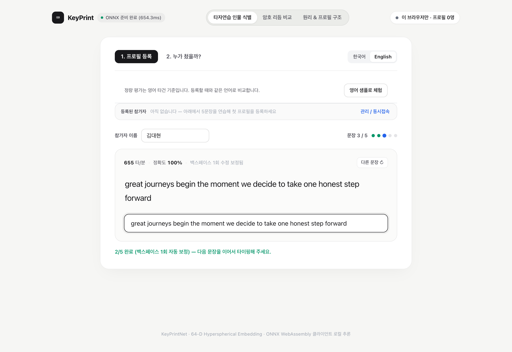

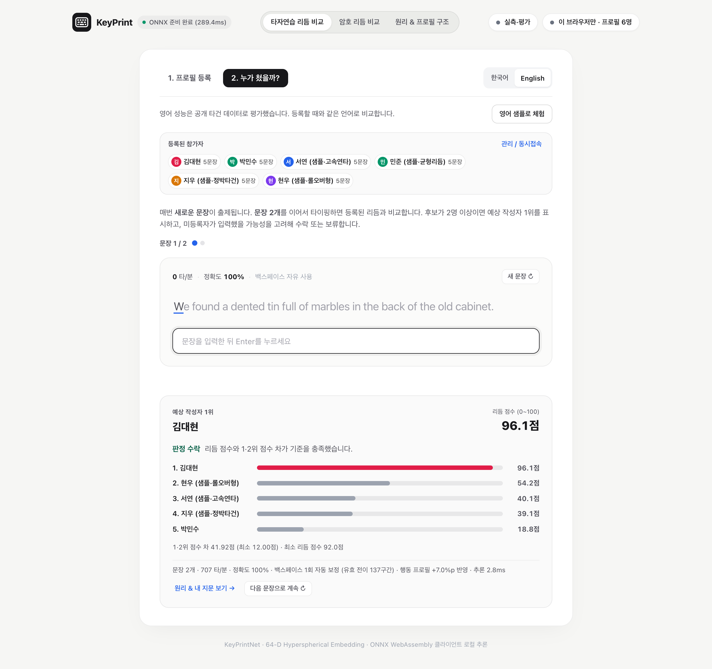

#### ② 유출 암호 침입 차단 (`1:1` — 듀얼 인코더 보정)
- **보호 계정 등록 (`12자 이상`) 및 덮어쓰기 차단**: 시연용 암호(`12자 이상`)를 4회 타이핑해 리듬 템플릿을 생성하며, 이미 등록된 이름이나 기본 샘플 이름으로는 무인증 재등록(덮어쓰기)을 차단합니다.
- **듀얼 인코더 및 문자열·고정샘플·습관 결합 판정**: `9채널` 타이밍 인코더와 `17채널` 기하 인코더의 점수를 암호 길이별 사칭 분포(스마트폰 터치 입력 시 문자열별 경량 코호트 보정 [`web/src/stringCalibration.js`](web/src/stringCalibration.js) 자동 결합, 기본 샘플 `.tie5Roanl`은 `Validation` 숙련 세션 전용 분포 `sample_fixed` 적용)로 표준화해 합산하고, 물리 키보드의 대문자 입력 습관(`Shift` vs `CapsLock`) 및 선택적 스위치 홀드 보정을 결합해 민감도(`여유 40%` · `표준 50%` · `엄격 70%`)에 따른 최종 일치도를 산출합니다.
- **시연 관찰 한계 투명 고지**: 아래 두 화면은 동일 암호에 대해 본인이 통과하고 타인이 차단된 실제 캡처이며, 타속이 매우 비슷한 사칭자가 통과하는 한계 사례(기능 시험 중 타인 3건 수락 관찰)와 정량 오류율은 §5.6\~5.7에 숨김없이 함께 보고했습니다.

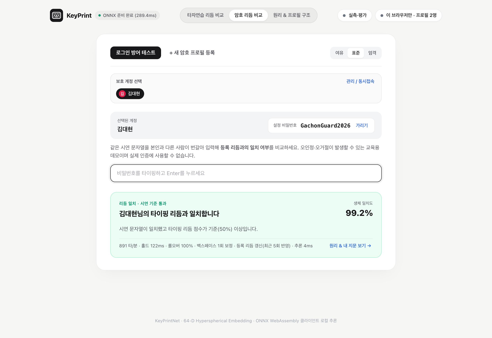

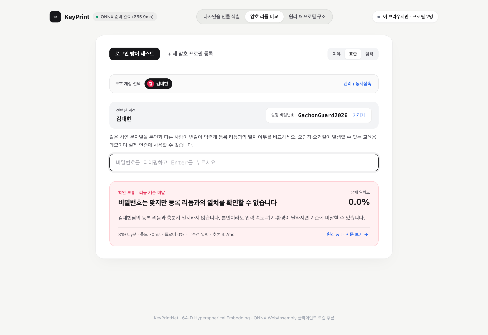

#### ③ 원리 & 프로필 구조 인터랙티브 시각화 (`Signal-to-Profile XAI Explorer`)
- **Step 1 — 타건 파형 해부 & 속도 불변성 (`Piano-Roll`)**: 각 키의 누름·해제 구간을 피아노롤 타임라인으로 펼쳐 **연타 롤오버(`UD < 0`)**, **백스페이스 봉합 지점(`✂`)**, 빠르게 쳐도 유지되는 상대 박자(`Rel_DD`)를 실시간 샌드박스로 보여줍니다.
- **Step 2 — `64차원` 바코드 수렴 및 안정도 (`Barcode-to-Centroid`)**: 서로 다른 문장(`#1`\~`#5`)에서 추출된 `64차원` 바코드가 초구면 중심점(`L2 Centroid`)으로 모이며 글자 배열 노이즈가 상쇄되는 과정과 **평균 쌍별 코사인 안정도**를 시각화합니다.
- **Step 3 — 실시간 참가자 `64차원` 초구면 생체 지문 지도 (`2D 주성분 투영`)**:
  - **사람이 보기 쉽게 압축한 2D 그림자**: 실제 생체 지문은 사람이 눈으로 볼 수 없는 `64차원` 초구면 공간에 존재하므로, 화면에는 참가자 간 분산이 가장 큰 상위 두 축(`PC1`, `PC2`)만 뽑아 `2차원` 평면에 선형 투영(`PCA`)해 보여줍니다.
  - **지도에서 원이 겹쳐 보여도 실제로는 구분되는 이유**: ① `64개` 차원 중 `2개` 축만 그린 그림자이기 때문에 나머지 **`62개` 차원(`PC3`\~`PC64`)에서 벌어져 있는 각도 차이**는 화면에서 생략되어 겹쳐 보일 수 있으며, 실제 `1:1`·`1:N` 판정은 이 2D 그림이 아닌 **원본 `64차원` 벡터 전체의 코사인 유사도와 `AS-Norm` 보정**으로 계산됩니다. ② 또한 각 프로필 주변의 반투명 점선 원은 실제 분류 경계선이 아니라 같은 사람의 개별 문장 샘플(`○`)을 묶어 보여주는 시각적 가이드(`24`\~`68px`)이며, 투영 왜곡을 막기 위해 점(`●`, `○`) 좌표를 인위적으로 밀어내지 않고 이름표만 안 겹치게 비켜 배치하므로 원끼리 자연스럽게 포개질 수 있습니다.

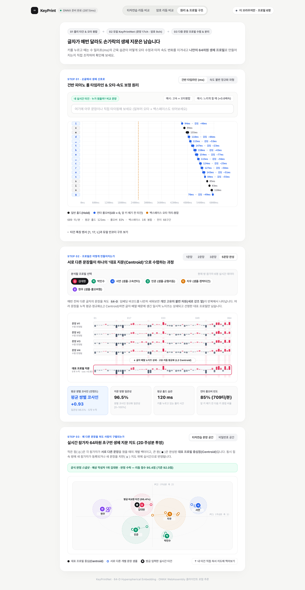

### 6.2 다중 기기 방 동기화(`Room Sync`) 및 잘못된 입력 예외 처리

첫 방문 시 모든 데이터는 기기 내부(`로컬 모드`)에만 머무릅니다. 여러 기기가 함께 비교하기 위해 **방 공유**에 동의하면 참가자 이름·임베딩·시연용 암호가 브로커를 통해 동기화되므로 **실제 개인 비밀번호는 절대 입력하지 않도록** 화면에 반복 안내합니다.

| 예외 입력 및 경계 상황 | 시스템 방어 및 처리 방식 |
| :--- | :--- |
| **오타 수정(`Backspace`) 및 긴 멈춤** | 오염된 경계 전이만 제외하고 앞뒤 정상 타이핑 리듬 구간을 봉합해 보존합니다. |
| **복사·붙여넣기 및 자동완성** | 붙여넣기 이벤트를 차단하고, 일괄 문자열 치환은 유효 타건 측정에서 자동 배제합니다. |
| **너무 짧은 입력 · 암호 불일치** | 문장은 유효 전이 `8개` 이상, 암호는 `4개` 이상(신규 암호 `12자 이상`) 조건 미달 시 즉시 안내합니다. |
| **추론 중 연타 제출** | 진행 중 중복 제출을 잠그며, 방 변경·언어 전환 시 이전 비동기 추론 결과를 자동 폐기합니다. |
| **구버전·비호환 모델 프로필 유입** | 스키마(`v4`), 전처리 버전, ONNX 해시가 일치하지 않는 외부 프로필은 비교 대상에서 격리합니다. |

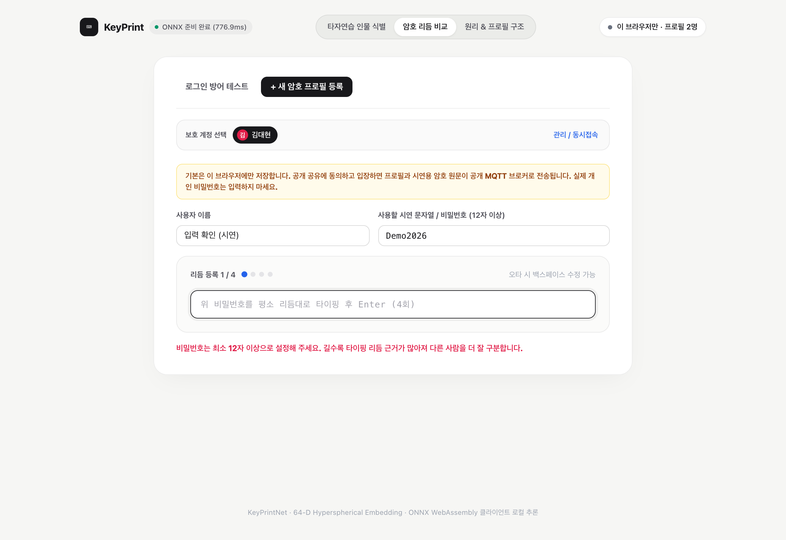

---

## 7. 배포

- **정식 공개 URL (`GitHub Pages`)**: [https://qwertypotter6873.github.io/keyprint-guard/](https://qwertypotter6873.github.io/keyprint-guard/) (`main` 브랜치 병합 시 GitHub Actions가 자동 빌드·검증·배포)
- **PR #5 리뷰용 미리보기 URL**: [https://keyprint-guard-pr5.bookend-dev.chatgpt.site/](https://keyprint-guard-pr5.bookend-dev.chatgpt.site/) ([배포 커밋·ONNX 체크섬 확인](https://keyprint-guard-pr5.bookend-dev.chatgpt.site/build-info.json))
- **공개 GitHub 저장소**: [https://github.com/qwertypotter6873/keyprint-guard](https://github.com/qwertypotter6873/keyprint-guard)

### 7.1 Zero-Server 브라우저 로컬 추론 아키텍처 채택 이유
1. **원시 타건 프라이버시 및 무서버 운영**: 학습한 두 모델을 `ONNX (Opset 17)`로 변환해 브라우저 `ONNX Runtime Web`(단일 스레드 `WASM SIMD`)에서 실행하므로, 별도 GPU/CPU 추론 서버 비용 없이 정적 호스팅만으로 상시 운영됩니다.
2. **초저지연 실시간 응답**: 네트워크 왕복 지연 없이 기기 내부에서 `1.5`\~`5 ms` 수준으로 임베딩을 추출하며, 매 판정마다 실측 추론 시간을 화면에 투명하게 표시합니다.
3. **자동화된 배포 무결성 검증**: GitHub Actions([`.github/workflows/deploy.yml`](.github/workflows/deploy.yml))가 빌드 단계에서 포트폴리오 지표 정합성(`refresh_portfolio.py --check`), Python↔JS 수치 일치성(`8,147개`), 실제 헤드리스 브라우저 ONNX 추론 및 배포본 SHA-256 대조를 모두 통과해야만 페이지를 갱신합니다.

### 7.2 보안 시스템으로 쓸 때 고려할 점 (현재는 시연용)

본 웹 앱은 행동 생체인식 원리와 다중 사용자 비교를 직관적으로 체험하기 위한 **교육·시연용 프로토타입**입니다. 실제 상용 인증에 도입하려면 아래 보안 통제가 추가되어야 합니다.

1. **반복 시도 제한(Rate Limiting)**: 시연용 화면은 횟수 제한 없이 리듬 비교를 허용하므로, 실서비스에서는 서버 기반 연속 실패 잠금 정책이 필수입니다.
2. **실패 응답 정보 최소화**: 교육용 화면은 정밀 일치도(`%`), 개인별 순위, 문자열 불일치 여부를 구분해 보여주지만 운영 인증에서는 공격자에게 힌트가 되지 않도록 통합 실패 응답으로 숨겨야 합니다.
3. **템플릿 자동 갱신 오염 방지**: 자동 적응은 장기 본인 거부율을 크게 줄이지만 정교한 사칭 통과 시 템플릿이 오염될 위험이 있으므로 보수적 게이트와 감사 로그가 필요합니다.
4. **서버 측 최종 검증 및 암호 해시 저장**: 브라우저 로컬 판정은 UI 조작으로 우회할 수 있고 공개 MQTT 브로커는 클라이언트 소유권 인증을 수행하지 않으므로, 실제 접근 권한 부여는 서버 측 ONNX 검증 API와 비밀번호 해시 저장소를 통해 이루어져야 합니다.

---

## 8. 실행 방법

### 8.1 실행 환경 및 학습 가중치 위치
- **실행 환경**: `Python 3.12`(`3.10+` 호환, `CUDA / Apple MPS / CPU` 자동 선택), `Node.js 22+`, `Chrome / Chromium` 브라우저, 패키지 명세 [`requirements.txt`](requirements.txt) 및 [`web/package.json`](web/package.json).
- **학습 완료 가중치 위치**
  - **문장용 17채널 `KeyPrintNet` (최종 채택)**: [`models/keyprint_net.pt`](models/keyprint_net.pt) · [`models/keyprint_net.onnx`](models/keyprint_net.onnx) · 웹 배포본 [`web/public/models/keyprint_net.onnx`](web/public/models/keyprint_net.onnx) (`599 KiB`)
  - **비밀번호용 9채널 `KeyPrintNet` (최종 채택)**: [`models/legacy/keyprint_net_9ch.pt`](models/legacy/keyprint_net_9ch.pt) · [`models/legacy/keyprint_net_9ch.onnx`](models/legacy/keyprint_net_9ch.onnx) · 웹 배포본 [`web/public/models/keyprint_net_password.onnx`](web/public/models/keyprint_net_password.onnx) (`592 KiB`)
  - **딥러닝 베이스라인 (`Vanilla1DCNN` 기본 / 증강)**: [`models/vanilla_1dcnn.pt`](models/vanilla_1dcnn.pt) · [`models/vanilla_1dcnn_aug.pt`](models/vanilla_1dcnn_aug.pt)
  - **웹 서빙 설정 및 코호트 통계**: [`web/public/models/model_config.json`](web/public/models/model_config.json) · 문자열별 암호 보정표 [`web/public/models/string_cohort_calibration.json`](web/public/models/string_cohort_calibration.json) (`20.6 KiB`)

```text
keyprint-guard/
├── README.md                                  # 메인 머신러닝 포트폴리오 문서
├── 포트폴리오_201935607_김대현.pdf              # 제출용 포트폴리오 PDF (README와 동일 내용)
├── submission.json                            # 자동 채점 제출 메타데이터
├── requirements.txt                           # Python 의존성 명세
├── data/
│   ├── raw/                                   # CMU · KeyRecs 원시 CSV 및 FACT 한국어 샘플 4인 픽스처
│   └── processed/scaler_and_metadata.json     # Train 적합 클리핑 경계·스케일러·분할 메타데이터
├── src/
│   ├── preprocessing.py, keyboard_layout.py   # 원시 UD 보존 클리핑, 무손실 파서, 두벌식·물리 키 좌표
│   ├── capture_sim.py, behavior_profile.py    # 브라우저 녹화기 Python 복제본 및 행동 프로필 LLR
│   ├── models.py, train_and_evaluate.py       # 베이스라인·KeyPrintNet 모델 및 35-Epoch 학습·평가
│   ├── feature_eval.py, password_synth.py     # 68자 웹 프로토콜 검증 및 원시 이벤트 분리 암호 합성
│   ├── string_calibration.py                  # 사용자 지정 암호 문자열별 경량 코호트 보정 및 물리 일관 홀드 보정
│   ├── eval_calibration_and_cross_device.py   # 문자열 보정 · 스위치 홀드 보정 · 모바일 β 오프라인 검증
│   ├── analyze_field_study.py                 # 다기기 실측 JSONL 병합 · 홀드 재채점 · DeviceMotion 분석기
│   ├── visualize_and_run.py                   # 통합 학습·평가 실행, 8종 그래프 및 ONNX 내보내기
│   ├── eval_password_calibration.py, eval_typing_style.py, eval_korean_fact.py
│   ├── eval_timestamp_sensitivity.py, eval_trial_sensitivity.py
│   └── refresh_portfolio.py, build_notebook.py, package_submission.py
├── research/
│   ├── korean-typing/                         # 한국어 타건(AI Hub · FACT) 외부 검증 코드 및 집계
│   └── cross-device-and-calibration/          # 6종 기기 교차 실측(`213`건) · 홀드/터치/암호 보정 리포트
├── notebooks/keyprint_training_pipeline.ipynb # 전 셀 실행 출력이 보존된 공식 검증 노트북
├── models/                                    # .pt / .onnx 가중치 및 평가 리포트 JSON 7종
├── assets/ (figures/ 8종, screenshots/ 6종)    # 분석 그래프 및 웹 프로토타입 캡처
└── web/                                       # Vite + ONNX Runtime Web 프런트엔드, 다기기 실측 허브 및 회귀 테스트
```

### 8.2 머신러닝 파이프라인 재현 (전처리 · 학습 · 평가 · 노트북 · 패키징)

```bash
# 1. 가상환경 생성 및 의존성 설치 (Windows PowerShell은 .venv\Scripts\Activate.ps1)
python3 -m venv .venv
source .venv/bin/activate
pip install -r requirements.txt

# 2. 전처리 + 전 모델 처음부터 학습 + 8종 분석 그래프 & ONNX 내보내기
#    (저장된 가중치로 평가만 빠르게 재현하려면 앞에 KEYPRINT_REUSE_WEIGHTS=1 추가)
python src/visualize_and_run.py

# 3. 보조 평가 실행 및 포트폴리오·검증 노트북 갱신
python src/eval_password_calibration.py
python src/eval_typing_style.py
python src/train_timestamp_control.py
python src/eval_timestamp_sensitivity.py
python src/eval_trial_sensitivity.py
npm ci --prefix web
python src/eval_korean_fact.py > models/korean_fact_ab.json
python src/refresh_portfolio.py
python src/build_notebook.py --execute

# 4. 단위 테스트, A4 PDF 렌더링 및 4단계 클린룸 검증 ZIP 생성
python -m unittest discover -s tests -v
(cd web && npm ci && node scripts/render_readme_pdf.mjs)
python src/package_submission.py
```

### 8.3 웹 프로토타입 로컬 실행 및 E2E 검증

```bash
cd web
npm ci

# 로컬 개발 서버 실행 (다기기 실측 및 스마트폰 HTTPS 모션 센서 연동 시: npm run field-study)
npm run dev

# Python↔JS 수치 일치성(8,147개 항목), 프로덕션 빌드 및 브라우저 회귀 테스트
node scripts/parity_check.mjs
npm run build
node scripts/functional_state.mjs
node scripts/functional_browser.mjs
node scripts/eval_study_e2e.mjs
node scripts/offline_smoke.mjs
node scripts/adversarial_regression.mjs
```

---

## 9. Lessons Learned

### 9.1 PMI 회고 (Plus · Minus · Interesting)
- **Plus (좋았던 점)**
  1. **증강·후처리를 분리한 엄격한 통제 비교**: `Vanilla1DCNN`에도 동일한 증강과 `AS-Norm`을 적용해 비교한 덕분에, 고정 암호에서는 통제 베이스라인과 대등하지만 자유 문장 교차 세션 식별(`Top-1 +3.47%p`)과 오픈셋 오수락 억제에서 `KeyPrintNet` 구조가 실질적 우위를 보인다는 점을 명확히 검증했습니다(§5.1·§5.3).
  2. **학습(Python)↔서빙(JS) 수치 완전 일치 검증**: 전처리·봉합·특징 추출·홀드/문자열/고정샘플 보정 수식을 양쪽에 동일하게 구현해 `8,147개` 자동 대조 항목을 통과시켰고, 가변 길이 5개 조건에서 PyTorch와 ONNX 출력 차이를 `4.85 × 10⁻⁷` 미만으로 맞췄습니다.
  3. **판정 스냅샷과 직결된 3단계 설명가능성(XAI)**: 단순 승인·차단 표시에 그치지 않고 피아노롤 파형, `64차원` 바코드 중심점 수렴, 무왜곡 `2D PCA` 지도를 연동해 생체 인식 원리를 직관적으로 전달했습니다.
- **Minus (아쉬웠던 점)**
  1. **짧은 비밀번호의 본질적 정보량 한계**: 96명 타이밍 분산 분해 결과 전체 타속을 제외한 순수 개인 리듬 비중이 눌림 간격 `14.8%`·홀드 `10.4%` 수준이어서, 전이 수가 적은 짧은 암호에서는 비슷한 속도의 사칭자를 완벽히 걸러내기 어려웠고 신규 등록 하한을 `12자 이상`으로 두어야 했습니다.
  2. **키보드 하드웨어 변경에 따른 잠재적 편차**: 기본 학습 코퍼스가 참가자별 단일 기기에서 수집되어 기기 변경 시 절대 홀드 시간(`H_curr`)이 이동할 수 있으며, §5.10에서 단일 참가자 6종 입력 환경 파일럿(`213`건, 5종 스위치 간 최대 `+21.97 ms` 홀드 편차 확인)으로 물리 일관 홀드 보정 효과를 입증했으나 다수 피험자 규모의 교차 기기 코퍼스 확장이 추가로 필요합니다.
  3. **모바일·한국어 오픈셋 수락률의 보수성**: 홀드와 물리 키 좌표가 빠지는 스마트폰 환경에서는 외부인 오수락을 막기 위해 `1·2위 점수 간격(12점)` 조건을 두자 실제 작성자도 상당수 `보류`로 분류되는 한계가 확인되었습니다(§5.8\~5.9).
- **Interesting (흥미로웠던 발견)**
  1. **같은 문장을 쳐도 극명하게 갈리는 무의식적 롤오버 습관**: 동일한 문구를 입력해도 어떤 참가자(`p003`)는 전체 전이 중 **`48%` 구간**에서 앞 키를 떼기 전 다음 키를 겹쳐 누른(`UD < 0`) 반면, 다른 참가자(`p023`)는 **단 `1%` 구간**만 겹쳐 누르는 뚜렷한 신경근육 차이가 관찰되었습니다.
  2. **글 내용이 완전히 바뀌어도 유지되는 교차 세션 리듬**: 세션마다 전혀 다른 문학 지문을 필사했음에도 `25자` 짧은 구간만으로 18명 중 `58.63%`(`68자` 3문장 기준 `77.74%`) 정확도로 작성자를 찾아낼 수 있었습니다.
  3. **미세 타이밍보다 강력했던 대문자 입력 습관** (`Shift` vs `CapsLock`): 대문자 1타의 미세 지연 시간은 매번 흔들렸지만, 대문자를 `Shift`로 치는지 `CapsLock`으로 치는지는 교차 세션 재현율이 **`98.95%`** 수준에 달해 `12자` 암호 사칭 수락률을 `21.60% → 15.93%`로 낮추는 핵심 단서가 되었습니다.

### 9.2 핵심 문제 해결 사례 (`문제 → 원인 → 시도 → 결과`)

#### [사례 1] 세션 숙련도 향상에 따른 본인 오거부(`FRR`) 급증 해결
- **문제**: CMU 첫 세션 타건으로 등록한 사용자가 후반 세션에서 본인임에도 침입자로 거부되는 현상이 발생했습니다.
- **원인**: 반복 입력으로 전체 타자 속도가 빨라지면 모든 구간의 절대 지연(`H, DD, UD`)이 일제히 줄어 초기 템플릿과 거리가 멀어지기 때문이었습니다.
- **시도**: 상대 리듬 파생 채널(`Rel_H`, `Rel_DD`), 탄성 템포 워핑 증강, `AS-Norm` 보정을 단계별로 적용하고, 암호 검증에서는 고신뢰 본인 입력만 반영하는 템플릿 자동 갱신(`dual_adapt_margin_1`)을 검증했습니다.
- **결과**: 전체 파이프라인 결합 시 고정 암호 본인 거부율을 낮췄으며, 2차 세션 말기 본인 거부율을 고정 템플릿 `34.29%`에서 자동 적응 적용 후 **`0.00%`** 수준으로 해소했습니다(동시에 상승하는 타인 수락률 `18.75% → 25.28%` 트레이드오프도 §5.6에 정량화).

#### [사례 2] 고정 암호(`L=10`)와 자유 문장(`L=24`) 통합 학습 시 프로토타입 충돌 해결
- **문제**: 고정 암호와 매번 철자가 바뀌는 자유 문장을 단일 분류 헤드로 동시 학습하자 초기 손실이 진동하며 수렴이 불안정해졌습니다.
- **원인**: 고정 암호는 특정 상대 위치 `τ`에 항상 같은 철자가 오지만 자유 문장은 매번 다른 철자가 오므로, 하나의 클래스 중심점에 묶으면 상반된 그래디언트가 백본을 흔들기 때문이었습니다.
- **시도**: 합성곱·풀링 백본 가중치는 공유하되, 학습 전용 `SubCenterCosFaceHead`의 클래스 인덱스를 세 코퍼스별로 분리(`35 + 68 + 68 = 171` 클래스, `K=2`)하고 마진을 `0 → 0.08`로 20에포크에 걸쳐 선형 증가시켰습니다.
- **결과**: `35 Epochs` 동안 안정적으로 수렴하여 최소 검증 `EER`을 `9채널 14.54%`, `17채널 13.61%`까지 낮췄습니다.

#### [사례 3] 정적 웹 배포(`GitHub Pages`)의 WASM 경로 오류 및 한글 IME 누락 해결
- **문제**: 프로덕션 빌드 후 하위 경로에서 WASM 파일 `404` 오류가 발생했고, Chrome 한글 입력 중 `e.key`가 `'Process'`로 전달되어 자모 타건이 누락되었습니다.
- **원인**: 번들 스크립트 기준 상대 경로가 어긋났고, 한글 조합 중에는 음절 확정 전까지 논리 문자 대신 조합 상태 코드만 발생하기 때문이었습니다.
- **시도**: `window.location.href` 기준 동적 WASM 경로 해석과 자동 복사 스크립트를 구성하고, 물리 스캔 코드(`KeyA`\~`KeyZ`) 기반 두벌식 자모 매핑 및 조합 중 `Enter` `15 ms` 지연 처리를 구현했습니다.
- **결과**: GitHub Pages 하위 경로와 로컬 환경 모두에서 한글·영문 타건 캡처 및 ONNX 추론이 무오류로 동작함을 브라우저 자동 테스트로 검증했습니다.

#### [사례 4] `Backspace` 오타 수정 시 문장 폐기 및 봉합 홀드 밀림 버그 해결
- **문제**: 초기에 `Backspace` 1회만 눌러도 문장 전체를 무효화하자 실제 `68자` 자연 필사 `1,206`건 중 **`80.3%`** (`968`건)가 폐기되었고, 단순 봉합 시 끊긴 다음 구간 첫 키 홀드에 이전 구간 끝 키 홀드가 잘못 매핑되는 결함을 발견했습니다.
- **원인**: 오타 수정 지점의 단일 전이만 인지 지연으로 오염될 뿐 앞뒤 정상 디그래프는 유효함에도 통째로 버렸고, 봉합 루프가 끊김 없는 단일 체인만 가정했기 때문이었습니다.
- **시도**: 오타 타건 `pop` 후 채택된 각 전이마다 `(hCurr[t], hNext[t])`를 개별 기록하고 접합점에 `stitchFlags[t] = true`(`Local_Accel = 0`)를 부여하는 `Clean-Digraph Stitching`을 구현했습니다.
- **결과**: 오타 포함 `968`건을 폐기 없이 모두 살려내면서 18인 식별 `Top-1` 정확도를 무보정 `81.71%`에서 **`82.54%`** 수준으로 개선했습니다.

#### [사례 5] 스마트폰 소프트 키보드에서 유효 전이 부족으로 등록이 막히던 문제 해결
- **문제**: 모바일 화면 키보드로 문장을 끝까지 쳐도 유효 전이가 `8개` 미만이라는 경고와 함께 등록이 불가능했습니다.
- **원인**: 모바일 소프트 키보드는 물리 `KeyboardEvent.code`가 비어 있고 `keydown` 직후 즉시 `keyup`이 발생해 물리 키 전용 녹화기에서 전이가 `0개`로 처리되었기 때문이었습니다.
- **시도**: `input` 이벤트 문자열 차분(한글 음절 자모 분해 포함)으로 타건 시각을 복원하고, 결측 홀드 중앙값 대체(`88 ms`) + `Hold_Valid = 0` 마스킹과 학습 시 `18%` 터치 모사 증강을 결합했습니다.
- **결과**: 모바일 에뮬레이션 E2E 등록·판별을 모두 통과했으며, `68자` 터치 모사 교차 세션 `Top-1`을 `9채널` (`43.43%`) 대비 `17채널`에서 **`59.20%`** 수준으로 끌어올렸습니다.

#### [사례 6] iOS·Safari 한글 조합 이벤트가 가짜 백스페이스로 오인되던 문제 해결
- **문제**: 백스페이스를 한 번도 누르지 않고 한글을 쳤는데 `백스페이스 N회 자동 보정`이 찍히며 유효 리듬 구간이 깨지는 현상이 발생했습니다.
- **원인**: 모바일·Safari 한글 입력기는 글자가 조합될 때마다 내부적으로 `삭제 → 재입력`(`ㅇ → 아`, 종성 연음 `간 + ㅏ → 가나`) 이벤트를 발생시켜 즉시 삭제 감지 로직이 이를 오타 수정으로 착각했기 때문이었습니다.
- **시도**: 물리 백스페이스 키 없이 일어난 삭제는 `30 ms` 대기 창에서 직후 입력과 병합해 순수 자모 증감만 반영하도록 [`web/src/recorder.js`](web/src/recorder.js)를 재설계하고, 실시간 피아노롤은 버퍼를 건드리지 않는 비파괴 조회(`peek`)로 분리했습니다.
- **결과**: iOS·Safari 한글 조합 재현 테스트에서 가짜 백스페이스 **`0회`**, 유효 리듬 구간 **`11/11` 전량 복원**을 달성했습니다.

#### [사례 7] 한국어 모바일 환경에서 예상 1위 표시와 오픈셋 수락·보류의 UI 분리
- **문제**: 한국어 FACT 시험 `250`건 중 `187`건(`74.8%`)에서 실제 작성자가 1위에 올랐으나, 미등록 외부인 차단 기준을 그대로 적용하자 최종 수락 건수가 `19`건(`7.6%`)에 그쳐 사용자 입장에서 모델이 전혀 작동하지 않는 것처럼 보였습니다.
- **원인**: 터치 입력에서는 홀드·키 위치 정보가 빠져 1위와 2위 점수 간격이 좁게 형성되는데, 간격 하한(`0.12` → `0.08`)을 낮추면 AI Hub 검증에서 정답 수락(`12.75% → 19.05%`)과 함께 미등록자 오수락(`12.70% → 20.86%`)도 급증하는 구조적 상충이 있었기 때문이었습니다.
- **시도**: 13개 간격 조건과 순위 가중치 학습 실험을 수행해 임계값 완화만으로는 두 오류를 동시에 줄일 수 없음을 정량 확인한 뒤, UI에서 **등록 후보 중 예상 1위 안내**와 **오픈셋 수락·보류 보안 판정**을 두 줄로 분리했습니다([상세 실험](research/korean-typing/README.md)).
- **결과**: 미등록 외부인 오수락 억제는 그대로 유지하면서도, 등록된 참가자끼리 체험할 때는 `58`\~`75%` 수준의 1위 리듬 매칭 결과를 직관적으로 확인할 수 있게 개선했습니다.

### 9.3 향후 개선 계획 (데이터 · 모델 · 서비스)
1. **[데이터 측면] 다수 참가자·다일간 교차 기기 코퍼스 확장 및 무지도 스위치 적응**: §5.10에서 구축한 6종 입력 환경 실측 파이프라인(`213`건 파일럿: 5종 물리 스위치 홀드 서열·물리 일관 홀드 보정 및 `iOS`·`Android` 자세 게이팅 `DeviceMotion` 융합 검증 완료)을 바탕으로, `20명 이상` 다수 피험자와 다일(Multi-day) 세션으로 표본을 확대하고 사용자 선언 없이 타건 초기 수 타만으로 스위치 편차($\Delta h$)를 자동 추정하는 무지도 온라인 적응으로 확장할 계획입니다.
2. **[모델 측면] 문자열별 코호트 보정의 비두벌식 한글 자판 및 다중 모달 확장**: §5.10에서 `388개` 디그래프 요약표 기반 경량 문자열별 코호트 보정기(`20.6 KiB`, 스마트폰 터치 `FRR @ FAR=5%` `-2.16%p` 유의 개선)를 구현·검증한 데 이어, 천지인·나랏글 등 비두벌식 모바일 자판 전용 전이 기하 피처와 자세별 멀티 프로토타입 템플릿을 결합할 계획입니다.
3. **[서비스·보안 측면] 오염 방지 게이트 · 시도 제한 및 서버 측 검증 API 전환**: [§7.2](#72-보안-시스템으로-쓸-때-고려할-점-현재는-시연용)에서 정리한 시연용 한계를 해소하기 위해 ① 직전 실패 이력 시 템플릿 갱신을 멈추는 오염 방지 게이트, ② 서버 기반 연속 실패 잠금 및 실패 응답 단순화, ③ 비밀번호 해시 저장 + 서버 측 ONNX 검증 API를 갖춘 실제 인증 플러그인으로 발전시킬 계획입니다.
