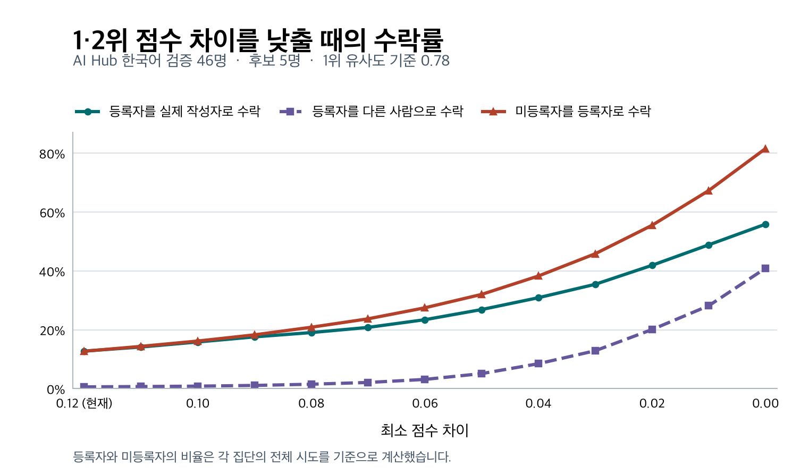

# 한국어 타건 연구 기록

영문 코퍼스로 학습한 `KeyPrintNet` 인코더가 **한국어 타자연습**(`KeyPrint Arena`)에서도 작성자를 구별할 수 있는지 두 가지 측면에서 검증했습니다.
1. **순위 식별 능력 (`Closed-Set Top-1`)**: 실제 작성자가 등록 후보 5명 안에 있을 때 **1위로 찾아내는 비율**
2. **오픈셋 판정 능력 (`Open-Set Accept / Reject`)**: 미등록 외부인이 입력했을 가능성까지 고려해 **정당 작성자만 수락하고 외부인은 보류·차단하는 비율**

비교 대상은 초기 공개 스냅샷(`main`, 커밋 `4afdaa2`, 1위 점수 하한 `0.73` · 간격 조건 `0.00`)과 오픈셋 격차 기준을 추가한 현재 배포 버전(`PR #5`, 커밋 `b999ecc`, 1위 점수 하한 `0.78` · 1·2위 최소 간격 `0.12`)입니다. ([두 버전 코드 비교](https://github.com/qwertypotter6873/keyprint-guard/compare/4afdaa2...b999ecc))

> **핵심 요약**
> - **AI Hub 당일 국어 답안(`VS` 46명, 5인 후보)**: 현재 버전(`PR #5`)의 1위 정답률은 **`58.61%`**(무작위 `20%` 대비 약 2.9배)였으며, 오픈셋 기준 적용 시 정답 수락 `12.75%`, 다른 등록자 오인식 **`0.60%`**, 미등록 외부인 오수락 **`12.70%`**(기존 `72.47%`에서 대폭 감소)를 기록했습니다.
> - **수락 간격의 트레이드오프**: 1·2위 점수 간격 하한을 낮추면 실제 작성자 수락률이 올라가지만 미등록 외부인 오수락률도 함께 급증했습니다. 별도 순위 가중치 학습 실험 역시 데이터셋마다 개선 폭이 일관되지 않아, 데모는 **예상 작성자 1위 이름**과 **오픈셋 판정**(수락·보류)을 화면에 분리 표시하도록 결정했습니다. ([AI Hub 집계](results.json) · [간격 비교](margin-sweep.json) · [순위 실험](ranking-pilot.json))

---

## 1. 실제 타건 자료 탐색

완성된 한글 문장이나 분당 타수(WPM) 요약치만으로는 키 누름 사이의 미세 간격(`DD`)을 복원할 수 없습니다. 동일 인물의 **등록 5개 · 질의 2개** 구성을 만들려면 ① 개별 키 이벤트 시각, ② 입력 순서 또는 날짜, ③ 문항·지문 식별자가 모두 필요했습니다. 공개 및 승인 자료 5종을 검토한 결과, 실측 타건 시각이 보존된 **AI Hub 71518**과 **FACT** 두 자료를 평가에 채택했습니다.

| 검토 후보 자료 | 확인한 데이터 구조 및 채택·제외 사유 |
| :--- | :--- |
| **AI Hub 71518** *(채택)* | 국어·수학 학습 문제 풀이 중 수집된 스마트기기 센서 자료입니다. 국어 키보드 로그에 가명 학생 ID, 문항 ID, 밀리초 단위 이벤트 시각이 모두 포함되어 당일 등록·질의 평가에 사용했습니다. ([데이터 설명](https://www.aihub.or.kr/aihubdata/data/view.do?currMenu=115&dataSetSn=71518&topMenu=100)) |
| **FACT** *(채택)* | 동일 피험자 50명이 Galaxy S8 스마트폰에서 한국어와 영어를 모두 입력한 연구 부록입니다. 실제 누름 간격으로 한·영 성능을 직접 대조했으나, 지문 ID와 날짜가 비공개여서 날짜 간 변화 분석에는 쓰지 않았습니다. ([논문](https://doi.org/10.1016/j.patcog.2020.107556) · [수집·분할, 학위논문 4장](https://dcollection.korea.ac.kr/srch/srchDetail/000000127101)) |
| **AI Hub 71560** *(제외)* | PC·스마트폰 한글 맞춤법 오류 교정 자료이나, 공개 스키마에 키별 타건 시각이 없어 제외했습니다. ([데이터 설명](https://www.aihub.or.kr/aihubdata/data/view.do?currMenu=115&dataSetSn=71560&topMenu=100)) |
| **Korean-MESSENGER** *(제외)* | PC 두벌식 대화 문장 2,700개를 제공하지만 공개 파일에 개인별 키스트로크 시계열이 포함되지 않아 제외했습니다. ([HCI Korea 논문](https://www.dbpia.co.kr/journal/articleDetail?nodeId=NODE12131607) · [저자 저장소](https://github.com/munjkim/Korean-MESSENGER)) |
| **TypeRacer 한국어** *(제외)* | 공개 경주의 WPM 요약과 달리 키별 시각을 담은 `keylog`는 유료 등급 및 인증이 필요해 대량 수집을 진행하지 않았습니다(공식 문서·응답 코드 `HTTP 401/404/504` 범위까지만 확인). ([한국어 경주](https://play.typeracer.com/?universe=lang_ko) · [요금제](https://data.typeracer.com/pit/upgrade_account) · [Keylogs 문서](https://developers.typeracer.com/keylogs.html) · [한국어 문장 목록](https://data.typeracer.com/pit/texts?q=&type=&language=korean) · [RaceResult 형식](https://developers.typeracer.com/entities/RaceResult.html) · [제3자 통계](https://www.typeracerdata.com/universes) · [기본 URL](https://developers.typeracer.com/getting_started.html) · [인증](https://developers.typeracer.com/authentication.html) · [결과 경로](https://developers.typeracer.com/endpoints/texts/get_text_race_results.html)) |

---

## 2. AI Hub 자료 확인과 중복 제거

한국지능정보사회진흥원(NIA) AI Hub의 `71518` 데이터셋을 이용 승인 후 로컬에서 분석했습니다. 원본 재배포는 허용되지 않으므로 공개 저장소에는 재현 스크립트와 익명 집계치만 수록했습니다([AI Hub 이용정책](https://www.aihub.or.kr/intrcn/guid/usagepolicy.do?currMenu=151&topMenu=105)).

분석 전 원시 이벤트 열 `(시각, 이벤트 종류, 키)`의 완전 일치 여부를 전수 감사하여, 서로 다른 학생 ID에 중복 적재된 로그를 모두 제거했습니다.

| 감사 항목 | 확인 및 정제 결과 |
| :--- | :--- |
| **국어 키보드 원본 규모** | `TS`(학습 분할) `8,572건 · 786명`, `VS`(검증 분할) `1,105건 · 79명` → 합계 **`9,677건 · 865명`** (분할 간 학생 ID 교집합 `0명`) |
| **완전 동일 이벤트 중복 발견** | **총 `59개` 그룹 · `319건` 로그**의 키 이벤트가 100% 동일했으며, 모두 2개 이상의 학생 ID에 걸쳐 중복됨 (`37개` 그룹은 `TS` `150건`·`VS` `57건`으로 분할 간 교차 중복) |
| **중복 그룹 전량 제거** | 임의로 1건을 남기면 실제 작성자를 특정할 수 없으므로 **`319건` 전량 제외** → 정제 후 **`9,358건 · 849명`** 확보 |
| **정제 후 날짜 및 길이 분포** | 중복 제거 후 서로 다른 날짜에 기록이 남은 학생이 `32명 → 0명`이 되어 **당일 평가로 범위 확정**. 기본 응답 타수 중앙값은 `52타 → 51타`(`76타` 이상 7문항 보유 학생은 `135명 → 125명`) |

점수 계산 대상인 기본 응답(`STAGE_BASE`)과 전처리 후 `DD` 시퀀스에서도 추가 중복은 `0건`이었습니다. ([중복 감사 집계](aihub-71518-audit.json) · [평가 입력 감사](results.json))

---

## 3. 입력과 평가 설계

- **실측 타이밍 추출 (`40타` 주 평가 · `76타` 보조 비교)**: 각 국어 답안에서 출력 문자·공백 기준 처음 `40타`(절반 이상 한글)를 추출했고, 데모 한국어 문장 중앙값인 `76타` 조건도 별도 비교했습니다. 인접 눌림 간격(`DD`)이 `6`\~`2,200 ms`인 전이만 유지하고 제어 키(삭제·전환·제출)나 범위 밖 지연에서는 구간을 끊어 봉합했습니다(기록당 최소 유효 전이 `8개`, 중앙값 `35개`). 홀드·키 좌표·편집 통계는 쓰지 않고 각 버전의 터치 대체값을 입력했습니다.
- **시간순 당일 등록·질의 분리**: 같은 날 작성한 서로 다른 7개 문항 중 시간순 앞 `5개`로 등록하고, 뒤 `2개`를 묶어 1회 질의로 평가했습니다(`40타` 기준 마지막 등록과 첫 질의 사이 간격 중앙값은 `TS 2.86분`, `VS 2.91분`). 학생 1명은 각 조건에 정확히 1회만 기여합니다.
- **문항 완전 분리 대조 실험**: 주 평가에서도 개인 내 등록·질의 문항은 겹치지 않으나, 학생 간에는 같은 문항이 다른 역할로 쓰일 수 있었습니다(`TS 11개`, `VS 7개`). 문항 효과까지 완전히 배제하기 위해 `문항 번호 3의 배수`만 질의로 고정한 보조 평가도 함께 수행했습니다.
- **타수 길이에 따른 표본 수 변화**: `40타` 조건은 `TS 333명 · VS 46명`이 충족했으나, `76타` 조건은 서술형 답안 길이 한계로 `TS 51명 · VS 4명`만 남아 `VS`에서 5인 미등록 비교 조를 구성할 수 없었습니다.
- **후보 조합 평균 및 95% 신뢰구간**: AI Hub에서는 특정 조 편성 운을 배제하기 위해 가능한 **모든 5인 등록 후보 조합**(작성자 포함 조 / 작성자 제외 외부인 조)을 전수 평가한 뒤 학생 단위로 동일 가중 평균했습니다. 버전 간 차이의 95% 신뢰구간은 학생 단위 짝지은 부트스트랩(`AI Hub 5,000회`, `FACT 2,000회`)으로 산출했습니다. ([AI Hub 프로토콜·지표](results.json) · [FACT 재현 기록](../../models/korean_fact_ab.json))

---

## 4. 기존 공개본(`main`)과 현재 배포본(`PR #5`) 비교

### 4.1 AI Hub 당일 국어 답안 결과

주 평가 대상인 `VS 46명`은 모델 학습 및 임계값 선정 과정에 한 번도 사용되지 않은 독립 표본입니다.

| 평가 조건 | 버전 | 1위 정답 | 정답 수락 | 등록자 오인식 | 등록자 보류 | 미등록자 오수락 |
| :--- | :--- | ---: | ---: | ---: | ---: | ---: |
| **40타 TS 333명 (시간순)** | `main` | 56.84% | 50.93% | 37.50% | 11.57% | 70.89% |
| **40타 TS 333명 (시간순)** | **`PR #5`** | **58.42%** | 12.00% | **0.87%** | 87.13% | **10.41%** |
| **40타 VS 46명 (시간순, 주 평가)** | `main` | 61.27% | 53.41% | 35.92% | 10.66% | 72.47% |
| **40타 VS 46명 (시간순, 주 평가)** | **`PR #5`** | **58.61%** | 12.75% | **0.60%** | 86.65% | **12.70%** |
| **76타 TS 51명 (시간순)** | `main` | 68.42% | 67.61% | 31.13% | 1.26% | 84.47% |
| **76타 TS 51명 (시간순)** | **`PR #5`** | **69.82%** | 9.61% | **0.49%** | 89.90% | **5.97%** |
| **40타 TS 257명 (문항 완전 분리)** | `main` | 57.40% | 52.17% | 39.10% | 8.73% | 74.86% |
| **40타 TS 257명 (문항 완전 분리)** | **`PR #5`** | **59.10%** | 10.04% | **0.38%** | 89.58% | **8.92%** |
| **40타 VS 38명 (문항 완전 분리)** | `main` | 62.89% | 55.22% | 33.24% | 11.54% | 63.68% |
| **40타 VS 38명 (문항 완전 분리)** | **`PR #5`** | **63.93%** | 16.00% | **0.00%** | 84.00% | **14.42%** |

- **순위 변화 해석**: `PR #5`의 1위 정답률 변화는 `TS +1.58%p`(`95% CI: -0.83%p`\~`+4.04%p`), `VS -2.66%p`(`-11.74%p`\~`+6.81%p`), 문항 분리 `VS +1.04%p`(`-6.79%p`\~`+8.43%p`)로 두 버전의 순위 분별력은 통계적으로 유사합니다. 참고로 무작위 추측은 `20.00%`, 단순 평균 타속 비교만 썼을 때는 `TS 44.10% · VS 39.64%`에 그쳤습니다. ([전체 결과 JSON](results.json))

### 4.2 FACT 스마트폰 한국어·영어 결과

동일 참가자 50명이 Galaxy S8에서 입력한 한국어·영어 공개 분할(언어별 등록 5개 · 2문장 묶음 질의 250건, 첫 `76타` 사용)을 고정 5인 조에서 비교했습니다(동일 `DD`·키 열 중복 `0건`). ([FACT 한·영 집계](fact-en-ko-comparison.json) · [한국어 상세 프로토콜](../../models/korean_fact_ab.json))

| 언어 · 버전 | 1위 정답 | 정답 수락 | 등록자 오인식 | 등록자 보류 | 미등록자 오수락 |
| :--- | ---: | ---: | ---: | ---: | ---: |
| 한국어 `main` | 177/250 (70.8%) | 176/250 (70.4%) | 73/250 (29.2%) | 1/250 (0.4%) | 219/250 (87.6%) |
| **한국어 `PR #5`** | **187/250 (74.8%)** | 19/250 (7.6%) | **0/250 (0.0%)** | 231/250 (92.4%) | **33/250 (13.2%)** |
| 영어 `main` | 188/250 (75.2%) | 188/250 (75.2%) | 62/250 (24.8%) | 0/250 (0.0%) | 209/250 (83.6%) |
| **영어 `PR #5`** | **180/250 (72.0%)** | 26/250 (10.4%) | **1/250 (0.4%)** | 223/250 (89.2%) | **11/250 (4.4%)** |

- **언어 및 규모별 경향**: 1위 정답률 변화는 한국어 `+4.0%p`(`-2.8%p`\~`+10.8%p`), 영어 `-3.2%p`(`-10.8%p`\~`+4.0%p`)로 두 언어에서 비슷한 수준의 순위 식별력을 보였습니다. 후보를 `50명` 전원으로 늘리면 한국어 `26.8%`·영어 `25.2%`로 낮아지며 전원 보류되었고, 반대로 한국어 원본 전체 길이(평균 약 `235타`)를 5인 조에 넣으면 1위 정답률이 **`85.6%`** 수준까지 상승했습니다.

---

## 5. 수락 기준과 순위 점수 실험

### 5.1 터치 수락 기준(`점수 0.78` · `간격 0.12`)의 선정 배경과 한국어 전이 현상
- **영문 검증셋 기반 기준 수립**: `PR #5`의 터치 수락 기준(`1위 점수 ≥ 0.78`, `1·2위 간격 ≥ 0.12`)은 한국어 데이터를 보지 않고 **KeyRecs 영문 터치 모사 Validation**에서 정답 수락률 하한(`20.66%`)을 만족하면서 외부인 오수락을 최소화하도록 정한 값입니다(영문 터치 모사 Test 5인 조 성적: 정답 수락 `16.92%`, 오식별 `0.05%`, 외부인 오수락 `0.47%`). ([보정 코드](../../src/feature_eval.py) · [공식 평가 리포트](../../models/evaluation_report.json))
- **보류의 직접적 원인**: 이 기준을 한국어 실측 터치에 그대로 적용하자 **1위 점수는 통과하지만 2위와의 점수 간격이 `0.12`보다 좁아 보류되는 현상**이 집중적으로 나타났습니다(FACT 한국어 보류 `231건` 중 **`230건`**, AI Hub `VS` 등록자 질의 중 **`83.43%` 사례**가 1위 점수는 넘었으나 간격 조건에서 보류됨). ([FACT 상세](../../models/korean_fact_ab.json) · [AI Hub 상세](results.json))

### 5.2 1·2위 최소 간격 13개 조건 변화 실험 (`Margin Sweep`)
1위 점수 하한(`0.78`)을 고정한 채 1·2위 최소 간격만 `0.12`에서 `0.00`까지 `0.01` 단위로 낮추며 AI Hub `VS 46명 · 40타`의 수락률 변화를 추적했습니다(보류 전 1위 정답률은 `58.61%`로 동일). ([13개 간격 전체 측정값](margin-sweep.json))



| 최소 간격 기준 | 정답 수락 ↑ | 등록자 오인식 ↓ | 미등록자 오수락 ↓ |
| :---: | ---: | ---: | ---: |
| **`0.12` (현재 기본값)** | 12.75% | **0.60%** | **12.70%** |
| `0.10` | 15.85% | 0.85% | 16.17% |
| `0.08` | 19.05% | 1.50% | 20.86% |
| `0.06` | 23.42% | 3.13% | 27.46% |
| `0.04` | 30.89% | 8.47% | 38.27% |
| `0.02` | 41.89% | 20.07% | 55.47% |
| `0.00` (간격 조건 해제) | 55.87% | 40.90% | 81.55% |

- 간격을 `0.06`으로 절반 완화하면 정답 수락이 `+10.67%p` 늘어나지만 미등록 외부인 오수락도 `+14.76%p` 함께 증가합니다.
- AI Hub `TS 333명`에서 점수(`0.70`\~`1.00`)와 간격(`0.00`\~`0.20`)을 동시에 격자 탐색해 외부인 오수락 `10%` 이내 최적점(`0.85 / 0.08`)을 골라 독립 `VS`에 적용했을 때도 정답 수락 `11.49%`·외부인 오수락 `12.82%`에 머물러 기본 기준(`12.75% / 12.70%`)을 개선하지 못했습니다.
- 별도로 이전 스냅샷(`e7529d3`)에서 FACT 한국어 50명을 25명씩 두 그룹으로 나누어 교차 탐색한 결과도 함께 보존했습니다([이전 FACT 기준 탐색](fact-early-cutoff-review.json)).

| FACT 한국어 2분할 교차 탐색 (양방향 합산) | 선택된 점수 / 간격 | 정답 수락 | 등록자 오인식 | 미등록자 오수락 |
| :--- | :---: | ---: | ---: | ---: |
| 기본 기준 유지 | `0.78 / 0.12` | 19/250 | 0/250 | 34/250 |
| 오수락을 기본 기준 이내로 묶고 정답 수락 최대화 | `0.87/0.03`, `0.87/0.05` | 46/250 | 0/250 | 29/250 |
| 등록자 정답과 외부인 차단에 동일 가중치 부여 | `0.85 / 0.00` | 155/250 | 47/250 | 95/250 |

### 5.3 동결 인코더 위 순위 점수 가중치 학습 파일럿
인코더 신경망 가중치는 그대로 고정한 상태에서 ① 현재 배포 점수(`AS-Norm`), ② 코호트 보정 전 순수 코사인 점수, ③ 로그 `DD` 5개 분위수(`10·25·50·75·90%`) 차이 점수, ④ 임베딩+타이밍 단순 결합, ⑤ AI Hub `TS 333명`에서 7개 점수 특징의 결합 가중치를 학습한 모델을 비교했습니다(`L2 규제 0.01`, `VS`·`FACT`는 학습 미사용). ([파일럿 상세 및 집계](ranking-pilot.json))

| 데이터셋 조건 (5인 후보 Top-1) | 배포 점수 (`PR #5`) | 보정 전 코사인 | 타이밍 분위수 | 단순 동일 결합 | 학습 가중치 | 학습 − 보정 전 (95% 구간) |
| :--- | ---: | ---: | ---: | ---: | ---: | :---: |
| **AI Hub VS 46명 (시간순)** | 58.61% | 60.30% | 51.75% | 56.79% | **62.05%** | `-4.34%p`\~`+7.95%p` |
| **AI Hub VS 38명 (문항 분리)** | 63.93% | **68.67%** | 58.91% | 65.39% | 66.42% | `-9.13%p`\~`+4.15%p` |
| **FACT 한국어 (250건)** | 74.8% | **78.4%** | 75.6% | 76.0% | 78.0% | `-6.4%p`\~`+5.6%p` |
| **FACT 영어 (250건)** | 72.0% | **75.2%** | 72.8% | **75.2%** | 72.0% | `-9.2%p`\~`+2.0%p` |
| **AI Hub TS (참가자 3분할 교차)** | 58.08% | 58.54% | 53.72% | 58.16% | **60.19%** | `-0.28%p`\~`+3.59%p` |

- `VS` 주 평가에서 가중치 학습 모델은 배포 점수 대비 `+3.44%p`(`95% CI: -3.10%p`\~`+9.72%p`) 높았으나 신뢰구간이 `0`을 포함했고, 문항 분리 `VS`와 `FACT`에서는 오히려 보정 전 단순 코사인이 더 높게 나타나는 등 독립 표본 전체에서 일관된 우위가 확인되지 않았습니다.

---

## 6. 웹 데모 설계에 반영한 최종 결론

1. **예상 1위 표시와 오픈셋 수락·보류의 분리**: 참가자 전원이 등록한 상태에서 타자연습 대결을 할 때는 **예상 작성자 1위**가 가장 유용한 정보인 반면, 미등록 외부인이 섞일 수 있는 환경에서는 **오픈셋 수락·보류 기준**이 필수입니다. 임계값 조정만으로는 두 목표를 동시에 만족시킬 수 없으므로, 후보가 2명 이상일 때 화면에 **예상 작성자 1위**와 **판정 수락 / 판정 보류**를 나란히 분리 표시합니다(후보 1명일 때는 1:1 리듬 비교 수행).
2. **기존 배포 모델 및 보수적 수락 기준 유지**: 한국어 보조 학습 실험이 독립 검증셋에서 통계적으로 확실한 개선을 입증하지 못했으므로, 가중치 과적합 위험을 피하기 위해 기존 `PR #5` 배포 점수와 터치 기준(`0.78 / 0.12`)을 그대로 유지합니다.
3. **적용 범위의 투명한 고지**: 본 평가는 스마트기기 터치 눌림 간격(`DD`)에 대한 오프라인 측정치입니다. 물리 키보드 두벌식 홀드 특성, 브라우저 실시간 IME 이벤트, 날짜가 바뀐 뒤의 장기 세션 전이 성능은 향후 별도 실측이 필요합니다.

---

## 7. 재현 방법

`Python 3.11+`, `Node.js / npm`, `Git`, `tar` 환경에서 실행합니다. AI Hub 이용 승인을 받아 내려받은 `TS.zip`과 `VS.zip`이 들어 있는 로컬 폴더 경로를 `--aihub` 인자로 전달하면 아카이브 체크섬 검증부터 전체 표·그래프 생성까지 자동 재현됩니다(FACT 공개 부록은 기본 자동 다운로드하며 `--fact-dir`로 로컬 경로 지정도 가능). ([재현 스크립트](reproduce.py))

```sh
npm ci --prefix web
python3.11 -m venv .venv
source .venv/bin/activate
python -m pip install "numpy==1.26.4" "scipy==1.11.4" matplotlib
python research/korean-typing/reproduce.py \
  --aihub "/path/to/approved-aihub-download" \
  --output-dir "/path/to/local-results" \
  --plot
```

- Matplotlib 없이 JSON 집계만 생성하려면 `--plot` 옵션을 생략합니다.
- 저장소에 기본 포함된 FACT 한국어 단일 비교만 빠르게 재현하려면 루트에서 `python src/eval_korean_fact.py`를 실행합니다([FACT 평가 코드](../../src/eval_korean_fact.py) · [브라우저 동일 채점 엔진](../../web/scripts/eval_korean_ab.mjs)).

**수록된 결과 파일 목록**
- [AI Hub 중복 감사 리포트](aihub-71518-audit.json) · [당일 평가 및 임계값 탐색 결과](results.json)
- [FACT 한국어·영어 비교 집계](fact-en-ko-comparison.json) · [이전 FACT 기준 교차 탐색](fact-early-cutoff-review.json)
- [13개 최소 간격 측정값](margin-sweep.json) · [간격 변화 그래프](../../web/src/assets/margin-sweep.png) · [순위 가중치 학습 파일럿](ranking-pilot.json)
